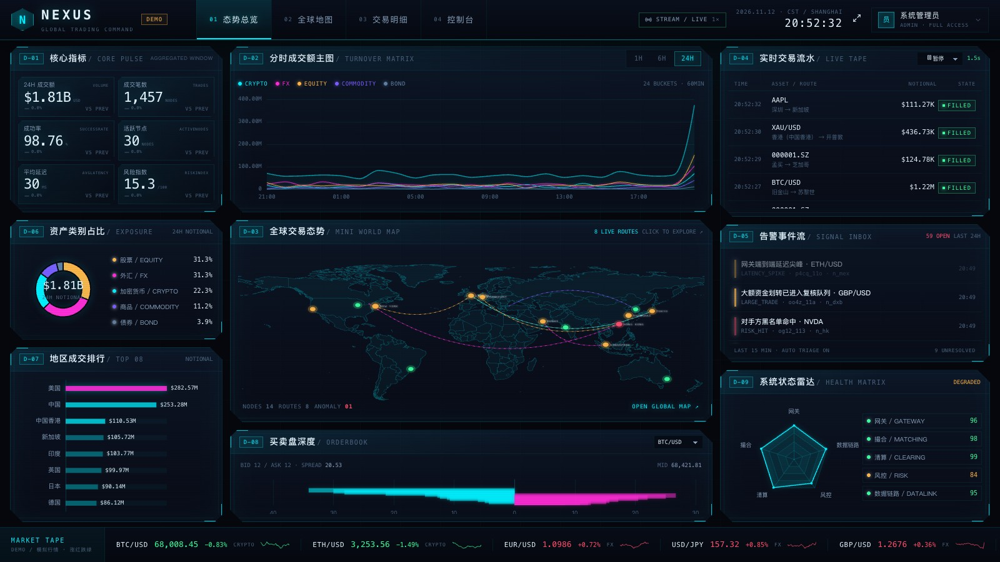
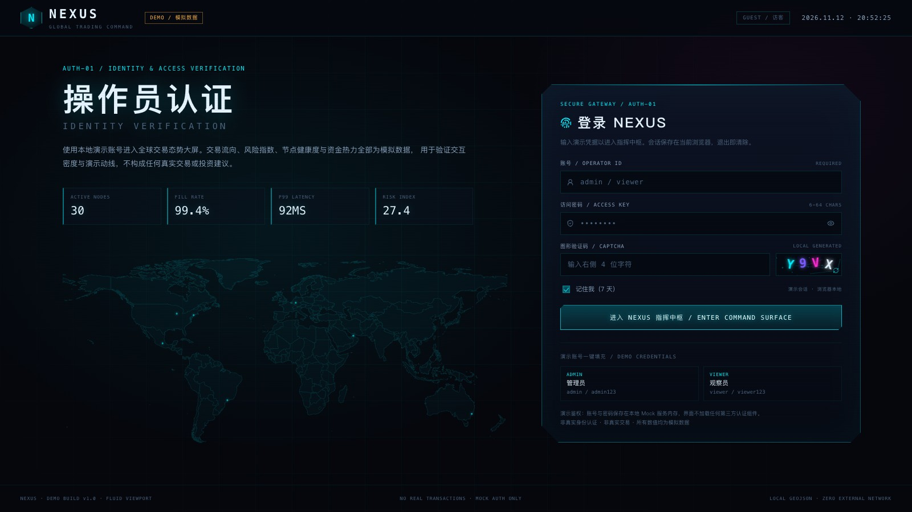
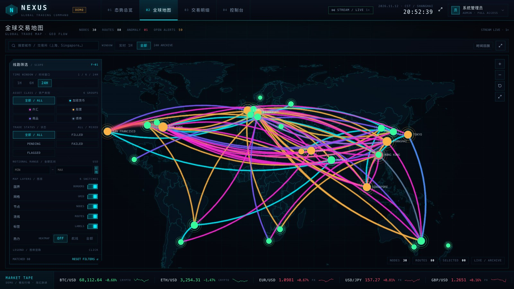
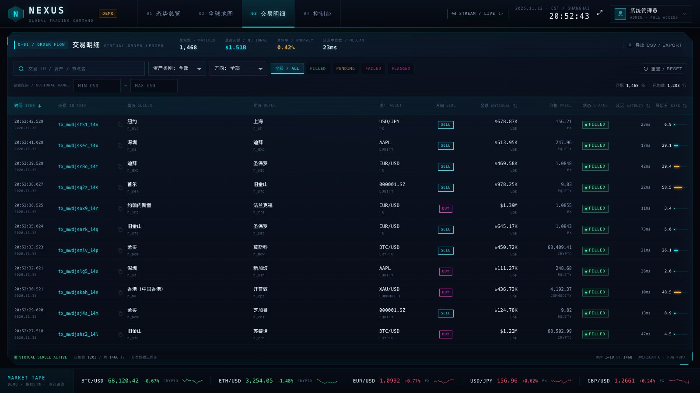
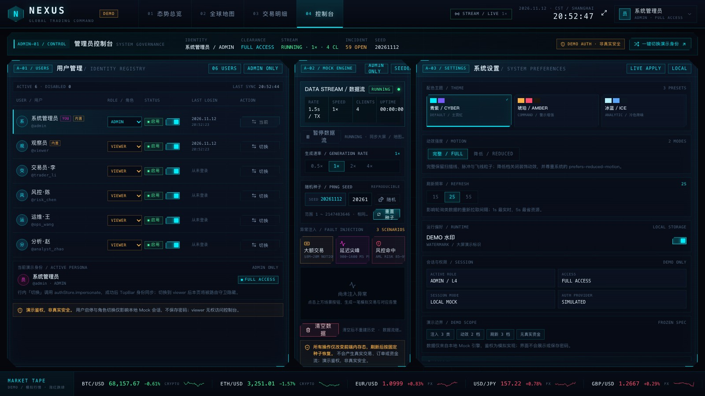
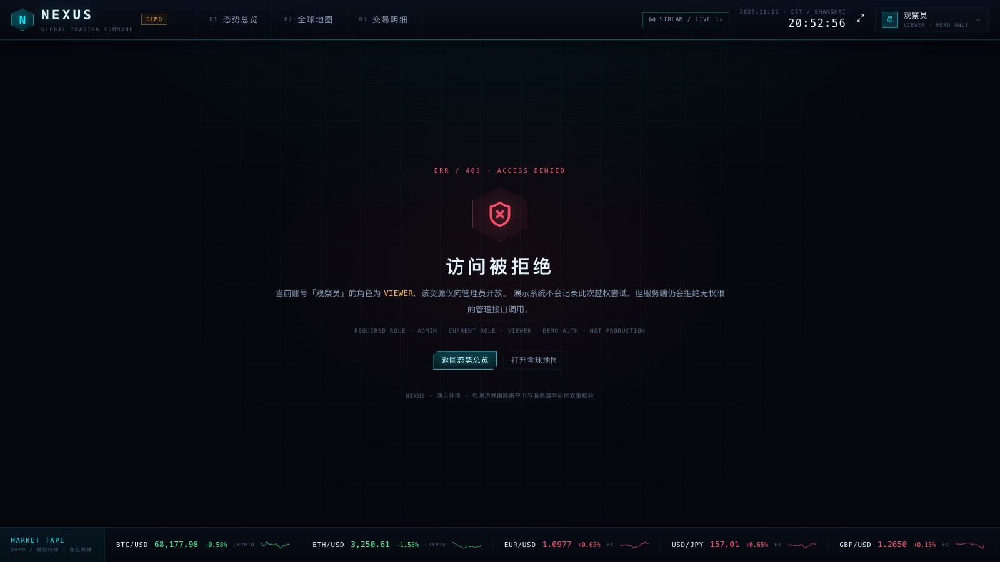
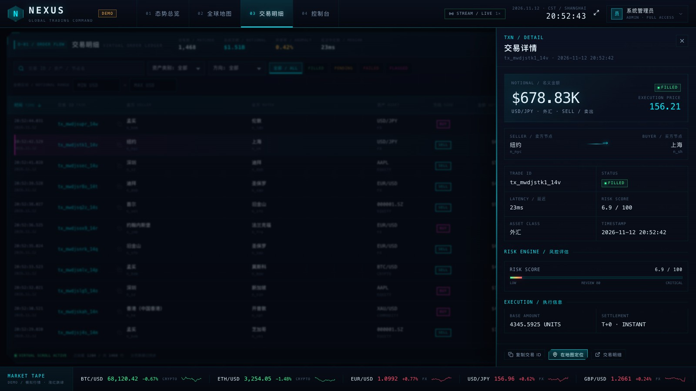
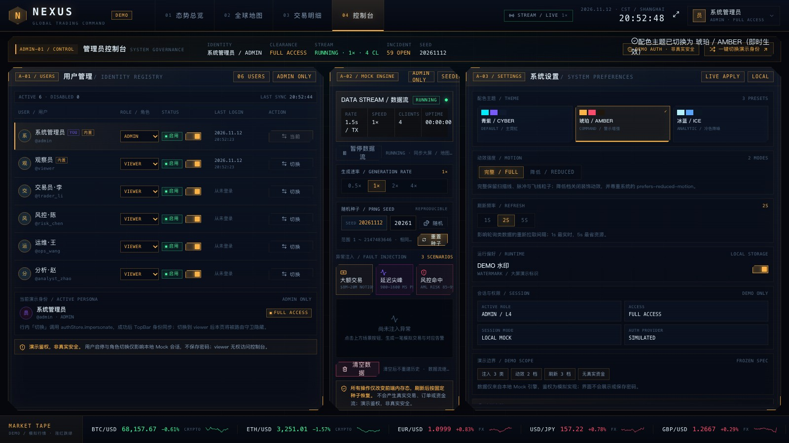
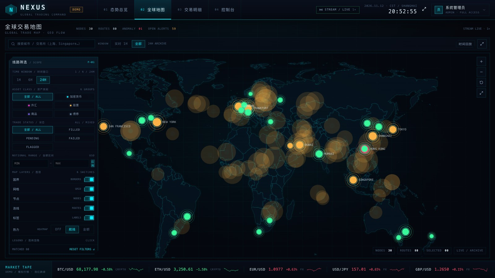

# NEXUS · 全球交易态势大屏

> **DEMO / 模拟数据**：本项目面向展厅、汇报与演示场景，不含真实行情、真实下单、真实清算与真实用户体系。所有金额、节点、告警均由本地 Mock 服务生成，仅用于验证交互密度与视觉动线，不构成任何投资建议。

NEXUS 以赛博 HUD 视觉呈现全球交易态势：登录与角色权限、首页态势大屏、独立全球交易地图、交易明细、管理员控制台与越权页。前端 React 18 + TypeScript + Vite，后端为 Node.js / Express 轻量 Mock 服务，通过 REST + SSE 提供 KPI、时序、占比、排行、弧线束、盘口与健康度等聚合数据。



## 目录

- [界面预览](#界面预览)
- [功能总览](#功能总览)
- [快速开始](#快速开始)
- [演示账号](#演示账号)
- [技术栈](#技术栈)
- [架构](#架构)
- [目录结构](#目录结构)
- [数据与接口](#数据与接口)
- [关键设计](#关键设计)
- [测试与验证](#测试与验证)
- [文档](#文档)
- [已知限制](#已知限制)
- [安全声明](#安全声明)

## 界面预览

以下均为 1600×900 浏览器实机整页截图，覆盖顶部四个 tab 与登录 / 越权页，前 6 张由 `node scripts/readme-shots.mjs` 自动生成（需先 `npm run dev`），后 3 张为交互细节补充。

### 01 · 登录 / AUTH-01

本地图形验证码 + 演示账号一键填充；左侧为品牌数据场与真实世界轮廓，右侧为认证面板。



### 02 · 态势总览 / DASHBOARD

`D-01~D-09` 九块 HUD 面板：核心指标、分时成交额主图、实时流水、资产占比、全球态势小地图、告警事件流、地区排行、买卖盘深度、系统健康度雷达；底部为单向行情带。


### 03 · 全球地图 / GLOBAL TRADE MAP

本地 GeoJSON 世界底图 + ECharts geo/lines 弧线束；支持时间窗、资产类别、交易状态、金额区间、图层开关、节点搜索、热力、时间回放与详情抽屉。



### 04 · 交易明细 / VIRTUAL ORDER LEDGER

服务端筛选/排序/分页 + 前端虚拟滚动；行点击打开交易详情抽屉，admin 可导出当前已加载数据为 CSV，viewer 显示只读徽标。



### 05 · 控制台 / SYSTEM GOVERNANCE

`A-01~A-03`：用户与角色管理、Mock 引擎（暂停/速率/种子/异常注入/清空）、主题与动效、刷新频率、水印、会话与权限状态。



### 06 · 越权页 / 403

viewer 直接访问 `/admin` 时由路由守卫拦截，展示所需角色与当前角色，并提供返回大屏 / 地图的出口。



> 其余截图（时间回放、地图弧线详情、10 分钟压测）见 [`docs/screenshots/`](docs/screenshots/)。

### 附 · 交互细节补充

交易详情抽屉（风险评分、执行信息、在地图定位）：



琥珀主题下的控制台（主题切换即时生效并持久化）：



地图热力模式（按航线 / 按金额切换节点热度）：



## 功能总览

| 页面 | 路由 | 核心能力 |
| --- | --- | --- |
| 登录 | `/login` | 本地验证码、记住 7 天、演示账号填充、错误内联提示 |
| 态势总览 | `/` | KPI、分时成交额、实时流水、资产占比、小地图、告警、地区排行、盘口、健康度、行情带 |
| 全球地图 | `/map` | 弧线束、节点/线路 hover、筛选、图层、热力、回放、搜索、缩放、详情抽屉、深链定位 |
| 交易明细 | `/trades` | 搜索、筛选、排序、分页、虚拟滚动、详情抽屉、CSV 导出（admin） |
| 控制台 | `/admin` | 用户管理、身份切换、数据流控制、种子重置、异常注入、主题/动效/刷新/水印 |
| 越权页 | `/403` | 角色不足提示与安全出口 |

全局能力：

- **实时数据流**：SSE 推送交易、告警、KPI、行情、连接状态；断线自动重连，页面顶部显示 `STREAM / LIVE`。
- **角色权限**：`admin` 全量；`viewer` 只读，控制台路由与组件级动作均按角色显隐。
- **快捷键**：`1~4` 切页、`Space` 暂停/恢复数据流（admin）、`F` 全屏、`Esc` 关闭抽屉。
- **单屏自适应**：流式网格铺满视口，1366×768 / 1600×900 / 2560×1440 实测无横向或纵向滚动条。
- **动效收敛**：首页图表、KPI 数字、小地图弧线只在**首次加载与 tab 切回**时播放入场动画；SSE 与轮询更新直接落值，不循环重播。
- **离线运行**：世界 GeoJSON、字体、图标全部本地，无地图 token、无 CDN、无在线瓦片。

## 快速开始

环境要求：Node.js ≥ 20.11。

```bash
# 1. 安装依赖
npm install

# 2. 开发模式：Mock API 8787 + Vite 5173
npm run dev

# 3. 打开浏览器
open http://127.0.0.1:5173
```

生产构建与单进程启动：

```bash
npm run build      # tsc --noEmit + vite build → dist/
npm start          # 8787 同源托管 dist 与 /api
open http://127.0.0.1:8787
```

环境变量：

| 变量 | 默认值 | 说明 |
| --- | --- | --- |
| `PORT` | `8787` | Mock 服务端口 |
| `HOST` | `127.0.0.1` | Mock 服务监听地址 |
| `DATA_PROVIDER` | `mock` | 数据源；`real` 为预留路径，尚未实现 |
| `DEMO_SEED` | `20261112` | 演示随机种子，相同种子生成相同历史 |

## 演示账号

| 角色 | 账号 | 密码 | 权限 |
| --- | --- | --- | --- |
| 管理员 | `admin` | `admin123` | 全部页面、数据流控制、异常注入、用户管理、系统设置 |
| 观察员 | `viewer` | `viewer123` | 大屏 / 地图 / 明细只读 |

另有 4 个演示用户（`trader_li`、`risk_chen`、`ops_wang`、`analyst_zhao`，密码 `demo123`），可在控制台一键切换身份，用于现场演示权限差异。

> 登录页验证码为本地生成、本地校验。演示鉴权把账号保存在 Mock 服务内存与浏览器 localStorage，**不具备真实安全性**，禁止用于生产或真实交易场景。

## 技术栈

| 层 | 选型 |
| --- | --- |
| 前端 | React 18.3、TypeScript 5.7（strict）、Vite 5.4 |
| 状态 | Zustand 4.5（auth / stream / filters / config / ui） |
| 图表 | ECharts 5.5（按需注册 line / pie / bar / radar / scatter / effectScatter / lines） |
| 路由 | React Router 6.28 |
| 图标 | lucide-react |
| 后端 | Node.js ≥ 20.11、Express 4.21 |
| 实时 | Server-Sent Events（SSE），15s 心跳 |
| 测试 | Vitest 2.1 + jsdom；服务端接口测试复用同一 runner |
| 截图/压测 | puppeteer-core + 本地 Chrome |

## 架构

```text
浏览器 SPA
  ├─ REST  /api/*        ← 页面数据与聚合
  └─ SSE   /api/stream   ← 交易 / 告警 / KPI / 行情 / 连接状态
                  │
Node.js Mock 服务（Express 4，单进程内存）
  ├─ routes/auth|data|admin
  ├─ middleware/auth     ← 演示 token 与角色校验
  ├─ providers/mockProvider
  ├─ core/generator      ← seeded PRNG 历史 1200 笔 + 实时 1.5s/笔 + 三类注入
  ├─ core/store          ← 环形上限：交易 6000 / 告警 400
  └─ core/aggregator     ← KPI / 时序 / 占比 / 排行 / 弧线束 / 健康度 / 盘口
```

- **同 seed 可复现**：`mulberry32` + 派生种子，同一 `DEMO_SEED` 得到相同历史。
- **页面只消费聚合 DTO**：聚合层为纯函数，全部有单测；前端不自行拼装统计口径。
- **数据源可替换**：`DataProvider` 接口已定义；接真实行情时新增 `providers/realProvider.js`，设置 `DATA_PROVIDER=real`，路由与前端不改。
- **地图适配层**：`MapAdapter` 固定 `mount / setNodes / setArcs / setLayers / setHeat / setSelected / focusNode / zoomBy / resetView / resize / dispose / on`；当前实现为 ECharts geo + lines，可替换为 L7 / OpenLayers。
- **流式自适应布局**：`ScaleStage` 只提供全屏画布，页面内部使用 `fr` / `%` / `minmax(0,1fr)` 布局，不再固定 1920×1080 等比缩放。

## 目录结构

```text
cyber-trade-nexus/
├── docs/                       # PRD、01~08 文档、design/ 设计稿与评审、screenshots/ 截图
│   └── screenshots/readme/     # README 内嵌的 6 张整页截图
├── public/geo/world.geo.json   # 本地世界国界（离线）
├── scripts/
│   ├── dev.mjs                 # 双进程开发编排
│   ├── gen-world-outline.mjs   # 生成首页简化地图轮廓
│   ├── screenshot.mjs          # 1920×1080 实机截图与页面断言
│   ├── verify-interactions.mjs # 验证码 / 权限 / 地图交互验证
│   ├── e2e-deeplink.mjs        # 交易明细 → 地图深链定位 E2E
│   ├── e2e-layout-all.mjs      # 多页面布局检查
│   ├── readme-shots.mjs        # 生成 README 内嵌的 6 张整页截图
│   └── soak.mjs                # 4× 速率长跑压测
├── server/
│   ├── app.js index.js config.js
│   ├── core/                   # generator / store / aggregator / prng
│   ├── middleware/             # 演示鉴权
│   ├── providers/              # DataProvider 接口与 Mock 实现
│   ├── routes/                 # auth / data / admin
│   └── tests/                  # 接口与聚合单测
├── src/
│   ├── api/                    # 唯一网络出口 + SSE 客户端
│   ├── charts/                 # ECharts 封装、option 构建、动画开关
│   ├── components/             # HUD 卡、按钮、抽屉、Toast、行情带、状态组件
│   ├── hooks/                  # 权限、快捷键、数字滚动、资源请求
│   ├── layouts/ pages/         # 布局与页面
│   ├── lib/                    # 纯函数（格式化/过滤/弧线/聚合/权限/存储）
│   ├── map/                    # MapAdapter + ECharts 适配器 + 世界轮廓
│   ├── store/                  # auth / stream / filters / config / ui
│   ├── styles/                 # tokens + CSS Modules
│   └── types/                  # 共享 DTO 与事件类型
└── package.json
```

## 数据与接口

接口契约见 [`docs/05-接口设计文档.md`](docs/05-接口设计文档.md)。统一响应信封 `{ data, serverTime }`，错误 `{ error: { code, message, details, requestId } }`。

核心接口：

| 方法 | 路径 | 说明 |
| --- | --- | --- |
| POST | `/api/auth/login` | 登录，返回 token 与用户 |
| GET | `/api/auth/session` | 恢复会话 |
| POST | `/api/auth/logout` | 退出 |
| POST | `/api/auth/impersonate` | admin 切换演示身份 |
| GET | `/api/meta` | 元信息、数据流状态、种子 |
| GET | `/api/trades` | 搜索 / 筛选 / 排序 / 分页 |
| GET | `/api/trades/:id` | 交易详情 |
| GET | `/api/nodes` | 节点 |
| GET | `/api/kpis` | KPI |
| GET | `/api/timeseries` | 时序 |
| GET | `/api/aggregations/assets` | 资产占比 |
| GET | `/api/aggregations/regions` | 地区排行 |
| GET | `/api/aggregations/depth` | 盘口深度 |
| GET | `/api/aggregations/health` | 健康度 |
| GET | `/api/aggregations/arcs` | 地图弧线束 |
| GET | `/api/markets` | 行情 |
| GET | `/api/alerts` | 告警 |
| GET | `/api/stream` | SSE：`hello / trade / alert / kpi / market / status / heartbeat` |
| GET/PATCH | `/api/admin/users` | 用户列表 / 启用禁用 |
| PATCH | `/api/admin/stream` | 暂停 / 恢复数据流 |
| POST | `/api/admin/inject` | 注入大额 / 延迟 / 风控场景 |
| POST | `/api/admin/reset` | 按种子重建历史 |
| POST | `/api/admin/clear` | 清空内存数据 |
| PATCH | `/api/admin/alerts/:id` | 标记告警处置 |

错误码：`VALIDATION_ERROR`、`INVALID_CREDENTIALS`、`UNAUTHORIZED`、`TOKEN_EXPIRED`、`FORBIDDEN`、`USER_DISABLED`、`NOT_FOUND`、`INTERNAL_ERROR`。

## 关键设计

### 视觉

深空黑底 + 青色 HUD 信号，品红标记风险与重点，琥珀标记等待与商品，红绿表达涨跌。切角面板、等宽编号、细网格与扫描线构成“指挥中枢”而非后台报表。设计 token 见 [`docs/design/design-system.md`](docs/design/design-system.md)。

### 动效

- 图表只在实例创建后的第一次 `setOption` 播入场动画；轮询与 SSE 更新覆盖 `animation: false`。
- `ResizeObserver` 在尺寸未变化时跳过 `chart.resize()`，避免打断入场动画。
- KPI 数字只在挂载时 0 → 目标值滚动一次，后续数据更新直接落值。
- 小地图弧线与节点环只在页面挂载后的入场窗口内播放；新成交产生的弧线不再重播。
- 实时流水新行直接插入，不做逐行动画。

### 权限

- 路由层：`RequireAuth` / `RequireRole`。
- 组件层：`usePermission` 控制导出、处置、控制台入口等动作。
- 服务层：`authenticate` + `requireRole('admin')` 双重校验。
- 三层只构成演示边界，不代表生产级安全。

### 自适应

页面以流式网格铺满视口，`1366×768`、`1600×900`、`2560×1440` 均实测无滚动条；不提供移动端布局。

## 测试与验证

| 项 | 命令 | 结果 |
| --- | --- | --- |
| 单元 / 接口测试 | `npm test` | **17 个文件、150 个测试全部通过** |
| 类型检查 | `npm run typecheck` | 0 error |
| 生产构建 | `npm run build` | 2227 modules；`index` 456KB / `echarts` 646KB / `react` 161KB（gzip 合计约 436KB） |
| 浏览器实机 | `node scripts/screenshot.mjs` | 登录、大屏、地图、明细、抽屉、控制台、403 截图；控制台错误 0 |
| README 截图 | `node scripts/readme-shots.mjs` | 重新生成 `docs/screenshots/readme/*.jpg`（6 张 1600×900 整页图） |
| 交互验证 | `node scripts/verify-interactions.mjs` | 验证码校验、viewer 无导出、地图热力/回放/节点筛选 |
| 深链定位 | `node scripts/e2e-deeplink.mjs` | 明细行 → 抽屉 → 地图定位 → 抽屉恢复 → 参数清除 |
| 4× 长跑压测 | `node scripts/soak.mjs` | 10.6 分钟、4× 速率：堆内存 14.4→14.8 MB（峰值 26.5 MB），60 FPS，0 错误 |

布局回归（本轮实测）：

| 视口 | 态势总览 | 全球地图 | 交易明细 | 控制台 |
| --- | --- | --- | --- | --- |
| 1366×768 | 无滚动 | 无滚动 | 无滚动 | 无滚动 |
| 1600×900 | 无滚动 | 无滚动 | 无滚动 | 无滚动 |
| 2560×1440 | 无滚动 | 无滚动 | 无滚动 | 无滚动 |

## 文档

| 编号 | 文档 |
| --- | --- |
| — | [`docs/PRD.md`](docs/PRD.md) 产品需求 |
| 01 | [`docs/01-需求分析说明书.md`](docs/01-需求分析说明书.md) |
| 02 | [`docs/02-概要设计说明书.md`](docs/02-概要设计说明书.md) |
| 03 | [`docs/03-详细设计说明书.md`](docs/03-详细设计说明书.md) |
| 04 | [`docs/04-数据库设计说明书.md`](docs/04-数据库设计说明书.md) |
| 05 | [`docs/05-接口设计文档.md`](docs/05-接口设计文档.md) |
| 06 | [`docs/06-原型设计说明书.md`](docs/06-原型设计说明书.md) |
| 07 | [`docs/07-测试计划与用例.md`](docs/07-测试计划与用例.md) |
| 08 | [`docs/08-部署与运维手册.md`](docs/08-部署与运维手册.md) |

设计过程：Codex 生成 5 页高保真 mockup → Chrome headless 逐页渲染评审 → 登录页首版阻断退回 → 修订版通过 → 实现落地。评审记录见 [`docs/design/review.md`](docs/design/review.md)。

## 已知限制

1. **PRD P1 未交付项**：导出当前视图快照、演示巡演模式未实现；交易明细提供 admin 的 CSV 导出，替代“快照导出”中的表格场景。
2. **地图线束聚合开关**：当前仅按服务端聚合弧线束展示，未提供“逐笔 / 线束”切换（I-35 的 P1 子项）。
3. **节点离线注入**：注入仅 3 类（大额 / 延迟 / 风控），与接口契约一致；节点离线告警只在历史流中出现。
4. **真实数据**：`DATA_PROVIDER=real` 为预留路径，尚未实现 RealProvider；历史数据为内存态，进程重启按 seed 重建。
5. **内存与长跑**：前端上限 1500 交易 / 200 告警，后端 6000 / 400。已做 10.6 分钟、4× 速率压测，真实硬件长时间重负载仍建议按部署环境复核。
6. **移动端 / 多语言 / 真实鉴权**：均不在范围。
7. **演示身份切换**：服务端生成新 token 并持久化到浏览器；旧 token 保留到过期，viewer 切换后访问 `/admin` 由路由守卫拦截。
8. **截图与主题**：README 主截图为默认青色主题；琥珀主题见 [`docs/screenshots/readme/07-admin-amber.jpg`](docs/screenshots/readme/07-admin-amber.jpg)，冰蓝主题可在控制台切换。

## 安全声明

- 演示 token 存于服务端内存与浏览器 localStorage；密码为本地常量，仅用于比对，**不是真实认证**。
- 服务端对管理接口做角色中间件校验，前端做路由守卫与组件级能力判断；三者只构成演示边界。
- 界面、文档与 README 均显式标注 DEMO / 模拟数据，所有数字不代表真实市场。
- 请勿将本项目用于真实交易、生产环境或任何需要安全保证的场景。
