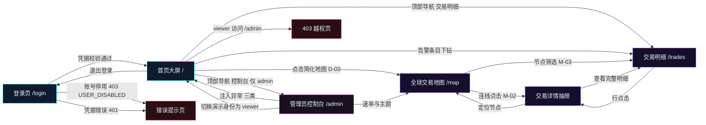
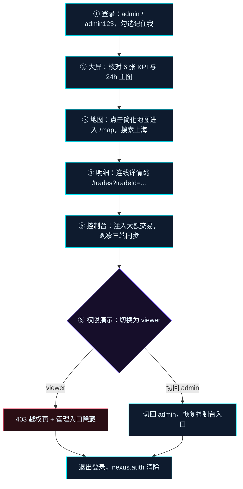
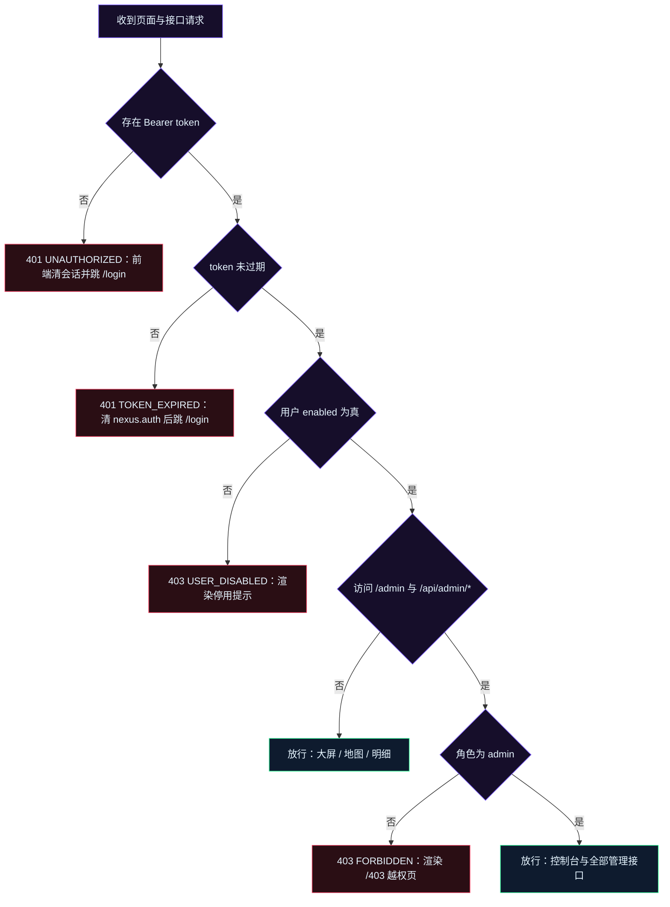
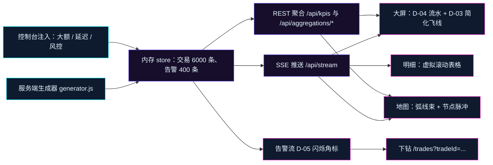

# 需求分析说明书

| 项目 | 内容 |
| --- | --- |
| 项目代号 | NEXUS（赛博交易中枢） |
| 工程目录 | `/Users/le/Desktop/project/cyber-trade-nexus` |
| 文档版本 | v1.0（评审冻结版） |
| 日期 | 2026-11-12 |
| 输入依据 | `docs/PRD.md` v0.1、`docs/02-概要设计说明书.md` v1.0、`docs/05-接口设计文档.md` v1.0 |
| 文档定位 | M1~M5 全部阶段的功能范围与验收口径唯一来源，冻结后作为《03-详细设计说明书》《06-原型设计》《07-测试计划与用例》的上位输入 |
| 冻结状态 | 已冻结（2026-11-12），变更须走第 11.2 节变更流程 |

> 本文档只陈述「要做什么」与「做到什么程度算通过」，不重复架构细节与接口字段。凡与 `02`、`05` 表述冲突处，以本文档第 8 节决策结论为准，并同步回写 `02`、`05`。

## 1. 引言

### 1.1 编写目的

把 PRD v0.1 的产品诉求转写为可逐条验收的需求基线，解决三类问题：

1. **范围收敛**：明确 6 个页面、10 个大屏模块、12 个地图能力、42 个交互点各自归属哪条编号需求，杜绝开发期「顺手加功能」导致范围蔓延。
2. **口径可度量**：每条功能需求给出可测量的验收口径（毫秒、帧率、像素、条数、百分比），避免「流畅」「大气」「好看」这类无法判定的形容词进入验收。
3. **决策落定**：把 PRD 第 13 节 Q1~Q6 从「待确认」改为「已选定」，并记录放弃的方案与理由，使 M1 编码阶段不再出现技术路线摇摆。

### 1.2 编写范围

覆盖 NEXUS 演示系统的全部交付面：

- 登录页与演示鉴权（含角色、会话、身份切换）；
- 首页大屏 D-01~D-10 十个模块；
- 全球交易地图页 M-01~M-12 十二项能力，含空中弧线渲染；
- 交易明细页（虚拟滚动、筛选、排序、详情抽屉）；
- 管理员控制台（用户管理、Mock 数据控制、系统设置）；
- 403 越权页、全局导航、快捷键、主题、全屏、空态与错误态；
- 支撑上述页面的 Node.js Mock 服务、聚合层、SSE 推送、种子数据与构建脚本。

不覆盖内容见第 9.3 节。

### 1.3 术语与缩写

| 术语 | 定义 |
| --- | --- |
| 大屏 | 首页 `/`，1920×1080 设计基准的单屏可视化视图，承载 D-01~D-10 |
| 弧线束 | 同一「卖方节点 → 买方节点 → 资产类别」的多笔交易聚合而成的一条地图连线，用于高密度降噪 |
| 快照窗口 | 全站统一的聚合时间窗，取值 `1h`、`6h`、`24h`，默认 `24h` |
| 聚合层 | 服务端 `aggregator.js`，把原始交易事件汇总为 KPI、时序、占比、地区排行、盘口、健康度、弧线束的确定性计算层 |
| Provider | 数据提供者接口；当前实现 MockProvider，未来接入真实行情时实现 RealProvider，路由与前端不改 |
| MapAdapter | 地图渲染适配接口，固定 `setNodes / setArcs / setFilters / focusNode / setLayers / resetView` 六个方法，隔离地图库选型 |
| SSE | Server-Sent Events，服务端到浏览器的单向实时推送通道 `/api/stream` |
| 种子 | `DEMO_SEED`，默认 `20261112`，驱动 mulberry32 确定性随机，决定历史交易、告警、行情、盘口的全部取值 |
| 演示身份 | 管理员通过 `POST /api/auth/impersonate` 临时以目标用户身份操作，用于现场演示权限差异 |
| DEMO 标识 | 界面固定展示的「模拟数据 / DEMO」水印与登录页声明，用于区分演示系统与真实交易系统 |
| 降级动效 | 关闭粒子、扫描线、故障字效三类高开销动画，保留基础过渡；由 `prefers-reduced-motion` 与「降低动效」开关共同触发 |
| P0 / P1 | 优先级：P0 为必须交付并通过验收，P1 为按排期交付并允许在验收单登记延后 |

### 1.4 编写依据

| 依据 | 版本 | 取其内容 |
| --- | --- | --- |
| `docs/PRD.md` | v0.1 | 页面清单、模块清单、交互点总表、验收标准 10 条、Q1~Q6 |
| `docs/02-概要设计说明书.md` | v1.0 | 技术栈基线、模块边界、性能指标、安全边界、目录结构、进程与端口 |
| `docs/05-接口设计文档.md` | v1.0（冻结契约） | 26 个端点、9 个错误码、7 类 SSE 事件、枚举全集、分页与鉴权约定 |
| P8 文档规范 | — | 两位编号命名、章节四级层级、决策须「选定方案 + 理由」、图示 mermaid ≤ 8.8.3 且配 classDef |

### 1.5 读者与使用方式

| 读者 | 关注章节 | 使用方式 |
| --- | --- | --- |
| 产品与评审方 | 第 2、3、5、10 章 | 逐条确认范围与验收口径，签署第 10.6 节 |
| 前端开发 | 第 3、5、6、7 章 | 以 FR 编号建任务，以验收口径写单测与联调用例 |
| 服务端开发 | 第 5.6、7、8 章 | 以接口契约与种子规格实现 Provider，以 NFR 定性能预算 |
| 测试 | 第 5、6、7、10 章 | 每条 FR 至少生成 1 条验收用例，P0 用例 100% 执行 |
| 演示讲解人 | 第 3.2、10.2 章 | 按演示动线排练，按权限矩阵说明角色差异 |

## 2. 干系人与角色

### 2.1 干系人清单

| 干系人 | 关注点 | 在本系统中的落点 |
| --- | --- | --- |
| 产品负责人 | 演示效果、交互密度、范围可控 | 第 5 章全部 FR 的验收签署 |
| 演示讲解人 | 现场操作不卡顿、权限差异可讲清 | 管理员账号、控制台注入、身份切换 |
| 评审专家与客户 | 视觉赛博感、数据可信度标识 | 大屏 D-01~D-10、DEMO 水印声明 |
| 前端开发 | 组件边界、性能预算、状态管理 | `pages`、`store`、`charts`、`map` 四层 |
| 服务端开发 | 聚合口径、SSE 稳定性、种子可复现 | `server/core`、`server/routes` |
| 测试 | 可度量口径、边界值、错误路径 | 第 10 章验收清单与第 7 章 NFR |
| 运维与演示保障 | 单机启动、离线、进程恢复 | 双进程编排、`/api/health`、重置种子 |
| 未来数据接入方 | Provider 接口稳定、字段可映射 | `providers/index.js` 切换点 |

### 2.2 角色与演示身份

系统只定义两种角色，不提供角色编辑器。

| 角色 | 代号 | 说明 | 内置账号 | 默认可见页面 |
| --- | --- | --- | --- | --- |
| 管理员 | `admin` | 全页面可见，可操作 Mock 控制台、管理用户、处置告警、切换演示身份 | `admin` / `admin123` | `/`、`/map`、`/trades`、`/admin` |
| 普通用户 | `viewer` | 只读浏览大屏、地图与明细，不可改动系统状态 | `viewer` / `viewer123` | `/`、`/map`、`/trades` |

演示身份（impersonate）规则，四条全部为强制：

1. 仅 `admin` 可调用 `POST /api/auth/impersonate`，请求体 `{"userId": "u_viewer"}`。
2. 成功返回新 token 与目标用户，**旧 token 保持有效**，用于一键切回原身份。
3. 切换后前端路由守卫、按钮显隐、服务端角色中间件在同一请求周期内同步生效，生效延迟 ≤ 600ms。
4. 切换到 `viewer` 后访问 `/admin` 渲染 403 视图，直接调用任一 `/api/admin/*` 返回 `403 FORBIDDEN`。

### 2.3 权限矩阵

「✅ 允许」「⚠️ 受限」「❌ 禁止」三种标记，逐项给出前端落点与服务端落点。

| 功能 | admin | viewer | 前端落点 | 服务端落点 |
| --- | --- | --- | --- | --- |
| 登录、退出、记住我 | ✅ | ✅ | `pages/Login`、`authStore` | `/api/auth/login`、`/api/auth/logout` |
| 首页大屏查看 | ✅ | ✅ | `RequireAuth` 登录守卫 | 数据接口登录即可 |
| 大屏筛选、图表窗口切换 | ✅ | ✅ | `filterStore` 本地状态 | 只读聚合接口 |
| 暂停数据流、倍速、主题切换 | ✅ | ⚠️ 只读，按钮隐藏 | `configStore` 管理员入口 | `PATCH /api/admin/stream` 仅 admin |
| 地图查看、缩放、筛选、回放 | ✅ | ✅ | `pages/TradeMap` | 弧线与节点只读接口 |
| 地图连线与节点下钻 | ✅ | ✅ | `DataDrawer`、`uiStore` | `/api/trades/:id` |
| 交易明细、详情抽屉 | ✅ | ✅ | `pages/Trades` | `/api/trades` |
| 复制交易 ID | ✅ | ✅ | 浏览器剪贴板 | 无 |
| 标记与处置告警 | ✅ | ❌ | `AlertsPanel` 按钮隐藏 | `PATCH /api/admin/alerts/:id` |
| Mock 控制台（启停、速率、注入、重置、清空） | ✅ | ❌ | `/admin` 路由不可达 | `/api/admin/stream`、`inject`、`reset`、`clear` |
| 用户管理（列表、启停、角色切换） | ✅ | ❌ | `/admin` 用户分区 | `GET/PATCH /api/admin/users` |
| 演示身份切换 | ✅ | ❌ | 顶部身份徽章菜单 | `POST /api/auth/impersonate` |
| 系统设置（动效、主题、刷新频率、水印） | ✅ | ❌ | `/admin` 设置分区 | 浏览器本地，服务端无接口 |
| 导出当前视图快照（P1） | ✅ | ❌ | 前端 canvas 导出 | 无服务端接口 |

### 2.4 鉴权边界与越权判定

判定顺序固定为四级，任一级失败即终止：

1. **会话级**：请求无 `Authorization: Bearer` → `401 UNAUTHORIZED`；token 过期 → `401 TOKEN_EXPIRED`；token 已登出 → `401 UNAUTHORIZED`。
2. **账号级**：用户 `enabled === false` → `403 USER_DISABLED`，其全部存量会话立即失效。
3. **角色级**：`viewer` 调用 `/api/admin/*` → `403 FORBIDDEN`。
4. **参数级**：枚举越界、分页越界、字符串超 80 字符 → `400 VALIDATION_ERROR`。

安全声明（验收时检查文案存在）：本系统鉴权为演示用途，token 仅存服务端进程内存，密码为明文常量，**不构成真实安全边界**，禁止用于真实交易与资金场景。声明需同时出现在登录页页脚、大屏顶部 DEMO 标识、接口 `meta.demo === true` 三处。

## 3. 业务流程与用户旅程

### 3.1 业务主流程

覆盖「登录 → 大屏 → 地图 → 明细 → 控制台」五段动线与两条回环（下钻回明细、注入回大屏）。

### 3.2 演示用户旅程

现场演示按六个阶段推进，每阶段都有明确的可见结果，用于验收第 10.2 节。

旅程约束：整条动线演练 ≤ 8 分钟，其中地图飞入 ≤ 800ms、注入到三端同现 ≤ 1s、身份切换 ≤ 600ms，保证讲解节奏不中断。

### 3.3 权限判定与越权路径

### 3.4 三端同源数据流

验收标准要求「注入一笔新交易后大屏、地图、明细三处同步出现」，其数据流固定如下，不允许任一页面自造数据。

同源判据：同一 `tradeId` 在大屏流水、地图弧线详情、明细表格中的 `amount`、`status`、`ts`、`fromNodeId`、`toNodeId` 五个字段完全一致，且三处出现时间差 ≤ 1s。

## 4. 功能需求总览与编号规则

### 4.1 模块与需求编号映射

| 章节 | 模块 | 需求编号 | 条数 | 对应 PRD |
| --- | --- | --- | --- | --- |
| 5.1 | 登录与认证 | FR-01~FR-06 | 6 | PRD 2.3、9 节 I-01~I-06 |
| 5.2 | 全局框架与导航 | FR-07~FR-13 | 7 | PRD 3、9 节 I-05~I-11、I-41、I-42 |
| 5.3 | 首页大屏 | FR-14~FR-24 | 11 | PRD 4、9 节 I-12~I-24 |
| 5.4 | 全球交易地图 | FR-25~FR-37 | 13 | PRD 5、9 节 I-25~I-35 |
| 5.5 | 交易明细 | FR-38~FR-41 | 4 | PRD 6、9 节 I-36~I-37 |
| 5.6 | 管理员控制台 | FR-42~FR-45 | 4 | PRD 6、9 节 I-38~I-40 |
| 合计 | — | FR-01~FR-45 | 45 | — |

编号规则：`FR-NN` 连续不跳号；新增需求只能追加在对应模块末尾并顺延后续编号，禁止复用已废除编号。

### 4.2 优先级定义与交付口径

| 优先级 | 定义 | 交付要求 |
| --- | --- | --- |
| P0 | 演示主链路必备，缺失即演示中断 | M5 里程碑前全部通过第 10 章验收，缺一条即整体不通过 |
| P1 | 增强体验与密度，缺失不影响主链路 | 按 M4、M5 排期交付；未交付须在验收单逐条登记，且不得阻塞 P0 |

本文档 45 条 FR 中 P0 为 38 条、P1 为 7 条（FR-02、FR-10、FR-11、FR-13、FR-29、FR-30、FR-33）。P1 未交付时，对应交互点在界面隐藏，不得留下灰色不可用按钮。

### 4.3 度量方法约定

所有验收口径按下列方法测量，测量环境为 1920×1080、Chrome 最近稳定版、8GB 内存开发机。

| 度量对象 | 测量方法 | 取值规则 |
| --- | --- | --- |
| 帧率 | `requestAnimationFrame` 采样 60s，记录相邻帧间隔 | 报 P95 帧间隔与折算 fps，P95 ≤ 33.3ms 记为 ≥ 30fps |
| 内存 | Chrome Performance 面板堆快照，运行前与运行后各一次 | 取两次快照 `usedJSHeapSize` 差值 |
| 接口耗时 | `performance.now()` 包裹 `fetch`，连续 100 次 | 报 P95 与 P99 |
| 交互响应 | 从用户事件到目标 DOM 变更完成的 `performance.now()` 差值 | 连续 20 次取最大值 |
| 分辨率 | DevTools 设备工具栏逐档切换 | 检查 `document.documentElement.scrollHeight <= innerHeight` |
| 外部请求 | Network 面板全量请求 + 服务端访问日志 | 统计非 `127.0.0.1` 与 `localhost` 的 host 数量 |
| 覆盖率 | `vitest run --coverage` 的 `text` 与 `lcov` 报告 | 行覆盖率与分支覆盖率分别取值 |

## 5. 功能需求清单

### 5.1 登录与认证

| 编号 | 需求描述 | 验收口径 | 优先级 |
| --- | --- | --- | --- |
| FR-01 | 登录页提供账号、密码输入与字段级校验，凭据经 `POST /api/auth/login` 校验，失败在表单内展示统一提示 | 输入 `admin/admin123` 后 ≤ 600ms 进入 `/`；错误凭据返回 `401 INVALID_CREDENTIALS`，提示文案不区分账号错与密码错；username 长度 2~32、password 长度 6~64，越界时前端阻止提交并展示字段提示；空提交不发起请求 | P0 |
| FR-02 | 图形验证码为纯前端本地生成与校验，4 位字符（大写字母与数字，剔除 `0/O/1/I`），点击刷新，校验通过后才调用登录接口 | 点击刷新 ≤ 50ms 生成新码；输入忽略大小写；错误 1 次立即刷新并提示；连续 3 次错误后提交按钮禁用 5s；验证码不进入登录请求体，`05` 契约的请求字段保持 `username/password/remember` 三项不变 | P1 |
| FR-03 | 支持「记住我」、密码可见切换、回车提交三项表单能力 | 勾选记住我时 `expiresAt - serverTime` 落在 7 天 ±5s，未勾选时落在 8 小时 ±5s；密码可见切换 ≤ 50ms 且不改变输入值；密码框内按回车触发提交 1 次，不重复发请求 | P0 |
| FR-04 | 提供 admin、viewer 两个演示账号一键填充按钮 | 点击后 1 次填充、1 次提交完成登录，总操作步数 ≤ 2；填充值必须与种子账号完全一致；填充动作不自动提交 | P0 |
| FR-05 | 退出登录清除会话与本地凭据，支持会话过期自动登出 | `POST /api/auth/logout` ≤ 300ms 返回；`nexus.auth` 被删除；任一受保护页访问跳 `/login` 且携带 `from` 路径；重复登出返回 `401 UNAUTHORIZED`；token 过期后首个请求触发 `401 TOKEN_EXPIRED` 并自动清会话 | P0 |
| FR-06 | 管理员可一键切换演示身份到任一启用用户，并可切回原身份 | 切换 ≤ 600ms 生效；导航隐藏 `/admin`；`/api/admin/*` 返回 `403 FORBIDDEN`；旧 token 仍有效，切回 ≤ 600ms；目标用户停用时返回 `403 USER_DISABLED` | P0 |

### 5.2 全局框架与导航

| 编号 | 需求描述 | 验收口径 | 优先级 |
| --- | --- | --- | --- |
| FR-07 | 顶部导航提供「态势总览 `/`、全球地图 `/map`、交易明细 `/trades`、控制台 `/admin`」四项，并高亮当前页 | 路由切换 ≤ 200ms；当前项高亮与实际路由 100% 对应；`viewer` 不渲染控制台入口；浏览器前进后退后高亮不丢失 | P0 |
| FR-08 | 顶部展示全局时钟、数据流连接状态灯、DEMO 标识与身份徽章 | 时钟每秒刷新，与服务端 `serverTime` 偏差 ≤ 1s，每 60s 校准一次；状态灯三态取值：已连接 `#39FF9E`、重连中 `#FFB547`、断开 `#FF4D6D`；状态变化到指示灯更新 ≤ 500ms；DEMO 标识在全部路由常驻可见 | P0 |
| FR-09 | 支持进入与退出全屏，全屏下保留导航、时钟与 DEMO 标识 | 调用 Fullscreen API，进入与退出各 ≤ 200ms；`F` 键可切换；全屏下导航可点击且不被裁切；浏览器拒绝全屏时将按钮置为禁用并提示原因 | P0 |
| FR-10 | 管理员可切换三套主题（青紫 `cyan`、琥珀 `amber`、冰蓝 `ice`）与两档动效强度（`full`、`reduced`），并持久化 | 主题切换 ≤ 100ms 全站生效，无白屏闪烁；`reduced` 下粒子、扫描线、故障字效全部停止，基础过渡保留；`prefers-reduced-motion: reduce` 时自动进入 `reduced`；配置写入 `nexus.prefs`，刷新后 100% 恢复 | P1 |
| FR-11 | 键盘快捷键：`1` 切大屏、`2` 切地图、`3` 切明细、空格暂停/恢复数据流、`F` 全屏、`Esc` 关闭抽屉 | 按键到动作 ≤ 50ms；输入框、文本域、验证码框聚焦时不触发；空格仅在 admin 生效；`Esc` 优先关闭最上层抽屉，无抽屉时不触发导航；与浏览器默认快捷键冲突为 0 | P1 |
| FR-12 | `/403` 越权页展示角色、被拒路径与两个返回入口（返回大屏、重新登录） | `viewer` 访问 `/admin` 时前端守卫直接渲染 403，不发起任何 `/api/admin/*` 请求；页面显示当前角色与目标路径；两个入口各 1 次点击可达；从 403 返回大屏 ≤ 300ms | P0 |
| FR-13 | 六个页面统一提供加载骨架、空态、错误态三类状态 | 首次加载 ≤ 300ms 内出现骨架屏；空态含「无匹配数据」文案与「重置筛选」按钮，点击后筛选条件全部复位且列表恢复；接口失败保留上一次成功数据，顶部 toast 展示 3s 后自动消失，页面内容清空率为 0% | P1 |

### 5.3 首页大屏

大屏以 1920×1080 为设计坐标，通过外层 `ScaleStage` 单层 `transform: scale` 适配，全部模块必须落在单屏内。

| 编号 | 需求描述 | 验收口径 | 优先级 |
| --- | --- | --- | --- |
| FR-14 | D-01 核心 KPI 卡 6 张：24h 成交额、成交笔数、成功率、活跃节点、平均延迟、风险指数 | 6 个 `key` 全覆盖且顺序固定；数值随 `kpi` 事件每 2s 更新；数字滚动动画 ≤ 800ms；单位按 `USD/count/pct/ms/index` 展示；`deltaPct` 保留 1 位小数并给出 `up/down/flat` 三态箭头；点击任意卡片 ≤ 200ms 联动主图窗口与流水筛选；左栏 22% 宽度内 6 卡不换行、不溢出、不截断 | P0 |
| FR-15 | D-02 分时成交额主图：折线叠加面积，支持 1h/6h/24h 切换与五类资产叠加 | 三档点数固定为 60/72/96；切换 ≤ 300ms 完成且无残影；图例可逐类开关，开关 ≤ 100ms；悬停展示十字准星与 tooltip，tooltip 出现 ≤ 100ms；无数据时展示空态而非空白画布 | P0 |
| FR-16 | D-03 简化版世界地图：自绘轮廓 + 16 个发光节点 + 8 条流动弧线，仅作概览 | 节点固定 16 个、弧线固定 8 条；节点悬停 ≤ 100ms 展示名称与 24h 成交额；点击节点跳 `/map?nodeId=<id>`，点击空白区域跳 `/map`，跳转 ≤ 300ms；大屏空闲帧率 ≥ 50fps；与地图页不共用渲染实例（DOM 中地图渲染实例数恰为 1，canvas、svg 均计入） | P0 |
| FR-17 | D-04 实时交易流水：竖向滚动列表，新增条目高亮入场，四种状态色标 | 列表上限 1500 条，超出按队首淘汰；新增条目高亮持续 1.2s ± 100ms；状态色 `filled #39FF9E`、`pending #FFB547`、`failed #FF4D6D`、`flagged #FF2BD6`；条目悬停高亮 ≤ 100ms，点击打开抽屉 ≤ 300ms；滚动动画帧率 ≥ 50fps | P0 |
| FR-18 | D-05 告警事件流：三类来源（延迟异常、大额交易、风控命中）与节点离线，带未处置角标闪烁 | 列表上限 200 条；未处置角标闪烁周期 1.2s ± 100ms；角标数字与未处置告警数一致；点击条目 ≤ 300ms 下钻到对应交易、节点；admin 点击「标记已处置」≤ 300ms 生效且 `handledAt` 由服务端写入；viewer 不渲染处置按钮 | P0 |
| FR-19 | D-06 资产类别占比：环形图展示五类资产金额占比，图例可开关 | 五类 `pct` 合计恒为 100.0（末项吸收舍入误差）；图例开关 ≤ 100ms；点击扇区 ≤ 200ms 联动主图筛选该类资产；扇区悬停展示金额、笔数、占比三项 | P0 |
| FR-20 | D-07 地区成交排行：横向条形图展示 TOP 8 国家 | 固定 8 条，按成交额降序；条形长度与金额成线性比例，误差 ≤ 2px；点击条形 ≤ 200ms 以该国度为筛选条件刷新流水与地图；国家名称超 6 字时省略号截断且悬停显示全称 | P0 |
| FR-21 | D-08 买卖盘深度：双向深度条，买卖各 12 档，价格档位可悬停 | 默认资产 `BTC/USD`，买卖各 12 档；档位间距与 `tickSize` 一致；档位悬停 ≤ 100ms 显示价格与累计量；深度快照每 5s 刷新一次；买盘降序、卖盘升序，顺序错误数 0 | P0 |
| FR-22 | D-09 系统状态雷达：网关、撮合、清算、风控、数据链路五项健康度 | 五项固定且顺序固定；分值范围 0~100 的整数；每 2s 刷新；健康度 ≥ 85 为正常 `#39FF9E`、60~84 为繁忙 `#FFB547`、< 60 为异常 `#FF4D6D`；雷达图在 28% 右栏内完整可见不裁切 | P0 |
| FR-23 | D-10 底部行情带：12 个资产无限横向滚动，含代码、价格、涨跌幅、迷你 sparkline | 12 个资产全覆盖；滚动速度 40px/s ± 5%，单圈 60s ± 3s；悬停立即暂停、移出 300ms 后恢复；点击 ≤ 200ms 联动主图切换到该资产；涨红 `#FF4D6D` 跌绿 `#39FF9E` 严格遵循中国区规范；sparkline 每资产 24 点 | P0 |
| FR-24 | 大屏模块联动规则统一：KPI 点击、地区条点击、告警下钻、行情带点击四类联动互不冲突 | 四类联动均 ≤ 200ms 生效；联动只更新相关切片，不触发整页刷新；连续触发 10 次后筛选状态一致且无叠加错乱；联动后各模块计数与筛选结果一致率 100% | P0 |

### 5.4 全球交易地图

| 编号 | 需求描述 | 验收口径 | 优先级 |
| --- | --- | --- | --- |
| FR-25 | M-01 连线悬停：高亮该线、其余降至 25% 透明度，浮层展示交易对、金额、时间、延迟、状态 | 悬停判定 ≤ 100ms；其余连线 `opacity` 降至 0.25 ± 0.02；浮层 5 个字段齐全，金额带单位、时间精确到秒；移出后 100ms 内恢复全部亮度；最细弧线端点命中率 ≥ 90% | P0 |
| FR-26 | M-02 连线点击：固定选中态，右侧抽屉展示交易详情，可跳转交易明细 | 点击到抽屉打开 ≤ 300ms；选中线保持高亮直至关闭抽屉；抽屉含 11 个交易字段；「查看完整明细」1 次点击跳 `/trades?tradeId=<id>`；`Esc` 与遮罩点击均可关闭 | P0 |
| FR-27 | M-03 节点悬停与点击：展示节点卡，点击筛选「与该节点相关」交易 | 悬停 ≤ 100ms 展示节点卡，含成交额、进笔数、出笔数、健康度、状态、类型六项；点击 ≤ 200ms 将 `nodeId` 写入筛选并刷新连线与计数；再次点击取消该筛选并恢复全量 | P0 |
| FR-28 | M-04 四维筛选：资产类别、金额区间、状态、时间窗口 | 四类筛选可任意组合，组合结果 ≤ 300ms 更新；连线与节点同时过滤；顶部计数与过滤结果一致率 100%；筛选条件写入 `filterStore` 并在大屏、地图、明细三页之间保留 | P0 |
| FR-29 | M-05 城市、交易所搜索：输入即定位并飞入视角、高亮目标节点 | 中文输入 1 字符、英文输入 2 字符后触发，去抖 300ms；命中后飞入动画 ≤ 800ms 且目标节点位于视口中央 ± 10%；无结果时 ≤ 200ms 展示空态提示；搜索匹配字段为 `name`、`nameEn` 两个 | P1 |
| FR-30 | M-06 时间轴回放：拖动、播放，按时间窗口重演交易流向 | 回放窗口固定为最近 6h；滑块步长 1 分钟；拖动时帧率 ≥ 30fps；播放倍速 1×、2×、4×；回放结束自动回到实时态；回放期间新交易不打断回放 | P1 |
| FR-31 | M-07 播放、暂停与倍速：0.5×、1×、2×、4× 四档 | 四档全覆盖；地图回放倍速为本地行为，修改不调用管理接口；大屏数据流倍速为服务端行为，`intervalMs = 1500 / speed`；切换 ≤ 1s 生效且状态灯同步 | P0 |
| FR-32 | M-08 图层开关：国界、网格、节点、连线、热力、标签六层独立开关 | 六层独立可控，单层切换 ≤ 100ms；全部关闭时展示「图层已全部关闭」提示，不留空白画布无说明；开关状态在当前会话内保持，跨刷新重置为默认（国界、节点、连线开启，网格、热力、标签关闭） | P0 |
| FR-33 | M-09 热力模式：航线密度与金额密度两种热力图 | 两种模式切换 ≤ 300ms；热力开启时连线亮度降至 0.3，关闭后恢复 1.0；热力色阶 5 档且图例可读；切换不重建地图实例 | P1 |
| FR-34 | M-10 缩放、拖拽、复位视角与全屏 | 缩放范围 1~8 倍，滚轮步进 1.2 倍；拖拽无惯性漂移，松手后位置稳定；复位到全局视图 ≤ 300ms；全屏与全局全屏行为一致；连续缩放 20 次后无坐标错位 | P0 |
| FR-35 | M-11 图例点击：按资产类别显隐对应连线 | 五类图例全部可点击；点击 ≤ 100ms 显隐对应连线；图例态与连线数实时一致；全部类别关闭时地图保留节点层并展示提示 | P0 |
| FR-36 | M-12 与首页联动：共享同一数据源，新交易在大屏与地图两端同步出现 | 注入交易、自然生成交易后，大屏流水与地图弧线出现时间差 ≤ 1s；两端同一 `tradeId` 的 5 个关键字段一致率 100%；联动不触发整页刷新 | P0 |
| FR-37 | 空中弧线渲染与线束聚合：按交易双方生成弧线，高密度时合并 | 弧线按 `fromNodeId + toNodeId + assetClass` 分组，输出上限 180 条，超出时接口返回 `truncated=true`；线宽按金额对数映射到 1~6px；颜色按资产类别映射为 `fx #00F0FF`、`equity #7B5CFF`、`crypto #FF2BD6`、`bond #39FF9E`、`commodity #FFB547`；`flagged` 状态统一覆盖为 `#FF4D6D` 并以 1.2s 周期闪烁；≥ 30 条并发弧线时帧率 ≥ 30fps | P0 |

### 5.5 交易明细

| 编号 | 需求描述 | 验收口径 | 优先级 |
| --- | --- | --- | --- |
| FR-38 | 交易明细表格：11 列固定（时间、交易 ID、卖方节点、买方节点、资产、方向、金额、价格、状态、延迟、风险分），虚拟滚动 | 11 列齐全且顺序固定；行高固定 48px，overscan 6；1000 行数据首屏渲染 ≤ 500ms；四种状态色标与 PRD 7.1 色板一致；表格在 1366×768 下无横向整页滚动条 | P0 |
| FR-39 | 搜索、多条件筛选、排序均由服务端完成，翻页保留筛选 | `search` 模糊匹配交易 ID、资产、卖方名、买方名四字段，长度 ≤ 80 字符；筛选维度覆盖 `assetClass`、`status`、`side`、`nodeId`、`country`、`minAmount`、`maxAmount`、`from`、`to`；`pageSize` 1~200、默认 50；翻页与排序后筛选条件 100% 保留；接口 P95 ≤ 80ms；非法参数返回 `400 VALIDATION_ERROR` | P0 |
| FR-40 | 行点击详情抽屉、一键复制交易 ID、跳转地图定位节点 | 行点击到抽屉 ≤ 300ms；复制成功 ≤ 100ms 且 toast 提示 1.5s；剪贴板 API 不可用时降级为选中文本并提示手动复制；「在地图定位」1 次点击跳 `/map?nodeId=<fromNodeId>` 且节点高亮 | P0 |
| FR-41 | 5000 行规模下滚动与筛选性能达标 | 滚动帧率 ≥ 45fps（帧间隔 P95 ≤ 22ms）；切换排序 ≤ 500ms；5000 行连续滚动 60s 无卡死、无白块；滚动期间内存增长 ≤ 5MB | P0 |

### 5.6 管理员控制台

| 编号 | 需求描述 | 验收口径 | 优先级 |
| --- | --- | --- | --- |
| FR-42 | 用户列表展示 2 个内置账号与 4 个演示用户，支持启停、角色切换、一键切换当前身份 | 6 行全展示；启停 ≤ 1s 生效且目标用户全部会话立即失效；角色切换 ≤ 1s 生效；把唯一启用管理员停用、降级时返回 `400 VALIDATION_ERROR` 且 `details.reason = "LAST_ADMIN"`；修改自己角色返回 `400` 且 `details.reason = "SELF_ROLE"`；身份切换 ≤ 600ms | P0 |
| FR-43 | Mock 数据控制台：数据流启停、速率四档、随机种子重置、清空数据 | 暂停与恢复 ≤ 1s 生效并广播到全部连接；速率 0.5/1/2/4 四档即时生效；重置种子 ≤ 2s 重建 1200 笔历史并复位 `paused=false, speed=1`；清空 ≤ 300ms 返回 `{trades, alerts}` 计数；重置与清空均需保留用户与会话 | P0 |
| FR-44 | 异常注入三类：大额交易、延迟尖刺、风控告警 | `large_trade` 生成 8,000,000~20,000,000 USD 的 `filled` 交易；`latency_spike` 生成延迟 900~1600ms 的 `pending` 交易；`risk_hit` 生成风险分 85~99 的 `flagged` 交易；三类均同步产生对应告警且 ≤ 1s 到达前端；注入后大屏流水高亮与地图红色闪烁同时可见 | P0 |
| FR-45 | 系统设置四项：动效强度、配色主题、刷新频率、DEMO 水印开关，实时生效 | 四项修改 ≤ 200ms 生效；刷新频率取值 1000、2000、5000ms 三档；水印关闭后登录页声明仍保留（声明不可关闭）；设置仅 `admin` 路由可达；配置持久化至 `nexus.prefs` 且刷新后 100% 恢复 | P0 |

## 6. 交互需求清单（I-01~I-42）

### 6.1 交互点总表

PRD 第 9 节 42 条交互点逐条登记，编号、优先级与落点不得缺失。落点页面写路由与承载组件。

| 编号 | 交互（来源页面） | 优先级 | 落点页面与组件 | 关联 FR |
| --- | --- | --- | --- | --- |
| I-01 | 登录：账号密码输入 + 校验提示 | P0 | `/login` · `LoginForm` | FR-01 |
| I-02 | 登录：图形验证码（本地生成、点击刷新） | P1 | `/login` · `CaptchaBox` | FR-02 |
| I-03 | 登录：记住我 / 显示密码 / 回车提交 | P0 | `/login` · `LoginForm` | FR-03 |
| I-04 | 登录：一键填充演示账号 | P0 | `/login` · `DemoAccountFill` | FR-04 |
| I-05 | 全局：身份徽章、退出登录 | P0 | 全站顶栏 · `IdentityBadge` | FR-05、FR-08 |
| I-06 | 全局：一键切换演示身份（admin） | P1 | 全站顶栏 · `IdentityBadge` 菜单 | FR-06 |
| I-07 | 全局：顶部导航 + 当前页高亮 | P0 | `DashboardLayout` · `NavBar` | FR-07 |
| I-08 | 全局：全屏 / 退出全屏 | P0 | 全站顶栏 · `FullscreenToggle` | FR-09 |
| I-09 | 全局：主题切换、动效强度切换（admin） | P1 | `/admin` 设置分区 + 顶栏快捷入口 | FR-10、FR-45 |
| I-10 | 全局：键盘快捷键 1/2/3、空格、F、Esc | P1 | 全局 `useHotkeys` | FR-11 |
| I-11 | 全局：时钟与数据流连接状态指示 | P0 | 全站顶栏 · `Clock`、`StreamStatus` | FR-08 |
| I-12 | 大屏：KPI 卡点击联动主图与流水筛选 | P0 | `/` · `KpiGrid` | FR-14、FR-24 |
| I-13 | 大屏：主图时间范围切换 1h/6h/24h | P0 | `/` · `TrendChart` | FR-15 |
| I-14 | 大屏：主图图例开关（按资产类别） | P0 | `/` · `TrendChart` 图例 | FR-15 |
| I-15 | 大屏：图表悬停十字准星 + tooltip | P0 | `/` · `TrendChart`、`DepthChart` | FR-15、FR-21 |
| I-16 | 大屏：简化地图节点悬停显示名称与成交额 | P0 | `/` · `MiniWorldMap` | FR-16 |
| I-17 | 大屏：简化地图点击跳 `/map` 并带入节点参数 | P0 | `/` · `MiniWorldMap` → `/map` | FR-16 |
| I-18 | 大屏：流水条目悬停高亮 / 点击打开抽屉 | P0 | `/` · `TradeStream` → `DataDrawer` | FR-17 |
| I-19 | 大屏：流水暂停 / 恢复滚动 | P1 | `/` · `TradeStream` 控制条 | FR-17 |
| I-20 | 大屏：告警条目点击下钻、admin 标记已处置 | P0 | `/` · `AlertStream` | FR-18 |
| I-21 | 大屏：地区排行条点击筛选该节点交易 | P1 | `/` · `RegionRanking` | FR-20、FR-24 |
| I-22 | 大屏：深度条价格档位悬停显示档位量 | P1 | `/` · `DepthChart` | FR-21 |
| I-23 | 大屏：行情带悬停暂停滚动 / 点击联动主图 | P1 | `/` · `MarketTicker` | FR-23、FR-24 |
| I-24 | 大屏：数据流暂停 / 倍速控制（admin） | P0 | `/` · `StreamControl` → `PATCH /api/admin/stream` | FR-31、FR-43 |
| I-25 | 地图：连线悬停高亮 + tooltip（M-01） | P0 | `/map` · `MapAdapter`、`ArcTooltip` | FR-25 |
| I-26 | 地图：连线点击进入交易详情抽屉（M-02） | P0 | `/map` · `DataDrawer` | FR-26 |
| I-27 | 地图：节点悬停 / 点击节点卡与关联筛选（M-03） | P0 | `/map` · `NodeCard` | FR-27 |
| I-28 | 地图：四维筛选（资产 / 金额 / 状态 / 时间窗，M-04） | P0 | `/map` · `FilterBar` | FR-28 |
| I-29 | 地图：城市搜索 + 飞入定位（M-05） | P1 | `/map` · `MapSearch` | FR-29 |
| I-30 | 地图：时间轴拖动回放 / 播放（M-06） | P1 | `/map` · `TimeReplayBar` | FR-30 |
| I-31 | 地图：播放暂停 / 倍速（M-07） | P0 | `/map` · `TimeReplayBar` | FR-31 |
| I-32 | 地图：图层开关 + 图例点击显隐（M-08、M-11） | P0 | `/map` · `LayerPanel`、`MapLegend` | FR-32、FR-35 |
| I-33 | 地图：热力模式切换（M-09） | P1 | `/map` · `LayerPanel` | FR-33 |
| I-34 | 地图：缩放 / 拖拽 / 复位 / 全屏（M-10） | P0 | `/map` · `MapControls` | FR-34 |
| I-35 | 地图：实时与全部航线切换、线束聚合开关 | P1 | `/map` · `ArcFilter` | FR-37 |
| I-36 | 明细：搜索、排序、多条件筛选、虚拟滚动 | P0 | `/trades` · `TradeTable`、`FilterBar` | FR-38、FR-39 |
| I-37 | 明细：行点击抽屉、复制交易 ID、跳转地图定位 | P0 | `/trades` · `DataDrawer` | FR-40 |
| I-38 | 控制台：用户启停 / 角色切换 / 身份切换 | P0 | `/admin` · `UserTable` | FR-42 |
| I-39 | 控制台：注入异常、重置种子、清空数据 | P0 | `/admin` · `MockConsole` | FR-43、FR-44 |
| I-40 | 控制台：系统设置项实时生效 | P1 | `/admin` · `SettingsPanel` | FR-45 |
| I-41 | 全局：403 越权页与返回入口 | P0 | `/403` · `ForbiddenView` | FR-12 |
| I-42 | 全局：空态 / 加载骨架 / 错误态 | P1 | 六页面通用 · `EmptyState`、`Skeleton`、`ErrorToast` | FR-13 |

### 6.2 交互优先级统计与交付要求

| 统计项 | 数量 | 交付要求 |
| --- | --- | --- |
| P0 交互点 | 28 | M5 前 100% 可用，演示动线全程可操作，任何一条不可用即验收不通过 |
| P1 交互点 | 14 | 按 M4、M5 排期交付；未交付时对应入口隐藏并在验收单登记编号与原因 |
| 交互点合计 | 42 | 与 PRD 第 9 节逐条对应，缺号、重号均为文档缺陷 |

### 6.3 全局输入约定

| 输入 | 行为 | 冲突处理 |
| --- | --- | --- |
| 鼠标悬停 | 触发 tooltip、行高亮、连线高亮 | 悬停 100ms 内不得发起网络请求 |
| 单击 | 选中、下钻、筛选 | 300ms 内的第二次点击按双击处理，不重复打开抽屉 |
| 滚轮 | 地图缩放、列表滚动、图表缩放 | 地图内滚轮阻止页面滚动，列表内滚轮阻止地图缩放 |
| 键盘 `1` `2` `3` | 切换大屏、地图、明细 | 输入框聚焦时忽略 |
| 键盘空格 | 暂停与恢复数据流 | 仅 admin 生效，滚动容器聚焦时阻止页面滚动 |
| 键盘 `F` | 全屏切换 | 输入框聚焦时忽略 |
| 键盘 `Esc` | 关闭最上层抽屉与弹层 | 无弹层时不触发导航 |

## 7. 非功能需求

### 7.1 性能

| 编号 | 指标 | 目标值 | 测量方法 |
| --- | --- | --- | --- |
| NFR-P01 | 首屏可见 | 冷启动 ≤ 1.5s，可交互 ≤ 3s | 1920×1080、Chrome 冷缓存，Performance 面板 FCP 与 TTI |
| NFR-P02 | 首屏传输体积 | gzip ≤ 1.2MB | `npm run build` 后统计 `dist` 内 js 与 css 的 gzip 合计 |
| NFR-P03 | 主图窗口切换 | ≤ 300ms | 连续切换 1h/6h/24h 各 10 次取最大值 |
| NFR-P04 | 地图弧线帧率 | ≥ 30 条并发弧线时 ≥ 30fps | rAF 采样 60s，帧间隔 P95 ≤ 33.3ms |
| NFR-P05 | 弧线渲染上限 | 服务端输出 ≤ 180 条，超出截断并置 `truncated=true` | 接口返回体条数与字段断言 |
| NFR-P06 | 明细滚动帧率 | 5000 行 ≥ 45fps | rAF 采样 60s，帧间隔 P95 ≤ 22.2ms |
| NFR-P07 | 长时运行内存 | 4× 倍速连续 10 分钟堆增长 ≤ 20MB | Chrome 堆快照前后差值 |
| NFR-P08 | 主线程单帧 | 4× 倍速下 ≤ 16ms | Performance 面板主线程任务时长 P95 |
| NFR-P09 | 聚合接口耗时 | P95 ≤ 50ms，P99 ≤ 120ms | 100 次连续请求，`performance.now()` 计时 |
| NFR-P10 | 明细分页耗时 | P95 ≤ 80ms | 100 次连续请求，覆盖 5 种排序字段 |
| NFR-P11 | SSE 渲染延迟 | 生成到界面可见 ≤ 500ms（P95） | 服务端打点 `ts` 与前端渲染 `performance.now()` 差值 |
| NFR-P12 | 心跳与重连 | 心跳 15s，`retry: 5000`，连续 3 次失败指示灯变红 | 抓包与断网注入实验 |
| NFR-P13 | 缩放适配 | 单层 `transform: scale`，1366×768~3840×2160 无滚动条 | DevTools 四档分辨率检查 `scrollHeight` |
| NFR-P14 | 服务启动 | `/api/health` 在启动 ≤ 3s 内可用 | 进程启动计时到首个 200 响应 |
| NFR-P15 | 状态更新节流 | KPI 2s、行情 5s、健康度 2s、深度 5s | SSE 事件时间戳间隔统计 |

### 7.2 可用性

| 编号 | 指标 | 目标值 | 说明 |
| --- | --- | --- | --- |
| NFR-A01 | 演示窗口可用性 | ≥ 99.5%（4 小时演示累计中断 ≤ 72s） | 中断定义为前端无法操作、数据流停止 |
| NFR-A02 | 优雅退出 | SIGINT 后 ≤ 5s 关闭连接并释放端口 | 端口占用检查 `lsof -i:8787` |
| NFR-A03 | 刷新恢复 | 刷新后登录态与主题偏好 100% 恢复 | 连续刷新 10 次逐次断言 |
| NFR-A04 | 数据流暂停恢复 | 暂停与恢复各 ≤ 1s，筛选与选中态不丢失 | 连续 10 次切换断言 |
| NFR-A05 | 断网恢复 | SSE 重连 ≤ 5s，重连成功后 REST 快照补齐 | 断网 10s 后恢复网络观察 |
| NFR-A06 | 错误降级 | 接口失败时保留上次成功数据，白屏次数 0 | 断网、超时、500 三种注入 |
| NFR-A07 | 稳定性 | 30 分钟演示未捕获异常 0 次，控制台 error 0 条 | 控制台与 `window.onerror` 统计 |
| NFR-A08 | 演示复位 | 重置种子 1 次点击回到初始态，≤ 2s 完成 | 控制台重置按钮实测 |

### 7.3 离线与零外部依赖

| 编号 | 要求 | 验收口径 |
| --- | --- | --- |
| NFR-O01 | 运行时零外部网络请求 | Network 面板全量请求的 host 仅含 `127.0.0.1` 与 `localhost`，外部 host 数量为 0 |
| NFR-O02 | 地图数据本地化 | 世界国界读取 `/public/geo/world.geo.json`，不使用在线瓦片与任何 token |
| NFR-O03 | 字体本地化 | 使用系统字体栈 `ui-monospace, SFMono-Regular, Menlo, Consolas, monospace` 与中文系统无衬线，不加载 CDN 字体 |
| NFR-O04 | 图标与依赖本地化 | `lucide-react` 按需打包进产物，无运行时 CDN 引用 |
| NFR-O05 | 断网可用性 | 断网后除 SSE 重连提示外，页面导航、筛选、抽屉、控制台操作 100% 可用 |
| NFR-O06 | 安装期网络 | `npm install` 允许联网一次；此后 `npm run dev`、`npm start`、`npm run build` 在离线状态可执行 |

### 7.4 兼容性与适配

| 编号 | 要求 | 验收口径 |
| --- | --- | --- |
| NFR-C01 | 浏览器基线 | Chromium 内核 ≥ 130；Chrome 与 Edge 各自最近两个大版本全部通过主链路回归，版本号登记于测试报告 |
| NFR-C02 | 分辨率基线 | 1366×768、1920×1080、2560×1440、3840×2160 四档同比例显示，单屏无滚动条，缩放误差 ≤ 1px |
| NFR-C03 | 设备像素比 | DPR 1、1.25、1.5、2 四档下文字与 1px 描边均清晰，无模糊与错位 |
| NFR-C04 | 非基线浏览器 | Safari、Firefox、IE 一律阻断进入，启动时展示「请使用 Chrome、Edge」提示页，可用功能数 0 |
| NFR-C05 | 字体回退 | 指定定宽字体缺失时回退系统定宽字体，不出现方块字与布局跳动 |
| NFR-C06 | 全屏能力缺失 | Fullscreen API 不可用时按钮置灰并提示，其余功能不受影响 |
| NFR-C07 | 输入法兼容 | 中文输入法组合输入期间不触发快捷键与搜索请求，组合结束后 1 次触发 |

### 7.5 安全边界

| 编号 | 要求 | 验收口径 |
| --- | --- | --- |
| NFR-S01 | 演示鉴权声明 | 登录页页脚、顶栏 DEMO 标识、`/api/meta` 的 `demo: true` 三处声明同时存在，缺一即不通过 |
| NFR-S02 | 会话存储 | token 仅存服务端内存，`expiresAt` 为 8 小时（未记住）与 7 天（记住）；进程重启后全部 token 失效 |
| NFR-S03 | 服务端角色校验 | 全部 `/api/admin/*` 由 `requireRole('admin')` 保护，viewer 调用 100% 返回 `403 FORBIDDEN` |
| NFR-S04 | 参数白名单 | 枚举字段越界、字符串长度 > 80、`pageSize > 200`、`page < 1` 一律返回 `400 VALIDATION_ERROR` |
| NFR-S05 | 凭据保护 | 密码为种子内明文常量，仅用于演示比对；日志与响应体中密码出现次数为 0 |
| NFR-S06 | XSS 防护 | 不使用 `dangerouslySetInnerHTML`；搜索关键词不做 HTML 回显；注入 `<script>` 后页面不执行 |
| NFR-S07 | 注入面 | 无 SQL、无 shell 调用；查询参数只进入内存过滤函数；命令注入与 SQL 注入面为 0 |
| NFR-S08 | CSRF 与响应头 | 不使用 Cookie 鉴权，token 由前端显式携带；响应头固定包含 `Cache-Control: no-store`、`X-Content-Type-Options: nosniff` |
| NFR-S09 | 使用边界 | 界面与 README 明确「禁止用于真实交易与资金场景」，验收时检查文案存在且不可关闭 |
| NFR-S10 | 依赖审计 | `npm audit` 的 high 与 critical 漏洞数为 0 |

### 7.6 可维护性

| 编号 | 要求 | 验收口径 |
| --- | --- | --- |
| NFR-M01 | 类型严格 | `tsc --noEmit` 退出码 0，`any` 显式声明数 ≤ 5 处且每处有注释说明 |
| NFR-M02 | 静态检查 | `eslint .` 退出码 0，error 与 warning 均为 0 |
| NFR-M03 | 文件粒度 | 单文件 ≤ 300 行；单组件职责 ≤ 5 项；超出时先拆分再提交 |
| NFR-M04 | 网络出口唯一 | 页面与组件不直接 `fetch`，全部经 `src/api/client.ts`，越界引用数 0 |
| NFR-M05 | 状态边界 | 五个 store 之间不相互 import；跨 store 编排只出现在 `hooks` 与页面层 |
| NFR-M06 | 适配层稳定 | `MapAdapter` 六方法签名不变；`Provider` 十五方法签名不变；变更须先改 `02`、`05` |
| NFR-M07 | 文档同步 | 接口字段变更先改 `05` 再改代码，提交信息含文档编号；不一致处数量 0 |
| NFR-M08 | 目录约定 | 目录结构与 `02` 第 3.3 节一致，新增一级目录须经评审并在 `02` 登记 |
| NFR-M09 | 命名规范 | 组件 PascalCase、hooks `useXxx`、常量 `UPPER_SNAKE`、测试文件 `*.test.ts`，违规数 0 |
| NFR-M10 | 注释质量 | 注释只解释「为什么」，不复述代码；被注释掉的死代码数 0 |

### 7.7 可测试性

| 编号 | 要求 | 验收口径 |
| --- | --- | --- |
| NFR-T01 | 聚合层覆盖率 | `server/core/aggregator.js` 行覆盖率 ≥ 90%，分支覆盖率 ≥ 85% |
| NFR-T02 | 纯函数覆盖率 | `src/lib` 下格式化、弧线几何、过滤、聚合函数行覆盖率 ≥ 90% |
| NFR-T03 | 错误码覆盖 | 9 个错误码 `VALIDATION_ERROR`、`INVALID_CREDENTIALS`、`UNAUTHORIZED`、`TOKEN_EXPIRED`、`FORBIDDEN`、`USER_DISABLED`、`NOT_FOUND`、`METHOD_NOT_ALLOWED`、`INTERNAL_ERROR` 各有 ≥ 1 条接口用例 |
| NFR-T04 | 用例密度 | 每个聚合函数 ≥ 3 条用例，覆盖正常值、边界值、非法输入 |
| NFR-T05 | 测试执行 | `vitest run` 全部通过，失败 0、跳过 0 |
| NFR-T06 | 关键路径实机验证 | 登录、大屏、地图、明细、控制台五条路径各 1 次真实浏览器操作验证，不以静态断言替代 |
| NFR-T07 | 复现测试 | 同一 seed 连续两次启动，交易与告警字段指纹一致（`ts` 按相对偏移比较） |
| NFR-T08 | 覆盖率产物 | 覆盖率报告随构建产物归档，路径与命令写入 `07` 测试计划 |

### 7.8 数据一致性与可复现性

| 编号 | 要求 | 验收口径 |
| --- | --- | --- |
| NFR-D01 | 成交额口径 | 24h 成交额 = 窗口内 `status = filled` 交易的金额之和，金额以整数分累加，精确到 0.01 USD |
| NFR-D02 | 节点成交额 | 单笔交易同时计入卖方与买方节点，全部节点 `volume24h` 之和 = 2 × 成交额，误差为 0 |
| NFR-D03 | 成功率口径 | 成功率 = filled ÷ (filled + failed + flagged) × 100，保留 2 位小数，`pending` 不计入分母 |
| NFR-D04 | 占比口径 | 资产五类占比保留 1 位小数且合计恒为 100.0；地区排行占比为 TOP N 占全量比例，不强制合计 100.0 |
| NFR-D05 | 三端同源 | 同一 `tradeId` 在大屏、地图、明细的 5 个关键字段一致率 100%，出现时间差 ≤ 1s |
| NFR-D06 | 种子可复现 | 同 seed 下交易序列、金额、状态、端点、告警类型与级别逐条一致；绝对 `ts` 随启动时刻整体平移，相对偏移一致 |
| NFR-D07 | 重置一致性 | 重置种子后 ≤ 2s 完成重建，重建结果与同 seed 首次启动的字段指纹一致 |

### 7.9 可观测性与演示恢复

| 编号 | 要求 | 验收口径 |
| --- | --- | --- |
| NFR-V01 | 存活探测 | `GET /api/health` 无需鉴权，返回 `ok`、`uptimeMs`、`version` 三字段 |
| NFR-V02 | 连接数可见 | `/api/meta` 的 `clients` 与 SSE 实际连接数一致，偏差 ≤ 1 |
| NFR-V03 | 请求日志 | 每个请求 1 行日志，含方法、路径、状态码、耗时、`requestId`；密码与 token 出现次数 0 |
| NFR-V04 | 前端错误边界 | 单页渲染异常不影响其余路由，错误边界捕获率 100% |
| NFR-V05 | 一键复位 | 控制台「重置种子」为演示中唯一的复位手段，1 次点击 ≤ 2s 回到初始态 |

## 8. 关键决策与 PRD Q1~Q6 结论

### 8.1 决策总表

| 编号 | 原问题 | 结论 | 放弃方案 | 理由 |
| --- | --- | --- | --- | --- |
| Q1 | 地图渲染库选型 | 选定 ECharts 5.5 `geo` + `lines` + `effectScatter`（PRD 10.1 方案 D） | AntV L7（方案 A）、OpenLayers（方案 B）、deck.gl（方案 C） | 完全离线、无 token、依赖最轻；`curveness` 直接出弧线、`effectScatter` 直接出脉冲；包体与集成成本低于 A、C，飞线手写成本低于 B |
| Q2 | 有无后端 | 改为 Node.js 轻量 Mock 服务：Node ≥ 20.11 + Express 4.21，端口 8787 | 纯前端 Mock、真实后端 + 数据库 | 聚合、权限、SSE 推送获得真实服务边界；`05` 的 26 个端点与 9 个错误码需要 HTTP 载体；接真实行情只换 Provider |
| Q3 | 目录与代号 | `cyber-trade-nexus` / NEXUS，包版本 `1.0.0` | 改名、换代号 | 与 PRD 附录 A、`02` 目录结构、`05` 版本字段一致，避免全仓改名 |
| Q4 | 演示分辨率 | 1920×1080 设计基准，同比例覆盖 1366×768、2560×1440、3840×2160 四档 | 仅支持 1920×1080、移动端适配 | 单层缩放成本最低；四档覆盖展厅常见屏；移动端不在演示场景 |
| Q5 | 交付形式 | Markdown 唯一交付，编号 `01`~`08` | Word、PDF 双份 | 评审链路用 Git diff 追踪变更；PDF 无法逐条批注；转换会引入排版返工 |
| Q6 | 快照导出与巡演 | 快照导出列 P1（前端 canvas 导出 PNG）；巡演模式不做 | 服务端截图、自动巡演 | 快照用前端 canvas 即可，零服务端成本；巡演会与讲解节奏冲突，且增加定时器与状态机复杂度 |

### 8.2 Q1 地图渲染方案的落地约束

选定方案 D 后，四条约束同时生效：

1. 世界底图使用本地 `world.geo.json` 注册为 ECharts `geo`，禁止在线瓦片与任何地图 token。
2. 弧线使用 `lines` 系列，`silent: true`；命中区由弧线中点的一组透明 `scatter` 提供，保证 M-01、M-02 可点。
3. 节点使用 `effectScatter`，`symbolSize` 映射 `volume24h`，颜色映射 `normal / busy / alert` 三态。
4. 适配层 `MapAdapter` 固定六方法，页面只调用适配层；若评审最终要求 L7，只替换 `src/map/adapters/` 一个目录，页面与 store 不改。

### 8.3 Q2 服务端形态的落地约束

选定 Node.js 轻量 Mock 服务后，四条约束同时生效：

1. 单仓双进程：Vite 5173 提供前端与 `/api` 代理，Mock 服务 8787 提供 REST、SSE 与生产静态托管；`scripts/dev.mjs` 统一编排，任一子进程退出即整体退出。
2. 业务数据只存服务端内存：交易上限 6000、告警上限 400；进程重启按种子重建；不写任何文件。
3. 生产同源：`npm run build && npm start` 由 8787 同时托管 `dist/` 与 API，保证离线可跑。
4. 数据接入点唯一：`providers/index.js` 依据 `DATA_PROVIDER` 选择实现，默认 `mock`。

### 8.4 Q3 命名与目录的落地约束

目录固定为 `/Users/le/Desktop/project/cyber-trade-nexus`，产物版本号 `1.0.0` 同时出现在 `package.json`、`/api/meta`、`/api/health` 三处，三处一致率 100%。文档编号固定 `01`~`08`，一级标题只写文档名本身。

### 8.5 Q4 分辨率与适配的落地约束

以 1920×1080 为设计坐标，外层 `ScaleStage` 计算 `scale = min(innerWidth / 1920, innerHeight / 1080)`，单层 `transform: scale` 应用到根容器，禁止多层嵌套缩放。断点微调只允许调整字号与间距各 1 档，不改变模块布局与模块数量。

### 8.6 Q5 交付形式的落地约束

八篇文档为唯一评审载体，Markdown 内表格与 mermaid 图可直接渲染。评审意见以行内评论与变更记录承载，不另发附件。冻结后的文档随代码同仓提交，版本号在文档头部表格维护。

### 8.7 Q6 快照导出与巡演的落地约束

快照导出为 P1：前端以原生 `canvas` 合成当前大屏可视区并导出 PNG，不引入 `html2canvas` 这类第三方截图库；文件名格式 `nexus-snapshot-YYYYMMDD-HHMMSS.png`，导出 ≤ 2s。巡演模式明确不做，进入范围外清单，不预留入口与开关。

### 8.8 决策变更的回退边界

| 决策 | 变更时允许改动的范围 | 禁止改动的范围 | 同步文档 |
| --- | --- | --- | --- |
| Q1 地图库 | `src/map/adapters/`、`src/map/MapAdapter.ts` 实现体 | 页面组件、store、接口 DTO | `02`、`05` |
| Q2 服务端形态 | `server/providers/`、`server/config.js` | 前端 `api` 层、DTO 字段 | `02`、`05`、`08` |
| Q4 分辨率 | `ScaleStage` 的断点参数 | 模块布局与模块数量 | `02`、`06` |
| Q6 快照导出 | 导出实现与入口按钮 | 大屏布局与交互点编号 | `02`、`06` |

## 9. 约束、假设与范围外

### 9.1 技术约束

| 编号 | 约束 | 具体值 |
| --- | --- | --- |
| C-01 | 运行时版本 | Node ≥ 20.11，验证版本 26.13；浏览器 Chromium ≥ 130 |
| C-02 | 前端基线 | React 18.3、TypeScript 5.6、Vite 5.4、react-router-dom 6.26、Zustand 4.5、ECharts 5.5 |
| C-03 | 服务端基线 | Express 4.21、SSE 原生、无数据库、无消息队列 |
| C-04 | 数据规模 | 交易 6000 条、告警 400 条、节点 30 个、资产 12 个、用户 6 个 |
| C-05 | 端口 | 开发 5173 与 8787，生产 8787 |
| C-06 | 离线 | 运行时外部请求 0，GeoJSON 与字体本地 |
| C-07 | 单机单进程 | 不支持集群与多副本，会话不跨进程共享 |
| C-08 | 语言 | 界面与文档均为简体中文，不做多语言 |

### 9.2 业务与演示假设

| 编号 | 假设 | 若不成立的影响 |
| --- | --- | --- |
| A-01 | 演示环境为单机，外网不可达 | 依赖 CDN 的方案全部不可用，故已本地化 |
| A-02 | 演示分辨率以 1920×1080 为主，偶用 4K 拼接屏 | 4K 下字号偏小但同比例可用 |
| A-03 | 单次演示时长 ≤ 30 分钟，4× 倍速连续运行 ≤ 10 分钟 | 超出后环形裁剪启动，明细回溯范围缩短 |
| A-04 | 同时在线浏览器 ≤ 5 个 | 超出后 SSE 客户端数上涨，需重启服务复位 |
| A-05 | 演示讲解人熟悉 admin 账号与三类注入 | 不熟悉时按 3.2 节动线排练 |
| A-06 | 种子固定 `20261112`，重置使用同一种子 | 换种子后历史分布变化，截图对比失效 |
| A-07 | 数据仅用于演示，不参与任何真实结算 | 误解为真实系统会造成认知风险，靠三处声明规避 |

### 9.3 范围外

| 编号 | 范围外内容 | 结论 |
| --- | --- | --- |
| O-01 | 真实行情接入、真实下单、撮合、清算 | 不做，Provider 预留接入点 |
| O-02 | 真实用户体系与服务端安全鉴权 | 不做，演示 token 明确声明 |
| O-03 | 数据库与持久化（SQL、NoSQL、Redis、IndexedDB、文件落盘） | 不做，业务数据只存内存 |
| O-04 | 移动端与响应式竖屏适配 | 不做，仅桌面四档分辨率 |
| O-05 | 多语言与国际化 | 不做，仅简体中文 |
| O-06 | 在线地图瓦片与任何地图 token | 不做，只用本地 GeoJSON |
| O-07 | 角色编辑器与细粒度权限配置 | 不做，固定 admin、viewer 两种角色 |
| O-08 | 自动巡演模式与讲解脚本播放器 | 不做，见 8.7 节 |
| O-09 | 数据导出到文件系统（CSV、Excel） | 不做，仅 P1 的 PNG 快照 |
| O-10 | 审计日志持久化与合规留痕 | 不做，日志仅进程内输出 |

### 9.4 依赖与前置条件

| 编号 | 依赖 | 前置条件 | 缺失时处置 |
| --- | --- | --- | --- |
| D-01 | Node 运行环境 | ≥ 20.11 | 启动脚本检测版本并中止并提示 |
| D-02 | 本地世界 GeoJSON | `public/geo/world.geo.json` 存在且为合法 GeoJSON | 缺失时地图页展示错误态，不白屏 |
| D-03 | 依赖安装 | `npm install` 完成一次 | 缺失时 `npm run dev` 失败并提示执行安装 |
| D-04 | 浏览器全屏权限 | 用户手势触发 | 拒绝时按钮禁用并提示 |
| D-05 | 剪贴板权限 | 安全上下文 | 拒绝时降级为选中文本 |
| D-06 | 端口可用 | 5173、8787 未被占用 | 启动失败并输出占用进程提示 |

## 10. 验收标准

验收以「全部勾选」为通过；任一条不通过则整体不通过，不允许「部分通过」结论。

### 10.1 交付与运行

- [ ] `npm install && npm run dev` 可在离线环境启动，前端 5173 与服务端 8787 均就绪，`/api/health` 返回 200。
- [ ] `npm run build && npm start` 构建成功，8787 同源托管页面与 API，浏览器访问一次即进入登录页。
- [ ] 运行时零外部网络请求：Network 面板中非本地 host 请求数为 0。
- [ ] 1920×1080 下首页单屏完整展示，`scrollHeight <= innerHeight`，无元素溢出与截断。
- [ ] 1366×768、2560×1440、3840×2160 三档同比例可用，缩放误差 ≤ 1px。

### 10.2 功能与权限

- [ ] 两个内置账号 `admin/admin123`、`viewer/viewer123` 均可登录，错误凭据提示统一。
- [ ] `viewer` 访问 `/admin` 渲染 403，管理接口返回 `403 FORBIDDEN`，管理按钮不可见。
- [ ] 切换演示身份 ≤ 600ms 生效，切回 ≤ 600ms 恢复，旧 token 全程有效。
- [ ] 大屏 D-01~D-10 十个模块全部渲染，六张 KPI、三档主图、16 节点与 8 弧线、12 资产行情带齐全。
- [ ] 地图 M-01~M-12 十二项能力全部可用，≥ 30 条弧线时帧率 ≥ 30fps。
- [ ] 明细 11 列齐全，筛选、排序、翻页保留条件，行点击抽屉与复制 ID 可用。
- [ ] 控制台用户管理、数据流控制、三类注入、四项设置全部可用。
- [ ] 交互点 P0 28 条 100% 可用；P1 14 条按排期交付并在验收单逐条登记。
- [ ] 注入一笔新交易后，大屏、地图、明细三处 ≤ 1s 同步出现，地图生成对应弧线。

### 10.3 性能与稳定性

- [ ] ≥ 30 条并发弧线帧率 ≥ 30fps，帧间隔 P95 ≤ 33.3ms。
- [ ] 5000 行明细滚动帧率 ≥ 45fps，帧间隔 P95 ≤ 22.2ms，滚动 60s 内存增长 ≤ 5MB。
- [ ] 4× 倍速连续运行 10 分钟，堆增长 ≤ 20MB，控制台 error 0 条，未捕获异常 0 次。
- [ ] 主图三档切换 ≤ 300ms，聚合接口 P95 ≤ 50ms，明细分页 P95 ≤ 80ms。
- [ ] 首屏 gzip ≤ 1.2MB，首屏可见 ≤ 1.5s。
- [ ] 「降低动效」开关与 `prefers-reduced-motion` 均生效，`reduced` 下粒子与扫描线停止。

### 10.4 服务端与契约

- [ ] 26 个端点全部实现，请求与响应均为 `application/json`，信封包含 `data` 与 `serverTime`。
- [ ] 9 个错误码全部可复现，错误体包含 `code`、`message`、`details`、`requestId`。
- [ ] SSE 7 类事件 `hello`、`trade`、`alert`、`kpi`、`market`、`status`、`heartbeat` 全部可达，心跳间隔 15s。
- [ ] 401 自动清会话并跳登录页，403 渲染 403 视图，其余错误保留上次数据并提示。
- [ ] 成交额 = Σ filled 金额，节点成交额双边计入，成功率按 7.8 节口径，三处数字自洽。
- [ ] 重置种子 ≤ 2s 恢复初始 1200 笔历史与约 60~120 条告警（同 seed 可复现），数据流复位 `paused=false, speed=1`。

### 10.5 测试与质量

- [ ] `tsc --noEmit` 退出码 0，`eslint .` 退出码 0，warning 为 0。
- [ ] `vitest run` 全部通过，失败 0、跳过 0。
- [ ] 聚合层行覆盖率 ≥ 90%、分支覆盖率 ≥ 85%；`src/lib` 行覆盖率 ≥ 90%。
- [ ] 26 个端点各有 ≥ 1 条接口用例，9 个错误码各有 ≥ 1 条用例。
- [ ] 同 seed 连续两次启动字段指纹一致，重置后一致。
- [ ] 五条关键路径在真实浏览器完成操作验证，留截图与步骤记录。

### 10.6 验收签署

| 角色 | 姓名 | 结论 | 日期 |
| --- | --- | --- | --- |
| 产品负责人 |  | ☐ 通过　☐ 不通过 |  |
| 前端负责人 |  | ☐ 通过　☐ 不通过 |  |
| 服务端负责人 |  | ☐ 通过　☐ 不通过 |  |
| 测试负责人 |  | ☐ 通过　☐ 不通过 |  |

## 11. 需求追踪与变更控制

### 11.1 追踪矩阵

| PRD 章节 | 本文档章节 | 需求编号 | 验收条目 |
| --- | --- | --- | --- |
| PRD 1.2 三个产品特征 | 2.2、5.3、5.4、7.1 | FR-14~FR-37 | 10.2、10.3 |
| PRD 2 用户角色与权限 | 2.2、2.3、2.4 | FR-01~FR-06、FR-42 | 10.2 |
| PRD 3 信息架构 | 3.1、5.2 | FR-07~FR-13 | 10.2 |
| PRD 4 首页大屏 | 5.3 | FR-14~FR-24 | 10.2、10.3 |
| PRD 5 地图页 | 5.4 | FR-25~FR-37 | 10.2、10.3 |
| PRD 6 明细与控制台 | 5.5、5.6 | FR-38~FR-45 | 10.2 |
| PRD 7 视觉与动效 | 7.2、7.4、7.6 | FR-10、FR-23、NFR-A07 | 10.3 |
| PRD 8 Mock 数据 | 3.4、7.8、8.3 | NFR-D01~NFR-D07 | 10.4、10.5 |
| PRD 9 交互点总表 | 6.1、6.2 | I-01~I-42 | 10.2 |
| PRD 10 技术方案与 Q1 | 8.2 | Q1 结论 | 10.2、10.3 |
| PRD 11 验收标准 10 条 | 10.1~10.5 | 全部 | 10.1~10.5 |
| PRD 13 Q1~Q6 | 8.1~8.7 | Q1~Q6 结论 | 10.1~10.5 |

### 11.2 变更流程

| 变更级别 | 触发条件 | 审批 | 回写范围 | 时限 |
| --- | --- | --- | --- | --- |
| CR-1 文案与措辞 | 验收口径表述不清，不改变行为 | 文档负责人 | 本文档对应 FR 行 | 1 个工作日 |
| CR-2 验收数值调整 | 性能目标提高、放宽，需重测 | 产品负责人 + 测试负责人 | 本文档第 7、10 章 | 2 个工作日 |
| CR-3 新增需求 | 演示动线新增可操作环节 | 产品负责人 + 架构负责人 | 本文档、`02`、`05`、`06` | 3 个工作日 |
| CR-4 决策变更 | Q1~Q6 任一结论改变 | 架构负责人 + 产品负责人 | 本文档第 8 章、`02`、`05` | 5 个工作日 |

变更一律新建编号，禁止直接改写已冻结条目；被替换条目保留原文并标注「已被 CR-xx 替代」。

### 11.3 冻结与回写规则

1. 本文档冻结后作为 M1~M5 的需求契约；实现偏离文档时先改文档再改代码，禁止「代码先行、文档后补」。
2. 接口字段、枚举、错误码变更必须同步 `05`；架构与选型变更必须同步 `02`；页面流转变更必须同步 `06`。
3. 每次里程碑结束执行一次追踪核对：FR 编号连续、交互点 42 条齐全、验收清单无未登记项。
4. 冻结版本号在文档头部表格维护，v1.0 为首次冻结，后续每次 CR 通过递增次版本号。
