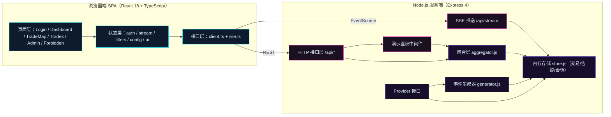
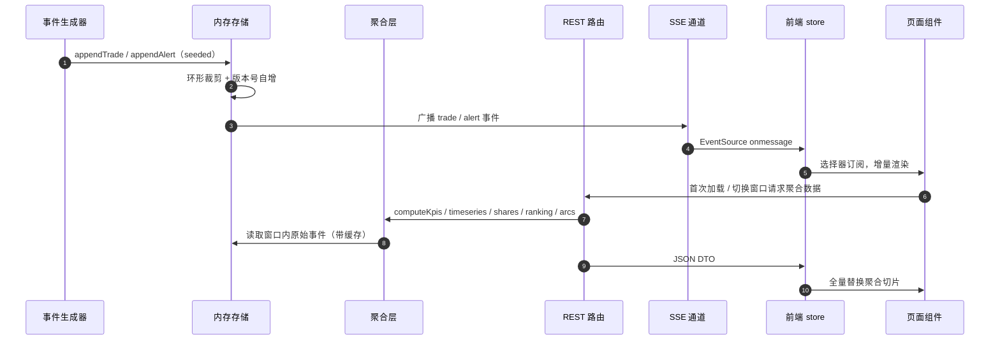

# 概要设计说明书

| 项目 | 内容 |
| --- | --- |
| 项目代号 | NEXUS（赛博交易中枢） |
| 文档版本 | v1.0 |
| 日期 | 2026-11-12 |
| 输入依据 | `docs/PRD.md` v0.1 |
| 适用范围 | M1~M5 全阶段，作为详细设计、接口设计与编码的上位契约 |

## 1. 引言

### 1.1 编写目的

把 PRD 的产品诉求固化为可实施的工程架构：确定技术栈、模块边界、数据流、状态归属、接口形态、性能与安全约束，使后续《03-详细设计说明书》《05-接口设计文档》可以逐条落地，编码阶段不再出现架构级摇摆。

### 1.2 设计范围

覆盖登录、首页大屏、全球交易地图、交易明细、管理员控制台、403 越权页，以及支撑它们的 Node.js Mock 数据服务、数据聚合层、实时推送通道、构建与部署脚本。

### 1.3 关键术语

| 术语 | 定义 |
| --- | --- |
| Provider | 数据提供者接口。当前实现 MockProvider；未来接入真实行情时实现 RealProvider，对上层接口保持不变 |
| 聚合层 | 把原始交易事件汇总为 KPI、时序、资产占比、地区排行、深度、健康度、弧线束的确定性计算层 |
| 弧线束 | 同一卖方→买方→资产类别的多笔交易合并而成的一条地图连线，避免高密度下糊成一片 |
| 演示会话 | 服务端内存中的 token→用户映射，仅用于演示鉴权，不具备真实安全性 |
| 快照窗口 | 1h / 6h / 24h 三种聚合窗口，全站统一枚举 |
| 降级动效 | 关闭粒子、扫描线、故障字效等高开销动画，保留基础过渡 |

## 2. 总体架构

### 2.1 架构结论

系统采用「单仓双进程」结构：浏览器端 React SPA 只通过 HTTP 与 SSE 访问 Node.js 服务；服务端由 MockProvider 生成数据、由聚合层计算视图所需数据、由内存存储保存原始事件；生产构建后由同一个 Node 进程托管静态产物与 API，保证离线可运行。不引入数据库、不引入消息队列、不引入外部地图瓦片与 CDN。



### 2.2 进程与端口

| 进程 | 端口 | 职责 | 启动方式 |
| --- | --- | --- | --- |
| Vite 开发服务器 | 5173 | 提供前端 HMR，`/api` 反向代理到 8787 | `npm run dev` |
| Mock API 服务 | 8787 | REST、SSE、数据生成、聚合、生产静态托管 | `npm run dev:server` / `npm start` |
| 生产预览 | 8787 | 同进程托管 `dist/` 与 API | `npm run build && npm start` |

开发脚本 `scripts/dev.mjs` 同时拉起两个子进程，任一退出即整体退出，SIGINT/SIGTERM 统一清理。

### 2.3 运行时边界

| 边界 | 约束 |
| --- | --- |
| 浏览器 → 服务端 | 只允许同源 HTTP/SSE；生产同源，开发经 Vite 代理；无第三方网络请求 |
| 服务端 → 外部 | 零外部调用；世界 GeoJSON 随包提供 |
| 数据持久化 | 业务数据仅服务端内存；会话与界面偏好仅浏览器 localStorage |
| 密钥 | 无真实密钥；演示凭据以常量形式存在于服务端种子文件 |

## 3. 技术选型与决策

### 3.1 选型结论

| 领域 | 选定方案 | 版本基线 | 决策理由 | 放弃的方案 |
| --- | --- | --- | --- | --- |
| 前端框架 | React + TypeScript + Vite | React 18.3 / TS 5.6 / Vite 5.4 | PRD 指定 React；Vite 冷启动与 HMR 最快；TS strict 保证契约可检查 | Next.js（无需 SSR）、Vue（PRD 指定 React） |
| 路由 | react-router-dom | 6.26 | 声明式路由与守卫成熟，`<RequireAuth>` 模式直接满足权限矩阵 | TanStack Router（生态成本高） |
| 状态 | Zustand | 4.5 | 轻量、按选择器订阅、适合高频 SSE 数据流；避免 Redux 样板代码 | Redux Toolkit、Jotai |
| 图表 | Apache ECharts | 5.5 | 折线/环图/条形/雷达/迷你图统一；本地按需引入；`geo` + `lines` 可支撑地图 | AntV G2（地图能力弱）、Chart.js（图型不足） |
| 地图渲染 | ECharts geo + lines 适配器 | 5.5 | PRD 10.1 方案 D；完全离线、无 token、依赖最轻；`geo roam` 支持缩放拖拽，`lines` 支持弧线，`effectScatter` 支持节点脉冲；30~60 条弧线可稳定 30fps 以上 | AntV L7（方案 A：WebGL 重依赖、无底图组合复杂）、OpenLayers（需手写大圆与动画）、deck.gl（包体过大） |
| 首页简化地图 | 自绘 SVG + 预生成世界轮廓路径 | 无依赖 | 与地图页隔离渲染实例，避免首页被 WebGL 拖垮；轮廓在构建期由 `scripts/gen-world-outline.mjs` 生成，运行时零开销 | 复用 ECharts 实例（违背 PRD 4.2 隔离要求） |
| 样式 | CSS 变量 + CSS Modules | 原生 | 赛博 HUD 需要完全可控的切角、描边、扫描线；组件库会强行引入设计语言 | Tailwind（视觉可控但 token 表达弱）、Element/AntD（风格冲突） |
| 图标 | lucide-react | 0.451 | 线性 HUD 风格、按需 tree-shaking | 自绘图标（维护成本高） |
| 动效 | CSS 动画 + requestAnimationFrame | 原生 | 可被 `prefers-reduced-motion` 与「降低动效」开关统一降级，无额外运行时 | Framer Motion（抽屉动画可接受，但整站引入收益低于成本，本版不引入） |
| Mock 服务 | Node.js + Express | Node 22+ / Express 4.21 | 单文件即可启动、SSE 与静态托管原生支持；生态稳定；符合「轻量服务」要求 | Koa（差异不大）、Fastify（plugin 体系对演示项目过重）、纯 `node:http`（路由与静态托管手写成本高） |
| 实时推送 | SSE | 原生 | 单向推送足够；自动重连由浏览器实现；比 WebSocket 少一层协议与心跳管理 | WebSocket、轮询 |
| 测试 | Vitest + jsdom | 2.1 | 前后端同一套测试运行器；纯函数聚合层可直接测；jsdom 覆盖 store/权限逻辑 | Jest（配置与 ESM 成本高）、Cypress（本版只做关键路径实机验证） |
| 质量 | ESLint 9 + Prettier + `tsc --noEmit` | — | 静态检查与格式统一，构建前置失败 | 仅靠人工 review |

### 3.2 关于 PRD 的两处工程修正

1. **PRD Q2 原假设为「纯前端 Mock、无后端」**：本版按用户最新指令改为「Node.js 轻量服务 Mock」。收益是数据聚合、实时推送、权限校验均有真实服务端边界，后期替换真实行情只改 Provider；代价是演示需同时启动服务进程。此修正在本文档、`05-接口设计文档` 与 `08-部署与运维手册` 同步登记。
2. **PRD Q1 默认方案 A（AntV L7）**：本版选定 PRD 10.1 已列出的方案 D（ECharts geo + lines）。判定依据是验收标准 1「运行时零外部网络请求」、验收标准 5「≥30 条并发弧线 30fps」与「轻量依赖」；L7 在无底图模式下仍需自建图层与飞线粒子，包体与集成复杂度显著高于 D。通过 `MapAdapter` 接口隔离，若评审最终要求 L7，只替换 `src/map/adapters/` 一个目录，页面与状态层不改。

### 3.3 目录结构

```text
cyber-trade-nexus/
├── docs/                          # PRD + 01~08 文档 + design/ 设计图与评审
├── public/geo/world.geo.json      # 本地世界国界数据（ECharts geo 直接注册）
├── scripts/
│   ├── dev.mjs                    # 双进程开发编排
│   ├── gen-world-outline.mjs      # 生成首页简化地图轮廓
│   └── screenshot.mjs             # 设计/页面截图（Chrome headless）
├── server/
│   ├── index.js                   # 进程入口：端口、静态托管、优雅退出
│   ├── app.js                     # Express 应用装配（可被测试直接引入）
│   ├── config.js                  # 端口、窗口、上限、种子等常量
│   ├── core/
│   │   ├── rng.js                 # mulberry32 + 种子派生
│   │   ├── seed.js                # 用户、节点、资产、告警文案等种子数据
│   │   ├── generator.js           # 历史预生成 + 实时 tick + 异常注入
│   │   ├── store.js               # 内存存储、环形上限、事件订阅
│   │   ├── aggregator.js          # KPI/时序/占比/排行/深度/健康/弧线束
│   │   └── depth.js               # 确定性盘口快照
│   ├── providers/
│   │   ├── index.js               # Provider 工厂（mock / real 切换点）
│   │   └── mockProvider.js        # 实现 Provider 接口
│   ├── middleware/auth.js         # 演示 token 鉴权、角色校验
│   ├── routes/auth.js             # 登录、会话、退出、身份切换
│   ├── routes/data.js             # 公共数据与聚合接口
│   ├── routes/admin.js            # 用户、数据流、注入、重置
│   └── tests/                     # 服务端单元与接口测试
├── src/
│   ├── main.tsx / App.tsx
│   ├── routes/                    # RouterView + RequireAuth + Forbidden
│   ├── layouts/DashboardLayout.tsx
│   ├── pages/                     # Login / Dashboard / TradeMap / Trades / Admin
│   ├── components/                # HudCard / NeonButton / DataDrawer / KpiCard 等
│   ├── charts/                    # EChart 封装与 5 类图表
│   ├── map/                       # MapAdapter 接口 + ECharts 适配器 + MiniWorldMap
│   ├── api/                       # client.ts / sse.ts / dto 映射
│   ├── store/                     # auth / stream / filters / config / ui
│   ├── hooks/                     # usePermission / useHotkeys / useScale / useCountUp
│   ├── lib/                       # 纯函数：format / arc / filter / aggregate
│   ├── styles/                    # tokens.css / global.css / modules
│   └── types/                     # 与 05 文档一致的 DTO 类型
└── package.json / vite.config.ts / tsconfig.json / eslint.config.js
```

## 4. 模块划分

### 4.1 前端模块职责

| 模块 | 职责 | 关键约束 |
| --- | --- | --- |
| `routes` | 路由表、登录守卫、角色守卫、403 | 未登录一律跳 `/login`；非 admin 访问 `/admin` 渲染 403 |
| `layouts/DashboardLayout` | 顶部栏、导航、身份徽章、全屏、时钟、数据流状态 | 1920×1080 固定画布，缩放由外层 `ScaleStage` 处理 |
| `pages/Dashboard` | D-01~D-10 模块编排、联动筛选 | 单屏无滚动；模块间通过 store 联动，不层层传 props |
| `pages/TradeMap` | 地图、筛选、图层、回放、弧线详情、节点详情 | 地图实例只在适配器内创建；React 层不直接操作 ECharts |
| `pages/Trades` | 虚拟滚动表格、筛选、排序、详情、复制、跳地图 | 行高固定 48px；筛选在服务端完成，翻页不丢筛选 |
| `pages/Admin` | 用户管理、数据流控制、系统设置 | 所有写操作经服务端校验；本页仅 admin 可见 |
| `pages/Login` | 账号密码、验证码、记住我、演示账号 | 登录态写入 authStore 并持久化 |
| `store` | 五个独立 store，禁止跨 store 直接读写 | auth 负责注入/清除 token；stream 负责 SSE 生命周期 |
| `api` | 唯一网络出口；DTO 校验与错误归一化 | 页面不得直接 `fetch`；401 统一触发登出 |
| `map` | `MapAdapter` 接口与实现 | `setNodes / setArcs / setFilters / focusNode / setLayers / resetView` 固定 |
| `charts` | ECharts 生命周期封装、主题注入 | `resize` 由 ResizeObserver 驱动；卸载时 `dispose` |
| `lib` | 纯函数（格式化、弧线几何、聚合、过滤） | 全部可单测，无 DOM 依赖 |

### 4.2 服务端模块职责

| 模块 | 职责 | 关键约束 |
| --- | --- | --- |
| `core/rng.js` | 确定性随机：mulberry32、种子派生、区间与分布工具 | 同 seed 必得同序列；单测锁定 |
| `core/seed.js` | 静态种子：30 个金融节点、账号、资产、告警模板 | 账号密码仅演示用途；`role` 枚举固定 |
| `core/generator.js` | 预生成 24h 历史、实时 tick、注入三类异常 | 历史 1200 笔；实时默认 1500ms/笔；单 tick 不阻塞超过 8ms |
| `core/store.js` | 原始事件存储、环形上限、订阅广播 | 交易上限 6000、告警上限 400；订阅者异常隔离 |
| `core/aggregator.js` | 全部聚合计算，带缓存与失效版本 | 纯函数可测；缓存 key = 窗口 + 过滤条件 + 版本 |
| `core/depth.js` | 确定性盘口快照（买/卖各 12 档） | 同资产同时间种子一致；价差单调 |
| `providers/mockProvider.js` | 实现 Provider 接口，包装 generator/store/aggregator | 上层路由只依赖接口，不知道 Mock 细节 |
| `providers/index.js` | 依据 `DATA_PROVIDER` 环境变量选择实现 | 默认 `mock`；`real` 为预留报错占位 |
| `middleware/auth.js` | Bearer token 解析、会话过期、角色断言 | 公共接口与受保护接口分离 |
| `routes/*` | 参数校验、调用 Provider、统一响应与错误 | 错误码与 05 文档一一对应 |

### 4.3 Provider 接口（真实数据接入点）

```ts
interface DataProvider {
  getMeta(): Meta;
  getNodes(): NodeDTO[];
  getTrades(query: TradeQuery): PageResult<TradeDTO>;
  getTradeById(id: string): TradeDTO | null;
  getAlerts(query: AlertQuery): AlertDTO[];
  getKpis(window: WindowKey): KpiDTO[];
  getTimeseries(range: WindowKey, assetClass: AssetClass | 'all'): TimeseriesDTO;
  getAssetShares(window: WindowKey): AssetShareDTO[];
  getRegionRanking(window: WindowKey, limit: number): RegionRankDTO[];
  getArcBundles(query: ArcQuery): ArcDTO[];
  getDepth(asset: string): DepthDTO;
  getHealth(): HealthDTO[];
  getMarkets(): MarketDTO[];
  subscribe(listener: (event: StreamEvent) => void): () => void;
  control(action: ControlAction): ControlResult;
}
```

真实行情接入时新增 `providers/realProvider.js`（REST/WS/消息总线适配），`DATA_PROVIDER=real` 切换；路由、聚合层缓存与前端 `api` 层无需修改。

## 5. 数据流设计

### 5.1 主链路



### 5.2 聚合缓存与失效

- 存储维护单调递增 `version`；每次写入交易或告警自增。
- 聚合函数生成 `cacheKey = 接口 + 窗口 + 过滤串 + version`；命中直接返回，未命中重算并写入 LRU（最多 64 项）。
- KPI 与行情由服务端每 2s 计算并广播 `kpi`、每 5s 广播 `market`；前端不重复计算，只做数字滚动动画。
- 弧线束按 `fromNodeId|toNodeId|assetClass` 分组，金额求和、延迟取最大、状态取最严重，输出 ≤180 条。

### 5.3 时间与窗口口径

| 口径 | 定义 |
| --- | --- |
| `now` | 服务端进程时钟，接口与前端以服务端时间为准，前端只做本地秒级时钟展示 |
| 24h 历史 | `[now - 24h, now]` 内预生成 1200 笔交易，时间分布密度随距当前时间递减 |
| KPI 窗口 | 1h / 6h / 24h，默认 24h |
| 时序桶 | 1h→1m（60 点）；6h→15m（24 点）；24h→1h（24 点） |
| 回放窗口 | 地图页可选最近 6h，滑块步长 1 分钟，播放速度随倍速 1×/2×/4× |

## 6. 状态管理设计

| Store | 关键字段 | 持久化 | 说明 |
| --- | --- | --- | --- |
| `authStore` | `user / token / expiresAt / status` | `localStorage: nexus.auth` | 登录、登出、身份切换；token 失效统一清除 |
| `streamStore` | `trades / alerts / markets / kpis / streamStatus / connection / lastEventAt` | 无 | 数组上限：交易 1500、告警 200；SSE 断线指数退避重连 |
| `filterStore` | `range / assetClasses / assetClass / status / minAmount / maxAmount / nodeId / country / search / timeCursor` | 无 | 大屏、地图、明细共享；跨页保留筛选 |
| `configStore` | `theme / motion / refreshMs / watermark / fullscreen` | `localStorage: nexus.prefs` | 主题三套：青紫 / 琥珀 / 冰蓝 |
| `uiStore` | `drawer / drawerKind / selectedTradeId / selectedNodeId / toasts` | 无 | 抽屉与全局提示 |

规则：

1. 页面只读取与本页相关的切片，使用 `useShallow` 或选择器，避免整表订阅。
2. SSE 推送只写 `streamStore`，聚合切片由 REST 拉取，不混用。
3. 跨 store 编排放在 hooks 或页面层，store 之间不直接 import。
4. 401 由 `api/client.ts` 统一抛出 `AuthError`，`RequireAuth` 与 `authStore` 处理。

## 7. 安全设计

### 7.1 威胁边界

| 项 | 结论 |
| --- | --- |
| 真实身份认证 | 不存在。演示 token 由服务端随机生成，仅存内存，进程重启即失效 |
| 密码存储 | 明文常量，仅用于演示账号比对；界面与 README 双重声明「非真实系统」 |
| 越权防护 | 前端路由守卫 + 服务端角色中间件双重校验；管理接口默认全部 `requireRole('admin')` |
| 输入注入 | 无 SQL；查询参数白名单校验，字符串长度上限 80，分页上限 200 |
| XSS | React 默认转义；不使用 `dangerouslySetInnerHTML`；搜索关键词不做 HTML 回显 |
| CSRF | 无 Cookie 鉴权，token 由前端显式携带，同源策略下风险不适用；仍设置 `X-Content-Type-Options` |
| 依赖 | 只引入必要包；地图数据本地化；无外部 CDN |
| 日志 | 只记录路由、状态码、耗时；不打印密码、token |

### 7.2 角色权限落点

| 能力 | 服务端 | 前端 |
| --- | --- | --- |
| 查看大屏/地图/明细 | 登录即可 | 守卫放行 |
| 标记告警处置 | admin | 按钮隐藏 |
| 数据流控制/注入/重置 | admin | 控制台仅 admin 路由 |
| 用户启停/角色/身份切换 | admin | 同上 |
| 系统设置 | 浏览器本地 | 控制台仅 admin 路由；主题与动效仍受管理员入口保护 |

## 8. 性能与容量设计

| 风险点 | 对策 | 指标 |
| --- | --- | --- |
| 高频 SSE 触发重渲染 | 事件按 16ms 合批入 store；列表最多 1500 条；选择器订阅 | 4× 倍速下主线程单帧 ≤ 16ms |
| 表格千级数据 | 自研虚拟滚动（固定行高，overscan 6） | 5000 行滚动 ≥ 45fps |
| 地图弧线过多 | 服务端弧线束 ≤180；前端只渲染视口内；异常线优先 | ≥30 条并发弧线 ≥30fps |
| 图表重绘 | `notMerge: false` 增量 setOption；窗口切换节流 200ms | 切换 ≤300ms 完成 |
| 内存增长 | 前后端全部数组环形上限；SSE 断开清理；ECharts dispose | 4× 连续 10 分钟堆增长 ≤ 20MB |
| 首屏体积 | ECharts 按需注册；lucide 按需；GeoJSON 异步加载 | 首屏 gzip ≤ 1.2MB |
| 缩放适配 | 1920×1080 设计坐标 + `transform: scale` 单层变换；禁用滚动条 | 1366×768~3840×2160 等比可用 |

## 9. 部署与运行环境

| 项 | 结论 |
| --- | --- |
| Node 版本 | ≥ 20.11，实际验证 26.13 |
| 安装命令 | `npm install` |
| 开发 | `npm run dev`（Vite 5173 + API 8787） |
| 构建 | `npm run build`（tsc 检查 + Vite 产出 `dist/`） |
| 生产启动 | `npm start`（8787 同源托管 API 与 dist） |
| 环境变量 | `PORT`（默认 8787）、`DATA_PROVIDER`（默认 mock）、`DEMO_SEED`（默认 20261112） |
| 离线要求 | 运行时零外部网络请求；GeoJSON、字体、图标全部本地 |
| 回滚 | 无状态服务，回滚仅需切回上一构建产物；内存数据随重启按种子重建 |

## 10. 风险与对策

| 风险 | 影响 | 对策 | 残余风险 |
| --- | --- | --- | --- |
| ECharts 地图弧线命中/高亮能力不足 | M-01/M-02 交互弱 | 弧线用 `lines` 绘制、`silent:true`；中点用透明 scatter 提供稳定命中区；选中态单独重绘高亮线 | 极细弧线端点命中率略低 |
| SSE 在代理/休眠下断连 | 数据流停止 | 前端指数退避重连 + 服务端 15s 心跳 + 顶部状态灯 | 休眠恢复后有 1~3s 空窗 |
| 浏览器半透明发光层过多导致掉帧 | 大屏掉帧 | 发光统一走 `filter: drop-shadow` 与 CSS 变量，降低动效时移除；弧线粒子只用 ECharts 内置 effect | 低端集显可能仍需降级 |
| 模拟数据被误认为真实 | 认知风险 | 全局 DEMO 水印、登录页声明、接口 `demo:true`、README 声明 | 无 |
| 后期接真实数据的字段差异 | 返工 | Provider 接口 + api 层 DTO 映射 + 05 文档字段契约 | 需补字段映射表 |

## 11. 里程碑映射

| 阶段 | 本文档对应产出 |
| --- | --- |
| M1 | 目录结构、技术栈、设计 token、鉴权与守卫 |
| M2 | Mock 服务、聚合层、大屏数据流、简化地图 |
| M3 | MapAdapter、地图页、弧线与交互 |
| M4 | 明细虚拟滚动、控制台、全局联动与快捷键 |
| M5 | 性能预算、部署脚本、测试与验收 |
