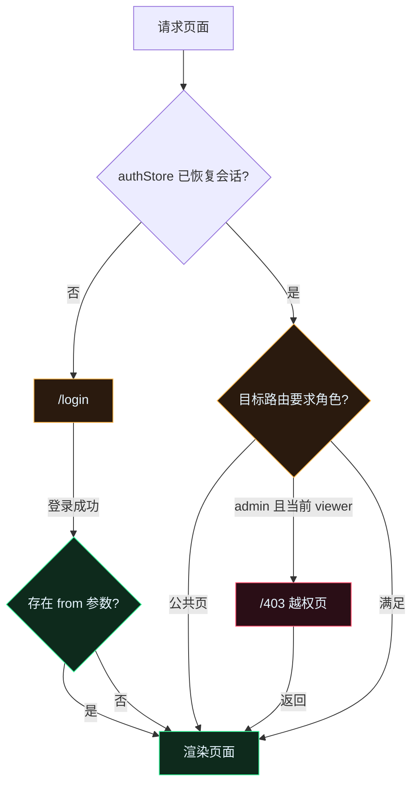

# 详细设计说明书

| 项目 | 内容 |
| --- | --- |
| 文档版本 | v1.0 |
| 日期 | 2026-11-12 |
| 上位文档 | `02-概要设计说明书.md`、`05-接口设计文档.md` |
| 读者对象 | 前端工程师、Node.js 服务端工程师、测试工程师 |

## 1. 设计原则

1. **单一数据源**：原始事件只在服务端 `store` 中存在；浏览器不自行生成业务数据，只做展示与轻量派生。
2. **契约先行**：所有接口 DTO 与 `05-接口设计文档` 字段逐字一致，前端类型集中在 `src/types`，服务端由测试锁定字段。
3. **适配器隔离**：地图渲染藏在 `MapAdapter` 后，页面不出现 ECharts 专有 API；数据来源藏在 `DataProvider` 后，路由不出现 Mock 逻辑。
4. **纯函数可测**：聚合、过滤、弧线几何、格式化全部实现为无副作用纯函数，允许单元测试直接断言。
5. **失败可降级**：任何数据请求失败保留上一次数据并展示错误条；SSE 断开只降级实时提示，不影响浏览。

## 2. 前端总体设计

### 2.1 渲染舞台与缩放

- 外层 `ScaleStage` 固定设计坐标 `1920×1080`，通过 `transform: scale(min(vw/1920, vh/1080))` 等比缩放并居中。
- 页面内容使用绝对尺寸（px）布局，不依赖浏览器宽度；`html, body` 设置 `overflow: hidden`。
- `useScale` 监听 `resize` 与 `fullscreenchange`，节流 100ms，更新 `--stage-scale` 变量。
- 断点：宽度 ≥ 2560 时缩放上限 1.6；1366×768 下缩放 0.711 但不小于 0.65；高度不足时以高度为主约束。

### 2.2 路由与守卫



路由表：

| path | 组件 | 守卫 | 说明 |
| --- | --- | --- | --- |
| `/login` | LoginPage | 无 | 已登录访问时重定向 `/` |
| `/` | DashboardPage | 登录 | 默认落地页 |
| `/map` | TradeMapPage | 登录 | 支持 `?node=` / `?trade=` 深链 |
| `/trades` | TradesPage | 登录 | 支持 `?tradeId=` 深链自动打开抽屉 |
| `/admin` | AdminPage | `role=admin` | viewer 渲染 403 |
| `/403` | ForbiddenPage | 登录 | 返回大屏 |
| `*` | Redirect | — | 回 `/` |

`authStore.hydrate()` 在应用挂载前读取 `localStorage`，校验 `expiresAt`，过期即清除并跳登录。token 失效（401）由 `client.ts` 抛 `AuthError`，`App` 订阅后执行登出。

### 2.3 Store 设计

#### 2.3.1 authStore

```ts
interface AuthState {
  user: UserDTO | null;
  token: string | null;
  expiresAt: number | null;
  status: 'idle' | 'loading' | 'authenticated' | 'error';
  login(username: string, password: string, remember: boolean): Promise<void>;
  logout(): Promise<void>;
  impersonate(userId: string): Promise<void>;
  hydrate(): void;
  clear(): void;
}
```

持久化键 `nexus.auth`，值为 `{ token, user, expiresAt, v: 1 }`。写操作在 `login/impersonate` 成功后同步落盘；`clear` 同时移除键。

#### 2.3.2 streamStore

```ts
interface StreamState {
  trades: TradeDTO[];        // 上限 1500，新元素在前
  alerts: AlertDTO[];        // 上限 200
  kpis: KpiDTO[];
  markets: MarketDTO[];
  streamStatus: StreamStatusDTO | null;
  connection: 'idle' | 'connecting' | 'open' | 'retrying' | 'closed';
  lastEventAt: number | null;
  pushTrade(t: TradeDTO): void;
  pushAlert(a: AlertDTO): void;
  replaceKpis(items: KpiDTO[]): void;
  replaceMarkets(items: MarketDTO[]): void;
  setStatus(s: StreamStatusDTO): void;
  setConnection(c: ConnectionState): void;
  hydrateSnapshot(items: { trades: TradeDTO[]; alerts: AlertDTO[] }): void;
}
```

服务端推送与 REST 快照去重：`pushTrade` 以 `id` 判断已存在则忽略；数组裁剪使用 `slice(0, cap)`。

#### 2.3.3 filterStore

```ts
interface FilterState {
  range: '1h' | '6h' | '24h';
  assetClasses: AssetClass[];          // 主图图例可见性，空数组=全显
  assetClass: AssetClass | null;       // 明确筛选
  status: TradeStatus | null;
  side: Side | null;
  nodeId: string | null;
  country: string | null;
  search: string;
  minAmount: number | null;
  maxAmount: number | null;
  activeKpi: string | null;            // 点击 KPI 后的高亮态
  reset(): void;
}
```

跨页保留；搜索与金额区间使用 250ms 防抖后再触发请求。

#### 2.3.4 configStore

```ts
interface ConfigState {
  theme: 'cyan' | 'amber' | 'ice';
  motion: 'full' | 'reduced';
  refreshMs: 1000 | 2000 | 5000;
  watermark: boolean;
  fullscreen: boolean;
  setTheme / setMotion / setRefresh / setWatermark / syncFullscreen(): void;
}
```

持久化键 `nexus.prefs`。主题通过 `document.documentElement.dataset.theme` 切换，`tokens.css` 内三套变量覆盖。`motion=reduced` 同时设置 `data-motion="reduced"`，CSS 动画 `animation: none`，地图粒子与扫描线关闭。

#### 2.3.5 uiStore

```ts
interface UiState {
  drawer: { kind: 'trade' | 'node' | null; id: string | null };
  toasts: ToastItem[];
  openTrade(id: string): void;
  openNode(id: string): void;
  closeDrawer(): void;
  toast(t: Omit<ToastItem, 'id'>): void;
  dismiss(id: string): void;
}
```

### 2.4 网络层

- `api/client.ts`：统一 `request(path, { method, body, query, signal })`；拼接查询参数时跳过 `null/undefined/''`；超时 15s；解析信封，非 2xx 抛 `ApiError(code, message, status, details)`。
- `api/dto.ts`：服务端字段 → 前端视图模型（数值格式化在展示层完成，DTO 保持数值）。
- `api/sse.ts`：单例 `startStream(token, handlers)`；连接 `EventSource('/api/stream?token=...')`；重连间隔 1s→2s→4s→8s，上限 8s；连续失败 3 次标记 `connection='retrying'`；`visibilitychange` 回到前台时若已关闭立即重连；`stop()` 关闭并移除监听。

### 2.5 页面结构

#### 2.5.1 布局

`DashboardLayout`：

- 顶部栏 64px：左侧 LOGO（NEXUS + 副标题）、DEMO 徽标；中部导航四项（态势总览 / 全球地图 / 交易明细 / 控制台）；右侧数据流指示灯、全局时钟、身份徽章（下拉：切换身份 / 退出）、全屏按钮。
- 主区 960px：由页面填充。
- 底部行情带 56px：所有登录后页面共享。
- 详情抽屉覆盖在主区右侧，宽 460px，带遮罩与 Esc 关闭。

#### 2.5.2 首页大屏

左栏（宽 422px）纵向：KPI 六卡（2×3 网格）、资产占比、地区排行。
中栏（宽 960px）纵向：分时成交额主图（高 380）、简化世界地图（高 332）、买卖盘深度（高 224）。
右栏（宽 538px）纵向：实时交易流水（高 372）、告警事件流（高 300）、系统状态雷达（高 236）。

数据装载顺序：先并发请求 KPI、时序、资产占比、地区排行、深度、健康度、节点、告警、行情，随后建立 SSE。任一接口失败展示该模块 `ErrorState` 并提供重试按钮，不阻塞其他模块。

KPI 卡点击：设置 `filterStore.activeKpi=key`，主图切换到对应资产类别（若 key 为 `volume/trades` 则保持全部）并高亮；右侧流水列表滚动到顶部并只展示与 KPI 语义一致的近期数据（`riskIndex` 时筛选 `flagged`，`avgLatency` 时排序延迟）。

#### 2.5.3 地图页

布局：顶部工具栏 64px（页内）；地图画布占满剩余；左侧浮动筛选面板 300px；右侧详情抽屉 420px；底部时间轴 72px。

`MapAdapter` 接口：

```ts
interface MapAdapter {
  mount(el: HTMLElement): void;
  setGeo(geojson: GeoJSON): void;
  setNodes(nodes: MapNode[]): void;
  setArcs(arcs: MapArc[]): void;
  setLayers(layers: MapLayers): void;
  setHeat(mode: 'off' | 'routes' | 'amount'): void;
  setSelected(arcId: string | null): void;
  focusNode(nodeId: string): void;
  resetView(): void;
  on<K extends MapEventName>(event: K, cb: MapEventHandler[K]): () => void;
  resize(): void;
  dispose(): void;
}
```

ECharts 适配器 option 组成：

| 层 | series / 组件 | 交互 |
| --- | --- | --- |
| 国界 | `geo`（`map: 'world'`、`roam: true`、`zoom: 1.35`） | 拖拽、滚轮缩放 |
| 网格 | `geo` 的 `itemStyle` + 背景 CSS 网格 | 由图层开关控制 |
| 弧线 | 5 个 `lines` series（按资产类别），`effect.show=true`、`curveness` 与距离正相关 | `silent: true`，视觉层 |
| 命中点 | `scatter` 透明命中层，弧线中点，`symbolSize: 16` | hover 浮层、click 打开抽屉 |
| 节点 | `effectScatter`，尺寸按 `volume24h` 开方映射 10~34px | hover 节点卡、click 筛选 |
| 标签 | `scatter` 的 `label` 或自定义 `graphic` | 图层开关控制 |
| 热力 | `scatter` 大尺寸低透明度层（`symbolSize` 40~120，`shadowBlur`） | 图层开关+模式切换 |
| 选中线 | 单独 `lines` series（琥珀色宽 3px） | 选中态固定显示 |

弧线中点计算（与 `lines` 的二次贝塞尔一致）：

```text
M = 中点(P0, P1)
L = 距离(P0, P1)
N = 单位法向量(M 到经度增加方向)
C = M + N * curveness * L
mid(t=0.5) = 0.25*P0 + 0.5*C + 0.25*P1
curveness = clamp(distance / 9000, 0.18, 0.55)
```

实现放在 `src/lib/arc.ts`，单测覆盖：距离单调、跨日期变更线、极小距离退化（同节点不生成弧线）。

地图筛选顺序：窗口（1h/6h/24h 或回放区间）→ 资产类别 → 状态 → 金额区间 → 端点节点/国家 → 聚合为弧线束（若关闭线束则按交易逐条）→ 限 180 条。筛选变化后重新请求 `/api/aggregations/arcs`，同时节点尺寸按过滤后的交易重算（客户端用最近交易估算，服务端 `/api/nodes` 提供 24h 常量）。

回放：滑块范围 `[now-6h, now]`，默认 `now`；播放时每 500ms 将光标前移 1 分钟（2×/4× 相应加速），请求 `/api/trades?from=cursor-5m&to=cursor&pageSize=200&sortBy=ts`，用 `aggregateArcs` 在客户端聚合，渲染后 200ms 淡出旧线。

#### 2.5.4 交易明细页

虚拟滚动算法：

```text
rowHeight = 48
viewportHeight = el.clientHeight
start = max(0, floor(scrollTop / rowHeight) - 6)
visibleCount = ceil(viewportHeight / rowHeight) + 12
end = min(items.length, start + visibleCount)
topSpacer = start * rowHeight
bottomSpacer = (items.length - end) * rowHeight
```

- 表格容器设置 `position: relative`，tbody 用上下两个 spacer 撑高；滚动事件用 rAF 节流。
- 排序/筛选变化时重置 `scrollTop=0`；`useEffect` 依赖筛选条件触发请求。
- 服务端分页 `pageSize=200`，滚动接近末尾时加载下一页；同时接收 SSE 新交易插入顶部。
- 行点击打开抽屉；复制使用 `navigator.clipboard.writeText`，失败降级 `textarea + execCommand`；跳地图按钮 `navigate('/map?trade=' + id)`。

#### 2.5.5 管理员控制台

三栏：用户管理（宽 640）、Mock 数据控制台（宽 600）、系统设置（宽 640）。

- 用户操作前 `Modal.confirm`，成功 Toast 并刷新列表；被保护操作用错误提示（最后管理员 / 自身角色）。
- 数据流控制：暂停开关、速率四档 segmented control、重置种子（输入框 + 随机按钮）、清空数据（危险确认）、注入三种异常（各一个按钮，带 loading）。
- 系统设置：主题三选、动效两档、刷新频率三档、水印开关；即时生效并落 `localStorage`。
- viewer 访问无入口；若直接请求管理接口返回 403，页面显示错误条。

#### 2.5.6 登录页

- 表单：账号、密码（显示/隐藏切换）、验证码（点击刷新）、记住我；回车提交；按钮 loading 态。
- 验证码为 4 位大写字符，客户端用 canvas 绘制随机旋转字符 + 干扰线，不请求服务端；校验在客户端完成（演示性质）。
- 演示账号一键填充：`admin / admin123`、`viewer / viewer123`。
- 错误提示：401 显示「账号或密码错误」，403 显示「该账号已被停用」，其余显示通用失败。
- 已登录且会话有效时访问 `/login` 直接跳 `/`。

### 2.6 通用组件

| 组件 | 职责 | 关键实现 |
| --- | --- | --- |
| `HudCard` | 切角面板 + 标题 + HUD 编号 + 操作区 | `clip-path` 八边切角；`::before` 四角准星；`--accent` 变量控制主题 |
| `NeonButton` | 主/次/危险三态按钮 | `loading` 时禁用并显示旋转环；`aria-busy` |
| `GlitchText` | 标题故障字效 | 双层伪元素低透明度位移，`motion=reduced` 或水印关时降频 |
| `DataDrawer` | 右侧详情抽屉 | 打开时焦点陷阱、Esc 关闭、内容滚动；`aria-modal` |
| `NeonNumber` | 数字滚动累加 | `requestAnimationFrame` 600ms ease-out；变化时短暂发光 |
| `Sparkline` | 迷你走势 | SVG polyline，点坐标预先计算，不依赖图表库 |
| `StatusTag` | 状态色标 | `filled/pending/failed/flagged` 与 `normal/busy/alert` 统一映射 |
| `LoadingSkeleton` | 骨架屏 | 按卡片形状闪烁，`motion=reduced` 时静态灰条 |
| `EmptyState` / `ErrorState` | 空态/错误态 | 错误态带「重试」回调 |
| `GlobalTicker` | 底部行情带 | 复制一份数据实现无缝循环，hover 暂停，点击联动主图 |
| `Toast` | 轻提示 | 顶部栈式，3s 自动消失，最多 3 条 |

### 2.7 主题与动效

- `tokens.css` 定义 `--bg-0/--bg-1/--panel/--cyan/--magenta/--violet/--amber/--red/--green/--text-1/--text-2/--text-3/--grid/--glow`。
- 三套主题：`cyan`（默认青紫）、`amber`（主霓虹琥珀 + 紫）、`ice`（主霓虹冰蓝 + 青）。
- 扫描线：`::after` 1px 线以 8s 平移；降动效关闭。
- 数字字体栈：`ui-monospace, "JetBrains Mono", "SF Mono", Menlo, Consolas, monospace`，不加载网络字体。
- `GlitchText` 每 12s 触发一次 300ms 位移；可用 `configStore.watermark` 之外的开关关闭（本版随动效档位联动）。
- 扫描过渡：页面切换时顶部一条 400ms 扫描线（纯 CSS）。

### 2.8 键盘快捷键

| 键 | 行为 | 生效范围 |
| --- | --- | --- |
| `1` | 跳 `/` | 全局，输入框聚焦时忽略 |
| `2` | 跳 `/map` | 同上 |
| `3` | 跳 `/trades` | 同上 |
| `4` | 跳 `/admin`（仅 admin） | 同上 |
| `Space` | 暂停/恢复数据流（admin） | 非输入框聚焦 |
| `F` | 全屏切换 | 全局 |
| `Esc` | 关闭抽屉/弹窗 | 全局 |
| `Ctrl+K`（macOS `⌘K`） | 聚焦地图搜索框（在地图页） | 地图页 |

输入框内按 `Space`/数字不触发；`useHotkeys` 注册时检查 `event.target` 是否 `input/textarea/select`。

## 3. 服务端详细设计

### 3.1 随机数与种子

```text
mulberry32(seed):
  返回闭包，每次调用：
    seed = (seed + 0x6D2B79F5) >>> 0
    t = seed
    t = (t ^ (t >>> 15)) * (1 | t)
    t = (t + ((t ^ (t >>> 7)) * (61 | t))) ^ t
    return ((t ^ (t >>> 14)) >>> 0) / 4294967296

派生种子 seedFor(base, label) = (base ^ hash32(label)) >>> 0
```

所有生成器持有独立 RNG 实例，互不影响，保证历史部分与实时部分可复现。

### 3.2 历史数据生成

启动时（`boot(seed)`）：

1. 用 `seedFor(seed, 'nodes')` 初始化节点基础体量；用 `seedFor(seed, 'market')` 初始化 12 个资产价格与 24 点 sparkline。
2. 生成 1200 笔历史交易：时间从 `now-24h` 到 `now`，`ts = start + (i / 1199) * 86400000 + jitter(-30s, 30s)`；保证不超过 now。
3. 每笔交易：随机端点（不同节点，权重按节点 `weight`）、随机资产、方向、金额、状态、延迟、风险分；按规则生成对应告警（大额 ≥ 8,000,000、延迟 ≥ 200ms、风险 ≥ 80、状态 flagged）。
4. 告警总数目标 60~120，写入后按时间倒序；`handled` 随机 30% 为 true。

金额分布：`amount = exp(rng 归一化) * 50,000`，截断到 `[20,000, 20,000,000]`；保留 0 位小数。
延迟：`8 + (-ln(1 - rng)) * 24`，截断 `[5, 2000]`，取整。
风险分：基础 `2 + rng^2 * 55`，flagged 强制 82~99。

### 3.3 实时生成与注入

`setInterval(tick, intervalMs)`，`intervalMs = 1500 / speed`。每 tick 生成 1 笔交易并广播；暂停时 clearInterval 但保留状态。`speed` 只允许 0.5/1/2/4，改变时重设定时器。

注入规则（`inject(type)`）：

| type | 交易特征 | 告警 |
| --- | --- | --- |
| `large_trade` | amount 8,000,000~20,000,000，status `filled`，assetClass 随机 | `large_trade`，`warn`，message 含金额与资产 |
| `latency_spike` | latency 900~1600，status `pending` | `latency_spike`，`warn` |
| `risk_hit` | riskScore 85~99，status `flagged` | `risk_hit`，`critical` |

注入的告警立即推送到所有 SSE 客户端，同时 `unhandled` 计数加一。

### 3.4 聚合公式

窗口 `[now - windowMs, now]`。

| 指标 | 公式 |
| --- | --- |
| 成交额 | `sum(amount where status='filled')` |
| 成交笔数 | `count(all trades)` |
| 成功率 | `filled / total * 100`，保留 2 位 |
| 活跃节点 | 窗口内 `fromNodeId ∪ toNodeId` 去重计数 |
| 平均延迟 | `round(mean(latencyMs))` |
| 风险指数 | `clamp(mean(riskScore) * 0.7 + flaggedRatio * 100 * 0.3, 0, 100)`，保留 1 位 |
| 环比 | `previous` 为紧邻的等长窗口；仅当 `prev >= 1` 且 `prev >= cur * 5%` 才计算，否则记 0（避免边界样本造成千倍假同比）；`deltaPct = (cur - prev) / max(prev, 1) * 100`，保留 1 位；`abs(deltaPct) < 0.05` 视为 `flat` |
| 时序 | 按桶左闭右开归并 filled 金额；桶数固定（1h→60 / 6h→24 / 24h→24），首桶对齐 `now - range + 1` 个桶 |
| 资产占比 | filled 金额按 assetClass 汇总；`pct = amount / total * 100` 保留 1 位；最后一项补差使合计 100.0 |
| 地区排行 | filled 交易按卖方节点国家汇总；`pct` 同上；`topNodeId` 取该国家成交额最高的节点 |
| 弧线束 | key=`from|to|assetClass`；amount 求和、count 计数、maxLatency 取最大、riskScore 取最大、latestTs 取最大；status 取最严重顺序 `flagged > failed > pending > filled`；按 amount 降序取 limit |
| 健康度 | 见下方公式 |

健康度：

```text
gateway   = clamp(100 - avgLatency / 8, 50, 100)
matching  = clamp(successRate, 0, 100)
clearing  = clamp(100 - (failed + flagged) / total * 200, 40, 100)
risk      = clamp(100 - riskIndex, 0, 100)
datalink  = clamp(100 - criticalAlerts10m * 2 - warnAlerts10m * 0.5, 50, 100)
取整；score >= 92 normal，>= 80 busy，其余 alert
```

### 3.5 盘口深度生成

对资产 `asset`：

1. 取资产基准价 `base` 与当前抖动 `price = base * (1 + ±0.0006)`。
2. `spread = price * 0.0003`。
3. 买 12 档：`price - spread/2 - i * tick`；卖 12 档：`price + spread/2 + i * tick`；`tick = price * 0.00015`。
4. 每档 `size = 0.5 + rng^2 * 8`，按买卖方向累计。
5. 以 `asset + minuteBucket` 派生种子，1 分钟内同资产返回不同随机分布但价格基准稳定，保证刷新不跳变。

### 3.6 存储与广播

- `store.trades` 与 `store.alerts` 为数组，写入后 `unshift` 并 `length > cap` 时 `pop`。
- `version` 每次写入 +1；聚合缓存读取版本号判断失效。
- `EventEmitter` 单例，事件名 `trade`、`alert`、`kpi`、`market`、`status`；每个 SSE 客户端一个监听器，关闭时移除。
- 会话 Map：`token -> { userId, createdAt, expiresAt }`；用户停用时删除该用户全部 token。
- 定时器：`tradeTimer`、`kpiTimer`（2s）、`marketTimer`（5s）、`heartbeat`（由 SSE 连接自己维护）。进程退出清理全部定时器。

### 3.7 参数校验

| 参数 | 规则 | 失败码 |
| --- | --- | --- |
| page | 正整数，缺省 1 | VALIDATION_ERROR |
| pageSize | 1~200 整数 | VALIDATION_ERROR |
| window/range | 枚举 | VALIDATION_ERROR |
| assetClass/status/side | 枚举 | VALIDATION_ERROR |
| minAmount/maxAmount | ≥0 数字；min ≤ max | VALIDATION_ERROR |
| from/to | 正整数；from < to | VALIDATION_ERROR |
| search | ≤80 字符，去除首尾空格 | VALIDATION_ERROR |
| limit | 1~200 | VALIDATION_ERROR |
| seed | 1~2147483646 整数 | VALIDATION_ERROR |

校验函数集中在 `server/core/validate.js`，纯函数可单测。

### 3.8 鉴权与错误处理

- `authMiddleware` 从 `Authorization: Bearer` 或 SSE query token 取 token；查询 Map；过期删除并返回 `TOKEN_EXPIRED`；用户停用返回 `USER_DISABLED`。
- `requireRole('admin')` 在 auth 之后；`req.user` 为内存用户对象（不含 password）。
- Express 全局错误中间件：已知 `AppError` 输出协议错误，未知错误输出 `INTERNAL_ERROR` 并记录 requestId；禁止把堆栈返回浏览器。
- 请求日志：`method path status durationMs requestId`，不记录请求体。

## 4. 交互实现映射

| 编号 | 实现位置 | 触发 | 后端/数据依赖 |
| --- | --- | --- | --- |
| I-01 | LoginPage 表单 | 提交 | POST /auth/login |
| I-02 | LoginPage CaptchaCanvas | 点击刷新 / 校验 | 纯前端 |
| I-03 | LoginPage | 记住我 / 显示密码 / Enter | 纯前端 |
| I-04 | LoginPage 演示按钮 | 点击填充 | 纯前端 |
| I-05 | TopBar 身份徽章 | 点击菜单 / 退出 | POST /auth/logout |
| I-06 | TopBar 切换身份 | admin 点击 | POST /auth/impersonate |
| I-07 | TopBar 导航 | 点击 | 路由 |
| I-08 | TopBar 全屏按钮 | 点击 / F | Fullscreen API |
| I-09 | TopBar 主题/动效 | admin 点击 | configStore（本地） |
| I-10 | useHotkeys | 键盘 | 路由 / stream / ui |
| I-11 | TopBar 时钟 + 状态灯 | 定时器 / SSE | /meta、heartbeat |
| I-12 | KpiCard onClick | 点击 | filterStore + 图表 |
| I-13 | VolumeChart 范围切换 | 点击 | /timeseries |
| I-14 | VolumeChart 图例 | 点击 | filterStore.assetClasses |
| I-15 | VolumeChart tooltip | hover | ECharts axisPointer |
| I-16 | MiniWorldMap 节点 | hover | 本地节点数据 |
| I-17 | MiniWorldMap 区域 | 点击 | navigate('/map') |
| I-18 | LiveTape 行 | hover / 点击 | uiStore.openTrade |
| I-19 | LiveTape 暂停按钮 | 点击 | 本地暂停滚动 |
| I-20 | AlertFeed | 点击 / admin 标记 | PATCH /admin/alerts/:id |
| I-21 | RegionRank | 点击条 | filterStore.country |
| I-22 | DepthPanel 档位 | hover | 本地数据 |
| I-23 | GlobalTicker | hover 暂停 / 点击 | filterStore.assetClass |
| I-24 | TopBar 数据流控制 | admin 点击 | PATCH /admin/stream |
| I-25 | MapAdapter hit overlay | hover | 本地弧线 |
| I-26 | MapAdapter hit overlay | 点击 | uiStore.openTrade |
| I-27 | MapAdapter 节点 | hover / 点击 | filterStore.nodeId |
| I-28 | MapFilterPanel | 表单变化 | /aggregations/arcs |
| I-29 | MapSearch | 输入/选择 | MapAdapter.focusNode |
| I-30 | MapTimeline | 拖动/播放 | /trades + aggregateArcs |
| I-31 | MapToolbar | 播放/倍速 | PATCH /admin/stream（admin）；viewer 只读提示 |
| I-32 | MapLayerPanel / Legend | 开关 | MapAdapter.setLayers |
| I-33 | MapHeatToggle | 点击 | MapAdapter.setHeat |
| I-34 | MapToolbar | 缩放/复位/全屏 | MapAdapter + Fullscreen API |
| I-35 | MapToolbar | 实时/全部、线束开关 | filter + /arcs |
| I-36 | TradesTable | 搜索/筛选/排序/滚动 | /trades 分页 |
| I-37 | TradesTable 行 / 抽屉 | 点击、复制、跳地图 | uiStore / clipboard / navigate |
| I-38 | AdminUsers | 开关、角色、切换身份 | PATCH /admin/users、/auth/impersonate |
| I-39 | AdminConsole | 注入/重置/清空 | /admin/inject、/admin/reset、/admin/clear |
| I-40 | AdminSettings | 主题/动效/频率/水印 | configStore |
| I-41 | ForbiddenPage | 路由拦截 | 守卫 |
| I-42 | 各模块 Loading/Empty/Error | 请求状态 | — |

## 5. 异常、空态与降级

| 场景 | 展示 | 行为 |
| --- | --- | --- |
| 首次加载 | 骨架屏 | 模块级独立 loading |
| 列表为空 | EmptyState「暂无匹配记录」+ 清空筛选按钮 | 保留表头 |
| 接口失败 | ErrorState + 重试按钮 | 保留旧数据；Toast 提示 |
| SSE 断开 | 顶部状态灯红 + 文案「数据流重连中」 | 指数退避重连；恢复后拉快照 |
| 地图 GeoJSON 加载失败 | 地图区域提示「底图加载失败」+ 重试 | 节点/弧线仍可降级不显示 |
| 全屏被拒绝 | Toast「全屏被浏览器阻止」 | 不改变状态 |
| localStorage 损坏 | 清空对应键，按默认值启动 | 不阻断登录 |
| 4× 高负载 | 自动降级：弧线粒子关闭、列表动画缩短 | 顶部加「性能降级」提示 |

## 6. 测试切入点

| 层 | 纯函数/模块 | 断言重点 |
| --- | --- | --- |
| 服务端 | `rng` | 同 seed 同序列、区间边界 |
| 服务端 | `aggregator` | KPI 口径、窗口边界、pct 合计、弧线分组、健康度公式 |
| 服务端 | `generator` | 1200 笔历史、字段合法、同 seed 一致、注入规则 |
| 服务端 | 路由 | 登录/鉴权/403、分页排序过滤、错误码、SSE 首帧 |
| 前端 | `lib/format` | 金额/时间/百分比格式化边界 |
| 前端 | `lib/arc` | 中点、弧长、跨日界线 |
| 前端 | `lib/filter` | 多条件组合、空值、极值 |
| 前端 | `hooks/usePermission` | admin/viewer 能力矩阵 |
| 前端 | `store` 持久化 | 过期清理、损坏 JSON 降级 |
