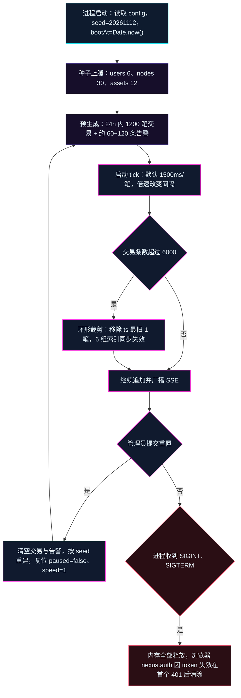
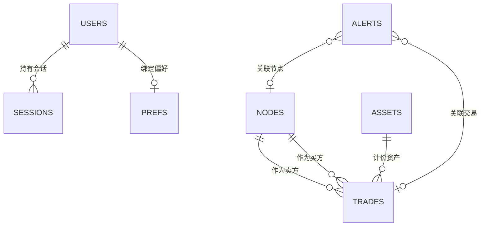
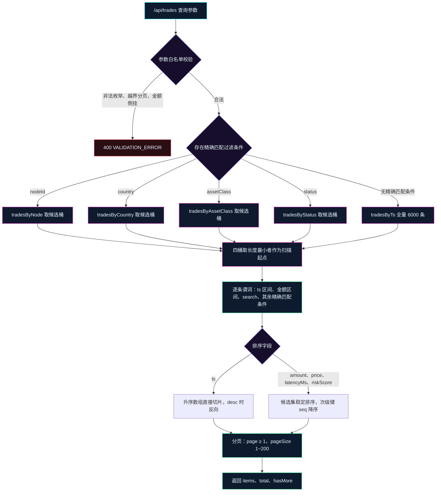

# 数据库设计说明书

| 项目 | 内容 |
| --- | --- |
| 项目代号 | NEXUS（赛博交易中枢） |
| 工程目录 | `/Users/le/Desktop/project/cyber-trade-nexus` |
| 文档版本 | v1.0（评审冻结版） |
| 日期 | 2026-11-12 |
| 输入依据 | `docs/01-需求分析说明书.md` v1.0、`docs/02-概要设计说明书.md` v1.0、`docs/05-接口设计文档.md` v1.0 |
| 文档定位 | 定义 NEXUS 的「无数据库」存储形态、七个逻辑实体、内存索引、浏览器持久化键、种子规格与一致性约束，并给出未来接真实数据库的迁移映射 |
| 冻结状态 | 已冻结（2026-11-12），变更须走第 10.2 节变更流程 |

> 本文档的「数据库」指逻辑数据设计，并非物理数据库的同义词。第 1 节给出「零数据库」的选定结论与理由，第 2~8 节按关系模型的严谨度组织内存实体、字段、约束、索引与种子，第 9 节给出迁移到真实数据库的映射。

## 1. 设计决策与依据

### 1.1 存储形态结论

选定：**零物理数据库**。业务数据全部存于 Node.js 服务进程内存；会话权威记录存服务端内存，浏览器 `localStorage` 只保存会话凭据快照与界面偏好；聚合结果以进程内 LRU 缓存承载。

| 数据类别 | 载体 | 权威方 | 生命周期 | 上限 |
| --- | --- | --- | --- | --- |
| 账号、节点、资产基准 | 服务端种子常量（内存） | 服务端 | 进程生命周期 | 6 个账号、30 个节点、12 个资产 |
| 交易 | 服务端内存数组 + 6 组索引 | 服务端 | 进程生命周期 + 环形裁剪 | 6000 条 |
| 告警 | 服务端内存数组 + 3 组索引 | 服务端 | 进程生命周期 + 环形裁剪 | 400 条 |
| 会话 | 服务端内存 `Map<token, Session>` | 服务端 | `expiresAt` 到期、进程退出 | 18 条（6 用户 × 3 会话） |
| 聚合缓存 | 服务端 LRU `Map` | 服务端 | `version` 失效 | 64 项 |
| 会话凭据快照 | 浏览器 `localStorage: nexus.auth` | 服务端 token 为权威 | 随 `expiresAt` | 1 条 |
| 界面偏好 | 浏览器 `localStorage: nexus.prefs` | 浏览器 | 无 TTL，仅版本不匹配时重置 | 1 条 |
| 行情与盘口 | 服务端派生（每 5s 重算） | 服务端 | 随请求重算 | 12 个资产 × 24 点、12 档 × 2 向 |

服务端进程重启后，上表前五行全部丢弃并按种子重建；浏览器两键保留，其中 `nexus.auth` 因 token 已失效会在首个请求的 `401` 后被清除。

### 1.2 放弃数据库的决策

选定零数据库；逐一放弃五个候选方案，理由与成本如下。

| 候选方案 | 放弃理由 | 引入成本 | 结论 |
| --- | --- | --- | --- |
| PostgreSQL 16 | 需独立进程与连接池，演示机多一个部署前置与故障点；数据可重建，持久化不产生业务收益；引入 schema 迁移与备份恢复流程 | 进程 + 迁移脚本 + 运维手册扩写 | 放弃 |
| SQLite（嵌入式文件库） | 持久化语义与「重启按 seed 重建」直接冲突；需维护 schema 版本与文件清理；并发写入虽少但仍要处理锁 | schema 版本管理 + 文件生命周期 | 放弃 |
| Redis 7 | 会话规模为 6 用户 18 条，独立进程的收益为零；内存本身即是存储，加一层反而增加序列化开销 | 进程 + 键设计 + 过期策略 | 放弃 |
| 浏览器 IndexedDB | 与服务端形成两个权威源，多标签页并发写入会分叉；前端已依赖 REST 与 SSE，再维护一套本地库无收益 | 版本升级 + 事务 + 清理 | 放弃 |
| JSON 文件落盘 | 写盘引入 I/O 抖动与文件损坏风险；与「业务数据仅内存」的架构边界冲突；重置种子还需额外清理文件 | 原子写 + 损坏恢复 | 放弃 |

决策的直接收益：单进程启动即完整可用，无迁移、无备份、无连接池、无 ORM；演示现场断网也不影响数据可用性。代价：数据不可跨进程共享、不可审计追溯、重启即丢失运行期增量，这三点已写入 `01` 第 9.3 节范围外。

### 1.3 容量与可行性核算

内存方案成立的量化依据，按单条记录的估算字节数计算。

| 对象 | 单条估算 | 数量上限 | 合计 |
| --- | --- | --- | --- |
| 交易 `Trade` | 260B | 6000 | 1.56MB |
| 告警 `Alert` | 180B | 400 | 72KB |
| 节点 `Node` | 400B | 30 | 12KB |
| 资产 `Asset` | 200B | 12 | 2.4KB |
| 账号 `User` | 300B | 6 | 1.8KB |
| 会话 `Session` | 220B | 18 | 4KB |
| 聚合缓存条目 | 8KB | 64 | 512KB |
| 索引数组引用 | 8B × 2 | 6000 | 96KB |
| 合计 | — | — | 2.26MB |

写入压力：默认 1500ms/笔，4× 倍速为 375ms/笔，即 2.67 笔/秒；单次 tick 处理 ≤ 8ms，远低于事件循环阻塞阈值。GC 压力主要来自 6000 条数组的裁剪，采用队首移除与惰性索引压缩，避免整表复制。

### 1.4 数据生命周期

从进程启动到退出的完整路径，含环形裁剪与重置两条回环。



「同 seed 可复现」的精确定义：种子决定交易序列的端点、资产、方向、金额、状态、延迟、风险分与告警的类型、级别、文案；绝对 `ts` 以 `bootAt` 为基准向前偏移，因此两次启动的时间戳整体平移，**除 `ts` 外全部字段逐条一致**，`ts` 的相对偏移一致。重置为同 seed 后，指纹与首次启动一致。

### 1.5 与 02、05 的一致性边界

1. `05` 中 JSON 示例的数值（如 48.62B USD、99.93%、1243 笔）为结构示例，契约冻结的是字段、类型、单位、枚举与分页规则；本文档第 7 节定义种子，运行时真值由种子聚合产生。
2. `02` 的交易上限 6000、告警上限 400、缓存 64 项与本文件一致；本文档进一步定义裁剪对聚合口径的影响（第 2.9 节）。
3. 本文档不新增任何 DTO 字段；`source`、`seq`、`amountCents` 为内部字段，不进入接口响应。

## 2. 逻辑实体设计

### 2.1 实体总览

| 实体 | 载体 | 主键 | 数量上限 | 写入方 | 读取方 | 生命周期 |
| --- | --- | --- | --- | --- | --- | --- |
| `users` | 服务端内存 | `id` | 6 | 种子 | 认证、管理接口 | 进程 |
| `nodes` | 服务端内存 | `id` | 30 | 种子 + 聚合派生字段 | 地图、聚合、明细 | 进程 |
| `assets` | 服务端内存 | `asset` | 12 | 种子 + 派生价格 | 行情、深度、明细 | 进程 |
| `trades` | 服务端内存 | `id` | 6000 | 生成器、注入 | 聚合、明细、地图 | 进程 + 环形 |
| `alerts` | 服务端内存 | `id` | 400 | 生成器、注入、处置 | 告警流、管理接口 | 进程 + 环形 |
| `sessions` | 服务端内存 | `token` | 18 | 登录、身份切换、登出 | 鉴权中间件 | 到期、登出 |
| `prefs` | 浏览器 localStorage | `key` | 1 | 设置面板 | 全站 UI | 无 TTL |

> 类型列约定：`string`、`number`、`boolean` 为内存值的 JS 类型；「可空」表示该字段允许 `null`，并在约束列给出空值语义；`enum` 后的名字指向第 4.1 节的枚举定义。

### 2.2 users

#### 2.2.1 字段定义

| 字段 | 类型 | 约束 | 默认值 | 索引方式 | 说明 |
| --- | --- | --- | --- | --- | --- |
| `id` | string | 主键，`u_` 前缀 + 用户名，长度 3~16，唯一 | 由种子生成 | 哈希索引 `usersById` | 账号主键 |
| `username` | string | 2~32 字符，去首尾空格，唯一，大小写敏感 | 种子常量 | 哈希索引 `usersByName` | 登录名 |
| `password` | string | 6~64 字符，明文常量，仅演示比对 | 种子常量 | 不建索引 | 禁止写入日志与响应体 |
| `role` | enum `role` | 取值 `admin`、`viewer` | `viewer` | 无 | 角色 |
| `displayName` | string | 1~24 字符 | 与 username 同名 | 无 | 顶栏徽章展示 |
| `enabled` | boolean | 至少保留 1 个启用的 `admin` | `true` | 无 | 停用后其会话立即失效 |
| `lastLoginAt` | number，可空 | 毫秒时间戳，非负 | `null` | 无 | 登录成功时更新 |

#### 2.2.2 约束与索引

1. `username` 唯一性由 `usersByName` 保证，重复注册不存在（账号只来自种子）。
2. `LAST_ADMIN` 保护：当目标是最后一个启用的 `admin` 时，`enabled=false` 与 `role=viewer` 一律返回 `400 VALIDATION_ERROR`，`details.reason = "LAST_ADMIN"`。
3. `SELF_ROLE` 保护：当前会话用户修改自身 `role` 返回 `400`，`details.reason = "SELF_ROLE"`。
4. 索引规模为 6 条，哈希查找 O(1)，无需 B 树。

### 2.3 nodes

#### 2.3.1 字段定义

| 字段 | 类型 | 约束 | 默认值 | 索引方式 | 说明 |
| --- | --- | --- | --- | --- | --- |
| `id` | string | 主键，`n_` 前缀 + 2~3 位 slug | 种子常量 | 哈希索引 `nodesById` | 节点主键 |
| `name` | string | 2~16 字符中文名 | 种子常量 | 无 | 展示名 |
| `nameEn` | string | 2~24 字符英文名 | 种子常量 | 无 | 搜索匹配字段 |
| `country` | string | 2~12 字符中文国家名 | 种子常量 | 哈希索引 `nodesByCountry` | 地区排行键 |
| `countryCode` | string | ISO 3166-1 alpha-2，2 位大写 | 种子常量 | 无 | 前端旗帜与聚合 |
| `lon` | number | -180~180，2 位小数 | 种子常量 | 无 | 经度 |
| `lat` | number | -90~90，2 位小数 | 种子常量 | 无 | 纬度 |
| `type` | enum `nodeType` | `exchange`、`clearing`、`gateway` | 种子常量 | 无 | 节点类型 |
| `weight` | number | 1、2、3 三档 | 种子常量 | 无 | 生成交易的抽取权重 |
| `status` | enum `nodeStatus` | `normal`、`busy`、`alert` | 派生 | 无 | 由 `health` 映射 |
| `volume24h` | number | ≥ 0，2 位小数，USD | 派生 | 无 | 双边计入的 24h 成交额 |
| `tradeCount24h` | number | ≥ 0 整数 | 派生 | 无 | 进笔数 + 出笔数 |
| `inCount24h` | number | ≥ 0 整数 | 派生 | 无 | 作为 `toNodeId` 的笔数 |
| `outCount24h` | number | ≥ 0 整数 | 派生 | 无 | 作为 `fromNodeId` 的笔数 |
| `health` | number | 0~100 整数 | 派生 | 无 | 健康度 |

#### 2.3.2 派生字段计算

| 字段 | 计算式 | 口径说明 |
| --- | --- | --- |
| `outCount24h` | 窗口内 `fromNodeId = id` 的交易笔数 | 含四种状态 |
| `inCount24h` | 窗口内 `toNodeId = id` 的交易笔数 | 含四种状态 |
| `tradeCount24h` | `inCount24h + outCount24h` | 自环交易已在写入期禁止，不重复计数 |
| `volume24h` | 窗口内以该节点为任一端点的 `filled` 交易金额之和 | 单笔计两次，两端各一次 |
| `health` | `clamp(round(98 - 0.12 × avgLatencyMs - 8 × failureRate - 6 × alertRate), 0, 100)` | `avgLatencyMs` 为该节点相关交易的算术平均延迟；`failureRate = failed 笔数 ÷ 相关笔数`；`alertRate = 相关告警数 ÷ 相关笔数`，后两者均为 0~1 比值 |
| `status` | `health ≥ 85` 取 `normal`；`60 ≤ health ≤ 84` 取 `busy`；`health < 60` 取 `alert` | 与 `01` FR-22 阈值一致 |

### 2.4 assets

#### 2.4.1 字段定义

| 字段 | 类型 | 约束 | 默认值 | 索引方式 | 说明 |
| --- | --- | --- | --- | --- | --- |
| `asset` | string | 主键，`BASE/QUOTE` 形式，2~6 位大写字母 + `/` + 3~6 位大写字母 | 种子常量 | 哈希索引 `assetsByKey` | 资产代码 |
| `assetClass` | enum `assetClass` | 五类枚举 | 种子常量 | 哈希索引 `assetsByClass` | 资产类别 |
| `label` | string | 2~8 字符中文名 | 种子常量 | 无 | 图例展示 |
| `quoteCurrency` | string | ISO 4217 三位大写 | 种子常量 | 无 | 计价货币 |
| `basePrice` | number | > 0，精度由 `pricePrecision` 决定 | 种子常量 | 无 | 基准价 |
| `tickSize` | number | > 0，最小报价单位 | 种子常量 | 无 | 价格对齐步长 |
| `pricePrecision` | number | 1~4 整数 | 种子常量 | 无 | 小数位 |
| `depthLevels` | number | 固定 12 | 12 | 无 | 盘口档位数 |
| `sparklinePoints` | number | 固定 24 | 24 | 无 | 行情带点数 |

#### 2.4.2 价格与盘口派生

1. 盘口步长 `step = max(tickSize, round(basePrice × 0.00015, pricePrecision))`，买一 = `price - step`，卖一 = `price + step`，逐档线性递增。
2. `spread = round((ask1 - bid1) / mid, 4)`，`mid = (ask1 + bid1) / 2`；BTC/USD 的 `spread` 为 `0.0003`。
3. 档位量 `size_i = round(1.8 × (1 - 0.06 × i) + 0.4 × rng(), 2)`，`i` 从 0 到 11，保证随档位递减且恒正。
4. `changePct = round((sparkline[23] - sparkline[0]) / sparkline[0] × 100, 2)`，与 24 点行情序列自洽。

### 2.5 trades

#### 2.5.1 字段定义

| 字段 | 类型 | 约束 | 默认值 | 索引方式 | 说明 |
| --- | --- | --- | --- | --- | --- |
| `id` | string | 主键，`t_{YYYYMMDD}_{HHMMSS}_{seq}`，全局唯一 | 生成时构造 | 哈希索引 `tradesById` | 交易 ID，前端可复制 |
| `seq` | number | 单调递增整数，从 1 开始，唯一 | 自增 | 裁剪游标 | 稳定排序的次级键 |
| `ts` | number | ≥ 0 毫秒时间戳，不得晚于服务端 `now` | 生成时写入 | 升序数组 + 二分 | 时间过滤与默认排序 |
| `fromNodeId` | string | 外键 → `nodes.id`，≠ `toNodeId` | 必填 | 哈希索引 `tradesByNode` | 卖方节点 |
| `toNodeId` | string | 外键 → `nodes.id` | 必填 | 同上 | 买方节点 |
| `asset` | string | 外键 → `assets.asset` | 必填 | 无独立索引 | 计价资产 |
| `assetClass` | enum `assetClass` | 与 `assets` 记录一致 | 必填 | 哈希索引 `tradesByAssetClass` | 类别过滤 |
| `side` | enum `side` | `buy`、`sell` | 必填 | 无 | 方向 |
| `amountCents` | number | 整数，> 0，单位分 | 生成时写入 | 无 | 内部字段，精确累加用 |
| `amount` | number | = `amountCents / 100`，≥ 0.01，USD | 派生 | 无 | 对外字段，2 位小数 |
| `price` | number | > 0，按该资产 `tickSize` 对齐 | 生成时写入 | 无 | 成交价 |
| `status` | enum `tradeStatus` | 四态枚举 | `filled` | 哈希索引 `tradesByStatus` | 状态色标来源 |
| `latencyMs` | number | 0~10000 整数 | 生成时写入 | 无 | 延迟 |
| `riskScore` | number | 0~100 整数 | 生成时写入 | 无 | 风险分 |
| `source` | enum `source` | `seed`、`stream`、`inject` | `seed` | 无 | 内部字段，不对外 |

#### 2.5.2 约束与索引

1. 六组索引：`tradesById`、`tradesByTs`、`tradesByAssetClass`、`tradesByStatus`、`tradesByNode`、`tradesByCountry`；`byCountry` 由 `nodesByCountry` 映射得到，不重复存储国家字段。
2. 写入顺序：先分配 `seq`，再写 `tradesByTs` 尾部，再写各哈希桶，最后自增 `version` 并广播。
3. 裁剪顺序：从 `tradesByTs` 队首移除 1 条，按 `id` 从 `tradesById` 删除，各桶数组采用惰性标记，每 500 次写入压缩一次。
4. 排序字段只允许 `ts`、`amount`、`price`、`latencyMs`、`riskScore` 五个，其余返回 `400 VALIDATION_ERROR`。

### 2.6 alerts

#### 2.6.1 字段定义

| 字段 | 类型 | 约束 | 默认值 | 索引方式 | 说明 |
| --- | --- | --- | --- | --- | --- |
| `id` | string | 主键，`al_{ts}_{seq}`，唯一 | 生成时构造 | 哈希索引 `alertsById` | 告警 ID |
| `seq` | number | 单调递增整数 | 自增 | 裁剪游标 | 稳定排序次级键 |
| `ts` | number | ≥ 0 毫秒时间戳 | 生成时写入 | 升序数组 + 二分 | 倒序列表排序键 |
| `level` | enum `alertLevel` | `info`、`warn`、`critical` | 由类型映射 | 哈希索引 `alertsByLevel` | 级别色标 |
| `type` | enum `alertType` | 四类枚举 | 必填 | 无 | 告警类型 |
| `tradeId` | string，可空 | 外键 → `trades.id`，可为空 | `null` | 无 | 关联交易 |
| `nodeId` | string，可空 | 外键 → `nodes.id`，可为空 | `null` | 无 | 关联节点 |
| `message` | string | ≤ 80 字符，模板生成，不含 HTML | 必填 | 无 | 展示文案 |
| `handled` | boolean | `false` 为未处置 | `false` | 计数派生 | 处置状态 |
| `handledAt` | number，可空 | 非空时 ≥ `ts` 且 ≤ 服务端 `now` | `null` | 无 | 处置时间 |
| `source` | enum `source` | `seed`、`stream`、`inject` | `seed` | 无 | 内部字段 |

#### 2.6.2 处置字段语义

1. `PATCH /api/admin/alerts/:id` 传 `handled=true` 且 `handledAt` 为 `null` 时，写入服务端当前时刻；`handledAt` 已有值时不覆盖，保证重复请求结果一致。
2. 传 `handled=false` 时，`handledAt` 置为 `null`。
3. `handledAt` 必须满足 `alert.ts ≤ handledAt ≤ serverNow`，违反时写入失败并返回 `400 VALIDATION_ERROR`。
4. 未处置计数 `unhandledAlerts` 在处置、撤销处置、裁剪三种变更上同步维护，偏差为 0。

### 2.7 sessions

#### 2.7.1 字段定义

| 字段 | 类型 | 约束 | 默认值 | 索引方式 | 说明 |
| --- | --- | --- | --- | --- | --- |
| `token` | string | 主键，`nx_` + 32 位十六进制 | 服务端随机生成 | 哈希索引 `sessionsByToken` | Bearer token |
| `userId` | string | 外键 → `users.id` | 必填 | 哈希索引 `sessionsByUser` | 会话归属 |
| `role` | enum `role` | 签发时用户角色快照 | 必填 | 无 | 避免每次请求回查 |
| `issuedAt` | number | 毫秒时间戳 | 登录时刻 | 无 | 签发时间 |
| `expiresAt` | number | `issuedAt + 8h`（未记住）、`issuedAt + 7d`（记住） | 按 `remember` 计算 | 无 | 过期判定 |
| `remember` | boolean | 与登录请求一致 | `false` | 无 | 会话时长档位 |
| `lastSeenAt` | number | 毫秒时间戳，节流 60s 更新 | `issuedAt` | 无 | 活跃度统计 |
| `revoked` | boolean | 登出、停用、重置会话时置真 | `false` | 无 | 失效标记 |

#### 2.7.2 过期与失效规则

1. 有效期：`remember=false` 为 8 小时，`remember=true` 为 7 天，误差 ≤ 5s。
2. 单用户最多 3 个活跃会话，第 4 次登录淘汰 `issuedAt` 最旧的一条。
3. 用户被停用、角色被修改、被管理员重置会话时，其全部会话立即 `revoked=true`。
4. 过期、撤销的 token 在鉴权中间件返回 `401 TOKEN_EXPIRED` 与 `401 UNAUTHORIZED`，并延迟 5 分钟清理记录，避免同一 token 反复报不同错误码。

### 2.8 prefs

#### 2.8.1 字段定义

| 字段 | 类型 | 约束 | 默认值 | 索引方式 | 说明 |
| --- | --- | --- | --- | --- | --- |
| `key` | string | 固定字面量 `nexus.prefs` | `nexus.prefs` | localStorage 键名即索引 | 存储键 |
| `v` | number | 固定 1 | 1 | 无 | 结构版本号 |
| `userId` | string，可空 | 最近一次登录用户 `id` | `null` | 无 | 偏好归属，用于多身份演示 |
| `theme` | enum `theme` | `cyan`、`amber`、`ice` | `cyan` | 无 | 配色主题 |
| `motion` | enum `motion` | `full`、`reduced` | `full` | 无 | 动效强度 |
| `refreshMs` | number | 1000、2000、5000 三档 | `2000` | 无 | 前端刷新节奏 |
| `watermark` | boolean | DEMO 水印开关 | `true` | 无 | 登录页声明不受此开关影响 |
| `updatedAt` | number | 毫秒时间戳 | 写入时 | 无 | 最近更新时间 |

#### 2.8.2 与 localStorage 的映射

`prefs` 是唯一一份以浏览器存储为权威的实体；`sessions` 的凭据快照键 `nexus.auth` 不属于本实体，见第 5 节。`prefs` 写入失败（配额不足、隐私模式）时降级为内存态，UI 提示「偏好仅本次会话生效」，不阻断操作。

### 2.9 聚合缓存与环形上限

#### 2.9.1 交易上限 6000 的字段影响

1. `seq` 成为裁剪游标：每次写入后若 `length > 6000`，按 `seq` 最小者移除 1 条，O(1)。
2. 聚合口径不被裁剪破坏：启动时把 24h 种子聚合为三层基线桶（15 分钟 96 桶、5 分钟 72 桶、1 分钟 60 桶），桶值一经写入不再变化；实时交易只累加增量桶。KPI 与时序按请求窗口从基线桶、增量桶中选取桶后求和，与原始数组长度无关。
3. 明细可回溯范围受限：`/api/trades` 的 `total` 为环形内计数，最多 6000；超过后与大屏 KPI 笔数产生差值，前端表格标题固定展示「可回溯最近 6000 笔」。
4. 无软删除字段：被裁剪记录不保留墓碑；引用它的告警 `tradeId` 允许悬空，详情接口返回 `404 NOT_FOUND`。

#### 2.9.2 告警上限 400 的字段影响

1. 裁剪按 `ts` 最旧优先，FIFO，不按级别保留；`critical` 在长跑后同样会被淘汰，文档明示不做审计追溯。
2. `handled` 与 `handledAt` 随记录淘汰一并消失，被淘汰告警的处置结果不可恢复。
3. `unhandledAlerts` 计数在裁剪时若被裁剪记录为未处置，则减 1；与 `/api/alerts?handled=false` 实时条数一致。
4. 衍生影响：`node_offline` 类告警引用 16 个节点，节点状态不因告警淘汰而回退，节点状态由 `health` 实时映射。

#### 2.9.3 聚合缓存结构与失效

| 项 | 规则 |
| --- | --- |
| 容量 | LRU 最多 64 项，超出淘汰最久未使用项 |
| 键 | 四段拼接：`endpoint`、`window`、`filterHash`、`version`，段间用双冒号 `::` 分隔，示例 `kpis::24h::8f2a1c::1243` |
| `filterHash` | 过滤参数按键名排序序列化后取 FNV-1a 32 位十六进制 |
| 值 | `{ payload, bytes, hitCount, createdAt }`，单条 ≤ 8KB |
| 失效 | 交易追加、告警处置、清空、重置使 `version` 自增，旧键不再命中 |
| 清理 | 只保留最近 2 个 `version` 的条目，写入时主动删除更旧键，避免 LRU 被死键占满 |
| 不缓存项 | `/api/trades` 分页结果（组合过多）、`/api/meta`（含实时 `clients`）、SSE 事件 |

## 3. 实体关系

### 3.1 ER 图

只画实体与关系，字段由第 2 节表格承载。

> 版本约束说明：mermaid ≤ 8.8.3 的 `erDiagram` 不支持 `classDef`，写入着色行会直接解析失败；本图按规范用例外的显式例外处理，着色语义由第 3.2 节的关系表与图例承载，其余图示全部使用带 `classDef` 的 `flowchart`。



配色语义（按实体分组，用于阅读而非渲染着色）：

| 分组 | 实体 | 语义色 | 说明 |
| --- | --- | --- | --- |
| 身份域 | `USERS`、`SESSIONS`、`PREFS` | 青 `#00F0FF` | 鉴权与个性化 |
| 市场域 | `NODES`、`ASSETS` | 紫 `#7B5CFF` | 静态基准数据 |
| 事件域 | `TRADES`、`ALERTS` | 品红 `#FF2BD6` | 运行时高频数据，受环形上限约束 |

### 3.2 关系与基数

| 编号 | 关系 | 左端基数 | 右端基数 | 方向读法 | 可空 | 内存实现 |
| --- | --- | --- | --- | --- | --- | --- |
| R-01 | `USERS → SESSIONS` | 1 | 0..N（应用层限制 3） | 一个用户持有 0~3 个活跃会话 | 否 | `sessionsByUser` 数组 |
| R-02 | `USERS → PREFS` | 1 | 0..1 | 一个用户在一个浏览器上至多 1 份偏好 | 是 | `nexus.prefs.userId` |
| R-03 | `NODES → TRADES`（卖方） | 1 | 0..N | 一个节点可作为多笔交易的卖方 | 否 | `tradesByNode` + `fromNodeId` 谓词 |
| R-04 | `NODES → TRADES`（买方） | 1 | 0..N | 一个节点可作为多笔交易的买方 | 否 | `tradesByNode` + `toNodeId` 谓词 |
| R-05 | `ASSETS → TRADES` | 1 | 0..N | 一个资产计价多笔交易 | 否 | `asset` 精确匹配过滤 |
| R-06 | `ALERTS → TRADES` | 0..N | 0..1 | 多条告警可指向同一交易，告警可不带交易 | 是 | `tradeId` 可空，悬空允许 |
| R-07 | `ALERTS → NODES` | 0..N | 0..1 | 多条告警可指向同一节点，告警可不带节点 | 是 | `nodeId` 可空 |

### 3.3 参照完整性规则

| 编号 | 规则 | 违反时的处置 |
| --- | --- | --- |
| I-01 | `fromNodeId ≠ toNodeId` | 生成器重抽端点，重抽上限 5 次，仍失败则跳过该笔 |
| I-02 | `fromNodeId` 与 `toNodeId` 必须存在于 `nodesById` | 注入接口返回 `400 VALIDATION_ERROR` |
| I-03 | `asset` 必须存在于 `assetsByKey`，且 `assetClass` 与该资产一致 | 同 I-02 |
| I-04 | 告警的 `tradeId` 在创建时必须存在 | 创建失败并丢弃该告警，计数不增加 |
| I-05 | 告警的 `tradeId` 与 `nodeId` 至少一个非空 | 同 I-02 |
| I-06 | 交易被裁剪后允许 `tradeId` 悬空 | 详情接口返回 `404 NOT_FOUND`，列表仍展示原始 ID |
| I-07 | `sessions.userId` 必须存在且 `enabled` 为真 | 登录返回 `403 USER_DISABLED` |
| I-08 | `handled` 与 `handledAt` 同步 | 违反时拒绝写入，返回 `400 VALIDATION_ERROR` |
| I-09 | `amountCents > 0`、`price > 0`、`latencyMs` 0~10000、`riskScore` 0~100 | 同 I-02 |
| I-10 | `ts` 不得晚于服务端 `now + 1000ms` | 生成器钳制到 `now`，不报错 |

### 3.4 关系在内存中的实现

身份域与事件域通过 `id` 字符串关联，不存在对象引用环：`trades` 只存 `fromNodeId`、`toNodeId`、`asset` 三个字符串，展示名在序列化时由 `nodesById`、`assetsByKey` 补全。该设计避免裁剪时出现悬挂对象引用，也使 DTO 映射与未来数据库外键一致。

## 4. 数据字典

### 4.1 枚举全集

| 枚举名 | 取值 | 默认值 | 使用位置 |
| --- | --- | --- | --- |
| `role` | `admin`、`viewer` | `viewer` | `users.role`、`sessions.role`、路由守卫 |
| `assetClass` | `fx`、`equity`、`crypto`、`bond`、`commodity` | 无 | `assets`、`trades`、`arcs`、聚合 |
| `side` | `buy`、`sell` | 无 | `trades.side` |
| `tradeStatus` | `filled`、`pending`、`failed`、`flagged` | `filled` | `trades.status`、`arcs.status` |
| `nodeStatus` | `normal`、`busy`、`alert` | `normal` | `nodes.status`、地图节点色 |
| `nodeType` | `exchange`、`clearing`、`gateway` | 无 | `nodes.type` |
| `alertLevel` | `info`、`warn`、`critical` | `info` | `alerts.level` |
| `alertType` | `large_trade`、`latency_spike`、`risk_hit`、`node_offline` | 无 | `alerts.type`、注入 |
| `window` | `1h`、`6h`、`24h` | `24h` | KPI、时序、占比、排行、弧线 |
| `speed` | `0.5`、`1`、`2`、`4` | `1` | `PATCH /api/admin/stream`、SSE |
| `injectType` | `large_trade`、`latency_spike`、`risk_hit` | 无 | `POST /api/admin/inject` |
| `sortBy` | `ts`、`amount`、`price`、`latencyMs`、`riskScore` | `ts` | `/api/trades` |
| `sortDir` | `asc`、`desc` | `desc` | `/api/trades` |
| `theme` | `cyan`、`amber`、`ice` | `cyan` | `nexus.prefs.theme` |
| `motion` | `full`、`reduced` | `full` | `nexus.prefs.motion` |
| `source` | `seed`、`stream`、`inject` | `seed` | `trades.source`、`alerts.source`，内部字段 |
| `kpiKey` | `volume`、`trades`、`successRate`、`activeNodes`、`avgLatency`、`riskIndex` | 无 | `/api/kpis` |
| `kpiUnit` | `USD`、`count`、`pct`、`ms`、`index` | 无 | `KpiDTO.unit` |
| `trend` | `up`、`down`、`flat` | `flat` | `KpiDTO.trend` |
| `healthKey` | `gateway`、`matching`、`clearing`、`risk`、`datalink` | 无 | `/api/aggregations/health` |
| `streamEvent` | `hello`、`trade`、`alert`、`kpi`、`market`、`status`、`heartbeat` | 无 | `GET /api/stream` |
| `errorCode` | `VALIDATION_ERROR`、`INVALID_CREDENTIALS`、`UNAUTHORIZED`、`TOKEN_EXPIRED`、`FORBIDDEN`、`USER_DISABLED`、`NOT_FOUND`、`METHOD_NOT_ALLOWED`、`INTERNAL_ERROR` | 无 | 错误响应体 |

### 4.2 数值精度、单位与舍入

| 字段 | 单位 | 精度 | 取值范围 | 舍入规则 |
| --- | --- | --- | --- | --- |
| `amountCents` | 分 | 整数 | 1 ~ 2,000,000,000 | 不适用，生成为整数 |
| `amount` | USD | 2 位小数 | ≥ 0.01 | 由 `amountCents / 100` 直接得到，禁止二次舍入 |
| `price` | 计价货币 | 按资产精度 1~4 位 | > 0 | 对齐到 `tickSize` 的整数倍 |
| `latencyMs` | 毫秒 | 整数 | 0 ~ 10000 | 四舍五入 |
| `riskScore` | 指数 | 整数 | 0 ~ 100 | 四舍五入 |
| `health` | 指数 | 整数 | 0 ~ 100 | 公式结果四舍五入后钳制 |
| `pct` | 百分比 | 1 位小数 | 0.0 ~ 100.0 | 末项吸收，保证合计 100.0 |
| `successRate` | 百分比 | 2 位小数 | 0.00 ~ 100.00 | 四舍五入 |
| `deltaPct` | 百分比 | 1 位小数 | -100.0 ~ 100.0 | 四舍五入 |
| `volume24h` | USD | 2 位小数 | ≥ 0.00 | 分累加后换算 |
| `spread` | 比值 | 4 位小数 | 0.0000 ~ 1.0000 | 四舍五入 |
| `depth size` | 数量 | 2 位小数 | > 0.00 | 四舍五入 |
| `lon` | 度 | 2 位小数 | -180.00 ~ 180.00 | 四舍五入 |
| `lat` | 度 | 2 位小数 | -90.00 ~ 90.00 | 四舍五入 |
| `ts`、`expiresAt`、`handledAt` | 毫秒 | 整数 | 13 位非负 | 取服务端 `Date.now()`，不额外舍入 |
| `intervalMs` | 毫秒 | 整数 | 375 / 750 / 1500 / 3000 | 由 `1500 / speed` 计算 |
| `refreshMs` | 毫秒 | 枚举 | 1000 / 2000 / 5000 | 不适用 |
| `sparkline point` | 计价货币 | 与资产精度一致 | > 0 | 24 个点逐点对齐 |
| `tradeCount`、`inCount`、`outCount` | 笔 | 整数 | ≥ 0 | 不适用 |

### 4.3 字符串与标识格式

| 对象 | 格式 | 示例 | 校验规则 |
| --- | --- | --- | --- |
| 用户 ID | `u_` + 用户名 | `u_admin`、`u_demo_01` | 长度 3~16，`^u_[a-z0-9_]{2,14}$` |
| 节点 ID | `n_` + slug | `n_sh`、`n_ny` | 长度 3~6，`^n_[a-z]{2,4}$` |
| 资产代码 | `BASE/QUOTE` | `BTC/USD`、`XAU/USD` | 两段大写，1 个 `/` |
| 交易 ID | `t_{YYYYMMDD}_{HHMMSS}_{seq}` | `t_20261112_120001_1` | 日期与 `ts` 同日，`seq` 全局唯一 |
| 告警 ID | `al_{ts}_{seq}` | `al_1763000000000_37` | `ts` 为毫秒整数 |
| 弧线束 ID | `a_{from}_{to}_{assetClass}` | `a_n_sh_n_ny_fx` | 三段拼接，`assetClass` 小写 |
| token | `nx_` + 32 位十六进制 | `nx_9f3a7c1d2b5e8f0a6c4d9e2b1f7a3c58` | `^nx_[0-9a-f]{32}$` |
| `requestId` | `req_` + 6 位十六进制 | `req_8f2a1c` | `^req_[0-9a-f]{6}$` |
| 告警文案 | 模板生成，≤ 80 字符 | `延迟尖刺：1250ms 超出阈值 900ms` | 不含 HTML 标签，不含换行 |

### 4.4 时间字段口径

1. 全站时间为服务端时钟的毫秒级 Unix 时间戳；前端只做展示，不做业务时间运算。
2. 窗口统一左闭右开 `[from, to)`；`window=1h` 为 `[now - 3,600,000, now)`，`6h` 为 `[now - 21,600,000, now)`，`24h` 为 `[now - 86,400,000, now)`。
3. 时序桶起点 `bucketStart = floor((ts - from) / bucketMs) × bucketMs + from`，最后一个桶允许未满。
4. 展示格式 `HH:mm:ss`，使用浏览器本地时区；接口传输一律毫秒数字，禁止传格式化字符串。

## 5. localStorage 键设计

### 5.1 键清单

| 键 | 版本 | 体积上限 | 写入方 | 读取方 | 清理时机 |
| --- | --- | --- | --- | --- | --- |
| `nexus.auth` | 1 | 2KB | `authStore` 登录、身份切换 | `authStore` 启动恢复、`api/client.ts` | 登出、过期、`v` 不匹配、服务端 401 |
| `nexus.prefs` | 1 | 1KB | `configStore` 设置变更 | `configStore` 启动恢复 | `v` 不匹配、JSON 解析失败；写入失败时降级为内存态，不删除键 |

两个键均只存 JSON 字符串，键名固定小写，不使用前缀命名空间变量，避免多环境串键。

### 5.2 nexus.auth 结构

```json
{
  "v": 1,
  "token": "nx_9f3a7c1d2b5e8f0a6c4d9e2b1f7a3c58",
  "expiresAt": 1763604800000,
  "remember": true,
  "user": {
    "id": "u_admin",
    "username": "admin",
    "displayName": "系统管理员",
    "role": "admin"
  },
  "savedAt": 1763000000000
}
```

| 字段 | 类型 | 必填 | 校验 | 说明 |
| --- | --- | --- | --- | --- |
| `v` | number | 是 | 必须为 1 | 结构版本 |
| `token` | string | 是 | `^nx_[0-9a-f]{32}$` | Bearer token |
| `expiresAt` | number | 是 | 非负，且 > `savedAt` | 服务端返回的过期时刻 |
| `remember` | boolean | 是 | 布尔 | 决定 8h 与 7d |
| `user` | object | 是 | 四字段齐全 | 不含 `password`、`lastLoginAt` |
| `user.id` | string | 是 | `^u_` 前缀 | 用户主键 |
| `user.username` | string | 是 | 2~32 字符 | 登录名 |
| `user.displayName` | string | 是 | 1~24 字符 | 徽章文案 |
| `user.role` | enum `role` | 是 | 两值之一 | 本地按钮显隐依据 |
| `savedAt` | number | 是 | 非负 | 写入时刻，用于排序与诊断 |

规则：`nexus.auth` 只用于刷新恢复与本地按钮显隐，**权限判定以服务端中间件为准**；客户端 `role` 被篡改时，服务端仍会返回 `403`。

### 5.3 nexus.prefs 结构

```json
{
  "v": 1,
  "userId": "u_admin",
  "theme": "cyan",
  "motion": "full",
  "refreshMs": 2000,
  "watermark": true,
  "updatedAt": 1763000000000
}
```

| 字段 | 类型 | 必填 | 默认 | 校验 |
| --- | --- | --- | --- | --- |
| `v` | number | 是 | 1 | 必须为 1 |
| `userId` | string，可空 | 否 | `null` | 存在时 `^u_` 前缀 |
| `theme` | enum `theme` | 是 | `cyan` | 三值之一 |
| `motion` | enum `motion` | 是 | `full` | 两值之一 |
| `refreshMs` | number | 是 | `2000` | 1000、2000、5000 之一 |
| `watermark` | boolean | 是 | `true` | 布尔 |
| `updatedAt` | number | 是 | 写入时 | 非负 |

### 5.4 版本号与迁移

| 场景 | 处理 | 校验断言 |
| --- | --- | --- |
| `v=1` 正常 | 按白名单逐字段类型校验，通过则整份采用 | 采用后 `theme`、`motion`、`refreshMs` 三值合法 |
| 字段缺失 | 用默认值补齐，不写入文件中不存在的字段 | 补齐后结构完整 |
| 字段类型错误 | 丢弃该字段并回退默认，其余字段保留 | 修复后重新写入 |
| `v` 缺失、不为 1 | 整键丢弃并重建为 v1 默认值，不迁移历史值 | 重建后 `v=1` |
| JSON 解析失败 | 整键丢弃并重建 | 同上 |
| 未来 `v=2` | 两键各自提供 `migrateV1toV2` 纯函数，各带 ≥ 3 条单测；`nexus.auth` 迁移中 `token`、`expiresAt` 保持不变，`nexus.prefs` 迁移中 `theme`、`motion` 语义不变 | 迁移后登录态与主题不丢失 |

迁移原则：**只做加法与默认值补齐，不改写已有语义**；版本升级必须先在 `01`、本文档登记，再随版本发布。

### 5.5 过期与清理

1. `nexus.auth` 由前端每 60s 检查一次 `Date.now() > expiresAt`，命中即清除并跳 `/login?from=<path>`。
2. 服务端 `401 TOKEN_EXPIRED` 与 `401 UNAUTHORIZED` 均触发客户端清除，作为兜底。
3. 登出清除 `nexus.auth`，保留 `nexus.prefs`，保证下次登录主题不跳变。
4. `nexus.prefs` 无 TTL，仅在版本不匹配、解析失败、写入失败三种情况重置、降级。

### 5.6 容量、失败与多标签页

1. 写入前序列化并检查体积：`nexus.auth` ≤ 2KB、`nexus.prefs` ≤ 1KB，超限则裁剪 `user.displayName` 至 24 字符并重试 1 次。
2. `setItem` 抛出配额不足、隐私模式异常时，降级为内存态并 toast 提示，登录与浏览不受影响。
3. 监听 `storage` 事件：`nexus.prefs` 变更时同步主题与动效，避免双窗口不一致；`nexus.auth` 变更时重新校验 `expiresAt`，失效即跳登录。

## 6. 内存索引与查询设计

### 6.1 索引结构

| 索引名 | 结构 | 键 | 值 | 维护时机 | 用途 |
| --- | --- | --- | --- | --- | --- |
| `tradesById` | `Map` | `trade.id` | `Trade` | 写入、裁剪 | 详情查询 O(1) |
| `tradesByTs` | 数组（按 `ts` 升序） | 下标 | `Trade` | 尾部追加、队首裁剪 | 时间范围二分、默认排序 |
| `tradesByAssetClass` | `Map` | `assetClass` | `Trade[]` | 写入、裁剪惰性标记 | 类别过滤 |
| `tradesByStatus` | `Map` | `status` | `Trade[]` | 写入、状态变更 | 状态过滤 |
| `tradesByNode` | `Map` | `nodeId` | `Trade[]` | 写入、裁剪 | 端点过滤，30 个桶 |
| `tradesByCountry` | `Map` | `country` | `Trade[]` | 写入、裁剪 | 国家过滤，由节点映射 |
| `alertsById` | `Map` | `alert.id` | `Alert` | 写入、裁剪 | 处置接口定位 |
| `alertsByTs` | 数组（按 `ts` 升序） | 下标 | `Alert` | 尾部追加、队首裁剪 | 倒序列表、时间过滤 |
| `alertsByLevel` | `Map` | `level` | `Alert[]` | 写入、裁剪 | 级别过滤 |
| `usersById`、`usersByName` | `Map` | `id`、`username` | `User` | 种子加载 | 登录、鉴权 |
| `nodesById`、`nodesByCountry` | `Map` | `id`、`country` | `Node`、`Node[]` | 种子加载 | 聚合、地图 |
| `sessionsByToken`、`sessionsByUser` | `Map` | `token`、`userId` | `Session`、`Session[]` | 登录、登出、撤销 | 鉴权、单用户会话上限 |
| `assetsByKey`、`assetsByClass` | `Map` | `asset`、`assetClass` | `Asset`、`Asset[]` | 种子加载 | 行情、深度 |
| `unhandledAlerts` | 计数器 | — | number | 处置、裁剪 | 未处置角标，O(1) |

索引的引用一致性：`tradesByNode`、`tradesByCountry`、`tradesByAssetClass`、`tradesByStatus` 四个桶存的是同一对象引用，状态变更时无需多写；裁剪时四个桶做惰性标记，`Map` 主索引立即删除。

### 6.2 查询选择流程

服务端 `/api/trades` 的固定执行路径，先选最小候选集，再做谓词与排序。



### 6.3 过滤实现

| 条件 | 参数 | 实现 | 复杂度 | 边界与返回 |
| --- | --- | --- | --- | --- |
| 时间 | `from`、`to` | `tradesByTs` 二分定位区间 | O(log n + k) | `from > to` 返回 `400 VALIDATION_ERROR`；缺省为 24h 窗口 |
| 资产类别 | `assetClass` | 桶取候选 + 谓词 | O(k_min) | 非法枚举 `400`；缺省不过滤 |
| 状态 | `status` | 桶取候选 + 谓词 | O(k_min) | 非法枚举 `400` |
| 方向 | `side` | 谓词 | O(k) | 非法枚举 `400` |
| 节点 | `nodeId` | `tradesByNode` 桶 + 两端谓词 | O(k_node) | 节点不存在返回空 `items` 与 `total=0`，HTTP 200 |
| 国家 | `country` | `tradesByCountry` 桶 + 两端谓词 | O(k_country) | 国家不存在返回空结果，HTTP 200 |
| 金额 | `minAmount`、`maxAmount` | `amountCents` 整数比较 | O(k) | `maxAmount < minAmount`、负值返回 `400` |
| 关键词 | `search` | 四字段小写包含匹配，`trim` 后 ≤ 80 字符 | O(k × 4) | 超过 80 字符返回 `400`；不做正则与通配 |

### 6.4 排序与分页边界

| 场景 | 入参 | 结果 |
| --- | --- | --- |
| 默认查询 | 无排序参数 | `sortBy=ts`、`sortDir=desc`、`page=1`、`pageSize=50` |
| 分页上限 | `pageSize=200` | 合法，返回 200 条 |
| 分页越界 | `pageSize=500` | `400 VALIDATION_ERROR`，`details.field="pageSize"` |
| 页码非法 | `page=0` | `400 VALIDATION_ERROR`，`details.field="page"` |
| 页码超出总页 | `page=999` | 返回 `items=[]`，`total` 与 `hasMore=false` 不变 |
| 排序字段非法 | `sortBy=foo` | `400 VALIDATION_ERROR`，`details.field="sortBy"` |
| 排序方向非法 | `sortDir=up` | `400 VALIDATION_ERROR`，`details.field="sortDir"` |
| 排序稳定性 | 两笔同金额 | 次级键 `seq` 降序，结果确定可复现 |
| 告警条数 | `limit` 1~200，缺省 60 | 越界返回 `400 VALIDATION_ERROR` |
| 弧线条数 | `limit` 1~180，缺省 120 | 超出后截断并置 `truncated=true` |

### 6.5 复杂度与上限

| 操作 | 复杂度 | 最坏规模 | 说明 |
| --- | --- | --- | --- |
| 按 ID 查交易 | O(1) | 6000 | 哈希查找 |
| 时间区间过滤 | O(log n + k) | k ≤ 6000 | 二分 + 顺序扫描 |
| 单条件精确匹配过滤 | O(k_min) | k_min ≤ 6000 | 取最小桶 |
| 多条件组合 | O(k_min) | k_min ≤ 6000 | 先桶后谓词 |
| 非时间字段排序 | O(k log k) | k ≤ 6000 | 稳定排序，6000 × log2(6000) 计 7.8 万次比较 |
| 分页切片 | O(pageSize) | ≤ 200 | 直接下标切片 |
| 交易写入 | O(1) 摊销 | — | 追加 + 桶 push + 版本自增 |
| 交易裁剪 | O(1) + 压缩摊销 | 6000 | 队列出队 + 每 500 次压缩 |
| 告警处置 | O(1) | 400 | 主索引定位 + 计数字段 |
| 聚合重算 | O(k × 5) | k ≤ 6000 | 一次扫描累加五类 |

## 7. 种子数据规格

### 7.1 种子与派生

| 项 | 规则 |
| --- | --- |
| 基础种子 | `DEMO_SEED`，默认 `20261112`，取值范围 1~2147483646 |
| 随机算法 | mulberry32，单状态 32 位，调用 1 次推进 1 步 |
| 域派生 | `seedOf(domain) = seed ^ FNV1a32(domain)`，`domain` 取 `users`、`nodes`、`assets`、`trades`、`alerts`、`markets`、`depth` 七个字面量 |
| 时间基准 | `bootAt = Date.now()`；历史交易 `ts = bootAt - offset`，`offset` 落在 `[0, 86,400,000)` |
| 重置语义 | 携带新 seed 时全量换种子；不携带时沿用当前 seed；两种情况都重建 24h 历史并复位数据流 |
| 指纹定义 | 对 1200 笔交易取 `id`、`fromNodeId`、`toNodeId`、`asset`、`side`、`amountCents`、`status`、`latencyMs`、`riskScore` 九字段，外加 `ts - bootAt` 的相对偏移，共十项做 SHA-256 |

### 7.2 节点 30 个

| 编号 | `id` | 名称 | 英文名 | 国家 | 代码 | 经度 | 纬度 | 类型 | 权重 |
| --- | --- | --- | --- | --- | --- | --- | --- | --- | --- |
| 1 | `n_sh` | 上海 | Shanghai | 中国 | CN | 121.47 | 31.23 | exchange | 3 |
| 2 | `n_hk` | 香港 | Hong Kong | 中国香港 | HK | 114.17 | 22.32 | exchange | 3 |
| 3 | `n_sz` | 深圳 | Shenzhen | 中国 | CN | 114.06 | 22.55 | gateway | 2 |
| 4 | `n_bj` | 北京 | Beijing | 中国 | CN | 116.41 | 39.90 | clearing | 2 |
| 5 | `n_sg` | 新加坡 | Singapore | 新加坡 | SG | 103.85 | 1.29 | exchange | 3 |
| 6 | `n_tk` | 东京 | Tokyo | 日本 | JP | 139.69 | 35.69 | exchange | 3 |
| 7 | `n_os` | 大阪 | Osaka | 日本 | JP | 135.50 | 34.69 | gateway | 1 |
| 8 | `n_ld` | 伦敦 | London | 英国 | GB | -0.13 | 51.51 | exchange | 3 |
| 9 | `n_fr` | 法兰克福 | Frankfurt | 德国 | DE | 8.68 | 50.11 | exchange | 3 |
| 10 | `n_pa` | 巴黎 | Paris | 法国 | FR | 2.35 | 48.86 | clearing | 2 |
| 11 | `n_ny` | 纽约 | New York | 美国 | US | -74.01 | 40.71 | exchange | 3 |
| 12 | `n_ch` | 芝加哥 | Chicago | 美国 | US | -87.63 | 41.88 | exchange | 3 |
| 13 | `n_sf` | 旧金山 | San Francisco | 美国 | US | -122.42 | 37.77 | gateway | 2 |
| 14 | `n_sb` | 圣保罗 | Sao Paulo | 巴西 | BR | -46.63 | -23.55 | exchange | 2 |
| 15 | `n_dx` | 迪拜 | Dubai | 阿联酋 | AE | 55.27 | 25.20 | exchange | 2 |
| 16 | `n_sy` | 悉尼 | Sydney | 澳大利亚 | AU | 151.21 | -33.87 | exchange | 2 |
| 17 | `n_mb` | 墨尔本 | Melbourne | 澳大利亚 | AU | 144.96 | -37.81 | gateway | 1 |
| 18 | `n_sr` | 首尔 | Seoul | 韩国 | KR | 126.98 | 37.57 | exchange | 2 |
| 19 | `n_tp` | 台北 | Taipei | 中国台湾 | TW | 121.56 | 25.03 | exchange | 2 |
| 20 | `n_mm` | 孟买 | Mumbai | 印度 | IN | 72.88 | 19.08 | exchange | 2 |
| 21 | `n_zg` | 苏黎世 | Zurich | 瑞士 | CH | 8.54 | 47.38 | clearing | 2 |
| 22 | `n_am` | 阿姆斯特丹 | Amsterdam | 荷兰 | NL | 4.90 | 52.37 | exchange | 2 |
| 23 | `n_tl` | 多伦多 | Toronto | 加拿大 | CA | -79.38 | 43.65 | exchange | 2 |
| 24 | `n_mx` | 墨西哥城 | Mexico City | 墨西哥 | MX | -99.13 | 19.43 | gateway | 1 |
| 25 | `n_jh` | 约翰内斯堡 | Johannesburg | 南非 | ZA | 28.05 | -26.20 | exchange | 1 |
| 26 | `n_ri` | 利雅得 | Riyadh | 沙特阿拉伯 | SA | 46.72 | 24.71 | clearing | 2 |
| 27 | `n_ist` | 伊斯坦布尔 | Istanbul | 土耳其 | TR | 28.98 | 41.01 | gateway | 1 |
| 28 | `n_cp` | 哥本哈根 | Copenhagen | 丹麦 | DK | 12.57 | 55.68 | gateway | 1 |
| 29 | `n_wz` | 华沙 | Warsaw | 波兰 | PL | 21.01 | 52.23 | clearing | 1 |
| 30 | `n_st` | 斯德哥尔摩 | Stockholm | 瑞典 | SE | 18.07 | 59.33 | gateway | 1 |

分布核对：`exchange` 17 个、`clearing` 5 个、`gateway` 8 个，合计 30 个；权重 3 的节点 8 个、权重 2 的 14 个、权重 1 的 8 个。节点 `status`、`volume24h`、`health` 三类派生字段不写入种子，由第 2.3.2 节公式实时计算。

### 7.3 账号 6 个

| `id` | 用户名 | 密码 | 角色 | 展示名 | 初始 `enabled` | 初始 `lastLoginAt` |
| --- | --- | --- | --- | --- | --- | --- |
| `u_admin` | `admin` | `admin123` | admin | 系统管理员 | true | null |
| `u_viewer` | `viewer` | `viewer123` | viewer | 只读观察员 | true | null |
| `u_demo_01` | `demo01` | `demo123` | viewer | 交易员·华东 | true | null |
| `u_demo_02` | `demo02` | `demo123` | viewer | 清算员·新加坡 | true | null |
| `u_demo_03` | `demo03` | `demo123` | admin | 风控值班 | true | null |
| `u_demo_04` | `demo04` | `demo123` | viewer | 网关运维·伦敦 | true | null |

账号约束：启用状态的 `admin` 共 2 个（`u_admin`、`u_demo_03`），因此可以停用其中一个而不触发 `LAST_ADMIN`；停用 `u_demo_03` 后只剩 1 个启用管理员，再停用 `u_admin` 即返回 `400`。四个演示用户密码统一为 `demo123`，便于现场切换。

### 7.4 资产 12 个

| 资产 | 中文名 | 类别 | 计价 | 基准价 | `tickSize` | 精度 |
| --- | --- | --- | --- | --- | --- | --- |
| `EUR/USD` | 欧元兑美元 | fx | USD | 1.0842 | 0.0001 | 4 |
| `GBP/USD` | 英镑兑美元 | fx | USD | 1.2731 | 0.0001 | 4 |
| `USD/JPY` | 美元兑日元 | fx | JPY | 151.28 | 0.01 | 2 |
| `USD/CNH` | 美元兑离岸人民币 | fx | CNH | 7.2415 | 0.0001 | 4 |
| `AAPL` | 苹果公司 | equity | USD | 231.45 | 0.01 | 2 |
| `NVDA` | 英伟达 | equity | USD | 128.90 | 0.01 | 2 |
| `TSLA` | 特斯拉 | equity | USD | 246.70 | 0.01 | 2 |
| `BTC/USD` | 比特币 | crypto | USD | 68420.5 | 0.1 | 1 |
| `ETH/USD` | 以太坊 | crypto | USD | 3128.4 | 0.1 | 1 |
| `US10Y` | 美国十年期国债 | bond | USD | 98.42 | 0.01 | 2 |
| `XAU/USD` | 现货黄金 | commodity | USD | 2385.60 | 0.01 | 2 |
| `BRENT` | 布伦特原油 | commodity | USD | 82.35 | 0.01 | 2 |

类别分布：fx 4 个、equity 3 个、crypto 2 个、bond 1 个、commodity 2 个，合计 12 个。盘口默认资产为 `BTC/USD`，`/api/aggregations/depth` 的 `asset` 必须命中本表，未命中返回 `400 VALIDATION_ERROR`。

### 7.5 交易 1200 笔

| 维度 | 规则 | 期望值 |
| --- | --- | --- |
| 时间分布 | 24h 均分 96 个 15 分钟桶，桶权重按序号 1→3 线性递增，按权重分配 1200 笔，余数补入最后 1 桶 | 近期密度是早期的 3 倍 |
| 端点 | 前 30 笔的卖方按节点编号顺序各取 1 个，第 31~60 笔的买方按节点编号顺序各取 1 个，保证两侧全覆盖；其余按 `weight` 加权抽取卖方与买方，`fromNodeId ≠ toNodeId`，重抽上限 5 次 | 卖方、买方各覆盖 30 个节点 |
| 类别 | fx 504 笔、equity 264 笔、crypto 192 笔、bond 108 笔、commodity 132 笔 | 合计 1200 笔 |
| 类别内资产 | fx 按 35/25/25/15 分给 EUR、GBP、JPY、CNH；equity 按 40/35/25 分给 AAPL、NVDA、TSLA；crypto 按 70/30 分给 BTC、ETH；bond 全为 US10Y；commodity 按 60/40 分给 XAU、BRENT；比例相乘后按最大余数法取整 | 每类内部合计与该类笔数一致 |
| 方向 | `sell` 660 笔、`buy` 540 笔 | 比例 55 : 45 |
| 普通金额 | 1156 笔，`amountCents = round(exp(N(13.9, 0.85)))`，钳制到 `[5,000,000, 799,990,000]` 分 | 每笔 50,000 ~ 7,999,900 USD |
| 大额金额 | 44 笔，均匀分布于 `[800,000,000, 2,000,000,000]` 分 | 每笔 8,000,000 ~ 20,000,000 USD |
| 成交总额 | 不设固定目标值，由 1200 笔求和得出，KPI `volume` 直接取该和 | 参数推导期望值 2.42B USD，以运行时求和为准 |
| 状态 | `filled` 1158 笔、`pending` 18 笔、`failed` 12 笔、`flagged` 12 笔 | 合计 1200 笔 |
| 延迟 | 1140 笔落在 18~60ms，60 笔落在 900~1600ms | 算术平均 99.6ms，尖刺占 5% |
| 风险分 | 1164 笔落在 5~40，36 笔落在 85~99 | 高风险占 3% |
| 高风险与状态交叉 | 36 笔风险分 ≥ 85 中，12 笔 `flagged`、24 笔 `filled` | 与告警 `risk_hit` 36 条对应 |
| `seq` | 1~1200，按 `ts` 升序分配 | 与 `tradesByTs` 顺序一致 |
| `source` | 1200 笔全为 `seed` | 实时流与注入分别为 `stream`、`inject` |

金额展示：KPI 与图表按 USD 展示，小于 1000 保留 2 位小数，≥ 1,000,000 用 `x.xxM`，≥ 1,000,000,000 用 `x.xxB`；展示舍入不回写存储。

### 7.6 告警 156 条

| 类型 | `info` | `warn` | `critical` | 小计 | 触发规则 |
| --- | --- | --- | --- | --- | --- |
| `large_trade` | 0 | 36 | 8 | 44 | 金额 ≥ 8,000,000 USD |
| `latency_spike` | 16 | 44 | 0 | 60 | `latencyMs ≥ 900` |
| `risk_hit` | 0 | 20 | 16 | 36 | `riskScore ≥ 85` |
| `node_offline` | 16 | 0 | 0 | 16 | 种子指定 16 个节点短时失联 |
| 合计 | 32 | 100 | 24 | 156 | — |

| 维度 | 规则 |
| --- | --- |
| `id` | `al_{ts}_{seq}`，`seq` 从 1 递增，与生成顺序一致 |
| `ts` | 取触发交易的 `ts + 0~2000ms`；`node_offline` 取独立时刻 |
| `tradeId` | 前三类指向触发交易；`node_offline` 为 `null` |
| `nodeId` | `node_offline` 指向失联节点；其余三类指向交易端点 |
| `message` | 四类模板，长度 ≤ 80 字符，含金额、延迟、风险分数字 |
| `handled` | 已处置 118 条、未处置 38 条；未处置由 24 条 `critical` 与 14 条 `warn` 组成 |
| `handledAt` | 已处置记录为 `ts + 60,000~600,000ms`；未处置为 `null` |
| 与交易一致性 | `large_trade` 44 条对应 44 笔大额交易；`latency_spike` 60 条对应 60 笔尖刺；`risk_hit` 36 条对应 36 笔高风险 |

### 7.7 行情与盘口

| 对象 | 生成规则 |
| --- | --- |
| `sparkline` | 每资产 24 点，以 `basePrice` 为终点向前回溯，逐点乘 `exp(N(0, 0.012))` 生成 24 小时路径，末点与当前 `price` 一致 |
| `price` | 取 `sparkline[23]`，按资产精度对齐，保留 `pricePrecision` 位 |
| `changePct` | `(sparkline[23] - sparkline[0]) / sparkline[0] × 100`，保留 2 位小数 |
| 盘口 | 买卖各 12 档，步长与档位量按第 2.4.2 节公式生成，`generatedAt` 为请求时刻 |
| 刷新节奏 | 行情每 5s 重算并广播；健康度每 2s 重算；KPI 每 2s 广播 |

### 7.8 复现断言

| 编号 | 断言 |
| --- | --- |
| SE-01 | 同 seed 两次启动，1200 笔交易的八字段指纹完全一致 |
| SE-02 | 同 seed 两次启动，生成告警的数量、类型、级别、文案、关联 ID 完全一致（目标 60~120 条） |
| SE-03 | 30 个节点、12 个资产、6 个账号的字段值完全一致 |
| SE-04 | 交易金额之和与 `/api/kpis?window=24h` 的 `volume` 值完全一致，差值为 0.00 |
| SE-05 | `filled` 笔数与 `successRate` 反算结果一致，差异 ≤ 0.01 个百分点 |
| SE-06 | 五类资产 `pct` 之和恒为 100.0，偏差 0.0 |
| SE-07 | 全部节点 `volume24h` 之和为 24h 成交额的 2 倍，差值为 0.00 |
| SE-08 | 重置同 seed 后，SE-01 到 SE-07 全部再次成立 |

## 8. 数据一致性约束

### 8.1 金额与成交额

1. 金额以整数分 `amountCents` 存储与累加，求和一律在整数域完成，最后一次性除以 100 输出 USD；禁止逐笔浮点累加。
2. 单笔上限 2,000,000,000 分（20,000,000 USD），下限 5,000,000 分（50,000 USD）；注入交易遵守同一区间。
3. 24h 成交额 = 窗口内 `status = filled` 交易的 `amountCents` 之和 ÷ 100，保留 2 位小数。
4. 节点 `volume24h` 双边计入：单笔 `filled` 交易分别计入卖方与买方各一次，因此全部节点之和为成交额的 2 倍。
5. 盘口 `size` 为数量，不参与成交额；深度快照变化不改变任何 KPI。

### 8.2 成功率口径

1. 成功率 = `filled ÷ (filled + failed + flagged) × 100`，`pending` 视为在途，不计入分母。
2. 保留 2 位小数，按四舍五入；分母为 0 时返回 `0.00`，禁止出现 `NaN` 与空值。
3. 种子状态下 `filled=1158`、`failed=12`、`flagged=12`，成功率 = `1158 ÷ 1182 × 100 = 97.97%`。
4. 成功率为实时计算，不进入缓存以外的任何持久结构；重置与清空后立即重算。

### 8.3 百分比舍入吸收

1. 资产五类 `pct`：先按 `amount / total × 100` 计算，四舍五入到 1 位小数；输出顺序固定为 `fx`、`equity`、`crypto`、`bond`、`commodity`。
2. 末项（`commodity`）取 `100.0 - 前四项之和`；若结果为负，把差额从占比最大项扣除，再把末项置 0.0，保证五项之和恒为 100.0。
3. 地区排行 `pct` 为 TOP N 占全部窗口金额的比例，四舍五入到 1 位小数，不强制合计 100.0；N 缺省 8，取值 1~20。
4. 弧线束不输出 `pct`，金额与条数直接求和，避免二次舍入。
5. 前端展示与接口值的偏差必须为 0：前端只做千分位与单位换算，不重新计算比例。

### 8.4 handledAt 语义

1. `handled` 为布尔状态，`handledAt` 为该状态的首次置真时刻，两者必须同步：`handled=true` 时 `handledAt` 非空，`handled=false` 时 `handledAt` 为 `null`。
2. 首次处置写入服务端 `now`；重复处置保留首次时间，不刷新，保证重复请求结果一致与审计语义。
3. 撤销处置后再次处置，`handledAt` 取第二次处置时刻，不保留历史第一次。
4. `handledAt` 不得早于 `alert.ts`，不得晚于请求时刻；违反返回 `400 VALIDATION_ERROR`。
5. 告警被环形裁剪后，其 `handledAt` 一并消失，不可恢复，`01` 第 9.3 节已声明不做审计留痕。

### 8.5 时间窗口与桶

1. `now` 每次请求由服务端计算，同一请求内所有窗口共用同一 `now`，避免跨秒抖动。
2. 三层桶：`1h` 使用 60 个 60s 桶；`6h` 使用 72 个 300s 桶；`24h` 使用 96 个 900s 桶。
3. 桶累加只使用 `filled` 金额；`total` 与五类分项同步累加，`total` 必须与五类之和一致。
4. KPI `deltaPct` 对比上一同长窗口；上一窗口无数据时取 `0.0`，`trend` 取 `flat`。
5. 回放窗口固定最近 6h，滑块的 `timeCursor` 只影响地图过滤，不改变服务端桶与 KPI。

### 8.6 版本号与缓存失效

| 触发动作 | `version` 是否自增 | 缓存影响 |
| --- | --- | --- |
| 追加交易 | 是 | 全部聚合键失效，按需重算 |
| 追加告警 | 是 | 告警与 KPI 键失效 |
| 处置告警 | 是 | 告警列表与未处置计数失效 |
| 清空数据 | 是 | 全部键失效，保留用户与会话 |
| 重置种子 | 是 | 全部键失效，缓存清空重建 |
| 暂停、恢复数据流 | 否 | 不影响聚合，只广播 `status` |
| 修改倍速 | 否 | 不影响聚合，只影响生成间隔 |
| 登录、登出 | 否 | 只影响 `clients` 与 `meta` |

缓存键包含 `version`，旧键自然不再命中；写入时清理只保留最近 2 个版本，防止 64 项容量被旧键占满。

### 8.7 跨端一致性

1. SSE 推送的 `TradeDTO`、`AlertDTO` 与 REST 返回的字段集完全一致，字段顺序不参与契约，字段名与类型必须一致。
2. 客户端按 `id` 去重：`streamStore` 维护 `Set<tradeId>`，重复事件直接丢弃，去重率 100%。
3. KPI、时序、占比、排行、弧线束只由 REST 聚合接口提供，前端禁止二次聚合，避免三端数字分叉。
4. 同一 `tradeId` 在大屏、地图、明细的 `amount`、`status`、`ts`、`fromNodeId`、`toNodeId` 五字段必须一致，差异为 0。

## 9. 未来真实数据库迁移映射

### 9.1 目标存储选型

选定 PostgreSQL 16 承载交易、告警、账号、节点、资产与偏好；选定 Redis 7 承载会话与热点聚合缓存；选定分钟级物化表承载时序与弧线束。放弃 MySQL（窗口函数与分区能力弱于 16）、放弃 MongoDB（交易与告警需要强一致关联与枚举约束）、放弃纯 Redis 持久化（交易需要范围查询与索引）。

### 9.2 实体到表映射

| 内存实体 | 目标对象 | 主键 | 关键索引 | 迁移方式 |
| --- | --- | --- | --- | --- |
| `users` | 表 `app_user` | `user_id` | `uk_username` | 种子导出 + 密码改 `bcrypt` 哈希（cost 12） |
| `nodes` | 表 `node` | `node_id` | `idx_country` | 种子导出，派生字段改为物化列 |
| `assets` | 表 `asset` | `asset_code` | `idx_class` | 种子导出 |
| `trades` | 表 `trade` | `trade_id` | `idx_ts`、`idx_from_ts`、`idx_to_ts`、`idx_class_ts`、`idx_status` | 批量导入 + 双写校验 |
| `alerts` | 表 `alert` | `alert_id` | `idx_ts`、`idx_handled_ts`、`idx_trade` | 批量导入 + 双写校验 |
| `sessions` | Redis 键 `nexus:sess:{token}` | `token` | 键自索引 + `userId` 集合 | 登录时写，TTL = `expiresAt - now` |
| `prefs` | 表 `user_preference` | `user_id` | `uk_user` | 前端 `nexus.prefs` 首次同步时 upsert |
| 聚合缓存 | Redis 键 `nexus:agg:{endpoint}:{window}:{hash}:{version}` | — | 键自索引 | 保留 64 项 LRU 语义改为 TTL 60s |
| 时序桶 | 表 `trade_bucket` | `(bucket_start, bucket_ms)` | `pk_bucket` | 每分钟物化写入 |
| 弧线束 | 表 `arc_bundle` | `(window_start, from_node, to_node, asset_class)` | `pk_arc` | 每分钟物化写入 |

### 9.3 参考 DDL

基准表先建，事件表与偏好表后建，保证外键可解析。

```sql
CREATE TABLE app_user (
  user_id        text        PRIMARY KEY,
  username       varchar(32) NOT NULL UNIQUE,
  password_hash  text        NOT NULL,
  role           text        NOT NULL CHECK (role IN ('admin','viewer')),
  display_name   varchar(24) NOT NULL,
  enabled        boolean     NOT NULL DEFAULT true,
  last_login_at  bigint
);

CREATE TABLE node (
  node_id      text        PRIMARY KEY,
  name         varchar(16) NOT NULL,
  name_en      varchar(24) NOT NULL,
  country      varchar(12) NOT NULL,
  country_code char(2)     NOT NULL,
  lon          numeric(6,2) NOT NULL CHECK (lon BETWEEN -180 AND 180),
  lat          numeric(5,2) NOT NULL CHECK (lat BETWEEN -90 AND 90),
  node_type    text        NOT NULL CHECK (node_type IN ('exchange','clearing','gateway'))
);
CREATE INDEX idx_node_country ON node (country_code);

CREATE TABLE asset (
  asset_code      text         PRIMARY KEY,
  asset_class     text         NOT NULL CHECK (asset_class IN ('fx','equity','crypto','bond','commodity')),
  label           varchar(8)   NOT NULL,
  quote_currency  char(3)      NOT NULL,
  base_price      numeric(18,6) NOT NULL CHECK (base_price > 0),
  tick_size       numeric(18,6) NOT NULL CHECK (tick_size > 0),
  price_precision smallint     NOT NULL CHECK (price_precision BETWEEN 1 AND 4)
);
CREATE INDEX idx_asset_class ON asset (asset_class);
```

```sql
CREATE TABLE trade (
  trade_id       text        PRIMARY KEY,
  seq            bigint      NOT NULL,
  ts             bigint      NOT NULL,
  from_node_id   text        NOT NULL REFERENCES node (node_id),
  to_node_id     text        NOT NULL REFERENCES node (node_id),
  asset_code     text        NOT NULL REFERENCES asset (asset_code),
  asset_class    text        NOT NULL CHECK (asset_class IN ('fx','equity','crypto','bond','commodity')),
  side           text        NOT NULL CHECK (side IN ('buy','sell')),
  amount_cents   bigint      NOT NULL CHECK (amount_cents > 0),
  price          numeric(18,6) NOT NULL CHECK (price > 0),
  status         text        NOT NULL CHECK (status IN ('filled','pending','failed','flagged')),
  latency_ms     integer     NOT NULL CHECK (latency_ms BETWEEN 0 AND 10000),
  risk_score     integer     NOT NULL CHECK (risk_score BETWEEN 0 AND 100),
  source         text        NOT NULL DEFAULT 'stream' CHECK (source IN ('seed','stream','inject')),
  CONSTRAINT chk_endpoints CHECK (from_node_id <> to_node_id)
);
CREATE INDEX idx_trade_ts        ON trade (ts DESC);
CREATE INDEX idx_trade_from_ts   ON trade (from_node_id, ts DESC);
CREATE INDEX idx_trade_to_ts     ON trade (to_node_id, ts DESC);
CREATE INDEX idx_trade_class_ts  ON trade (asset_class, ts DESC);
CREATE INDEX idx_trade_status    ON trade (status, ts DESC);

CREATE TABLE alert (
  alert_id     text     PRIMARY KEY,
  ts           bigint   NOT NULL,
  level        text     NOT NULL CHECK (level IN ('info','warn','critical')),
  type         text     NOT NULL CHECK (type IN ('large_trade','latency_spike','risk_hit','node_offline')),
  trade_id     text     REFERENCES trade (trade_id),
  node_id      text     REFERENCES node (node_id),
  message      varchar(80) NOT NULL,
  handled      boolean  NOT NULL DEFAULT false,
  handled_at   bigint,
  source       text     NOT NULL DEFAULT 'stream' CHECK (source IN ('seed','stream','inject')),
  CONSTRAINT chk_handled CHECK ((handled = false AND handled_at IS NULL) OR (handled = true AND handled_at >= ts)),
  CONSTRAINT chk_relation CHECK (trade_id IS NOT NULL OR node_id IS NOT NULL)
);
CREATE INDEX idx_alert_ts          ON alert (ts DESC);
CREATE INDEX idx_alert_handled_ts  ON alert (handled, ts DESC);
CREATE INDEX idx_alert_trade       ON alert (trade_id);

CREATE TABLE user_preference (
  user_id      text     PRIMARY KEY REFERENCES app_user (user_id),
  theme        text     NOT NULL DEFAULT 'cyan'  CHECK (theme IN ('cyan','amber','ice')),
  motion       text     NOT NULL DEFAULT 'full'  CHECK (motion IN ('full','reduced')),
  refresh_ms   integer  NOT NULL DEFAULT 2000    CHECK (refresh_ms IN (1000,2000,5000)),
  watermark    boolean  NOT NULL DEFAULT true,
  updated_at   bigint   NOT NULL
);
```

### 9.4 迁移步骤与回滚

| 步骤 | 动作 | 校验 | 回滚 |
| --- | --- | --- | --- |
| S0 | 冻结 `DATA_PROVIDER=mock`，备份种子参数与指纹基线 | 指纹基线通过 SE-01~SE-08 | 无 |
| S1 | 建表与基准数据导入，`app_user` 密码改哈希 | 6 用户、30 节点、12 资产行数一致 | 删表重建 |
| S2 | 新增 `providers/realProvider.js`，SELECT 走新库，写仍走内存 | 影子读比对 5 字段，差异为 0 | 删除 realProvider |
| S3 | 历史交易与告警批量导入 | 行数 1200 与 156，抽查 50 条字段一致 | 清空两表重导 |
| S4 | 切换写入：注入与实时流双写数据库与内存 | 双写差异 ≤ 1 条，延迟 ≤ 50ms | 关闭双写开关 |
| S5 | `DATA_PROVIDER=real`，前端与聚合层不改 | 26 个端点回归、9 个错误码回归 | 切回 `mock`，保留新库 |

迁移不改变 DTO：字段差异在 `realProvider` 内部完成归一化，禁止泄漏到接口层。单位与口径必须保持本文档第 4.2、8 节定义。

### 9.5 不可迁移项与验收差异

| 项 | 结论 |
| --- | --- |
| 种子分布与确定性随机 | 不迁移，改为真实数据源；同 seed 复现能力在真实模式下不存在 |
| 内存 LRU 64 项 | 改为 Redis TTL 60s，命中率下降可接受 |
| `version` 单调计数 | 改为数据库序列、缓存失效时间戳 |
| token 随机生成与撤销 | 迁移到 Redis，TTL 与会话上限改由 Redis 过期策略承载 |
| 环形裁剪 6000 / 400 | 取消，改为按时间分区与归档表 |
| `demo: true` 语义 | 真实模式下 `meta.demo=false`，前端 DEMO 标识改为「实时数据」标识 |

## 10. 变更记录

### 10.1 版本历史

| 版本 | 日期 | 变更内容 | 作者 |
| --- | --- | --- | --- |
| v0.1 | 2026-11-12 | 初稿：存储形态、七实体、索引、种子规格 | 文档工程师 |
| v1.0 | 2026-11-12 | 评审冻结：补齐环形上限影响、百分比吸收、迁移映射与 DDL | 文档工程师 |

### 10.2 变更控制

| 变更级别 | 触发条件 | 审批 | 回写范围 |
| --- | --- | --- | --- |
| DB-CR-1 | 字段注释与措辞修订，不改变结构 | 文档负责人 | 本文档对应表格行 |
| DB-CR-2 | 种子参数调整（金额区间、告警条数） | 产品负责人 + 服务端负责人 | 本文档第 7 节、`01` 第 7.8 节 |
| DB-CR-3 | 新增实体、索引 | 架构负责人 | 本文档第 2、3、6 节，`02`、`05` |
| DB-CR-4 | 引入真实数据库 | 架构负责人 + 运维负责人 | 本文档第 9 节、`02`、`05`、`08` |

冻结后禁止直接改写条目，被替换内容保留原文并标注「已被 DB-CR-xx 替代」；接口字段变化必须先改 `05` 再改本文档。
