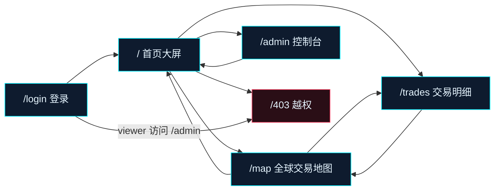
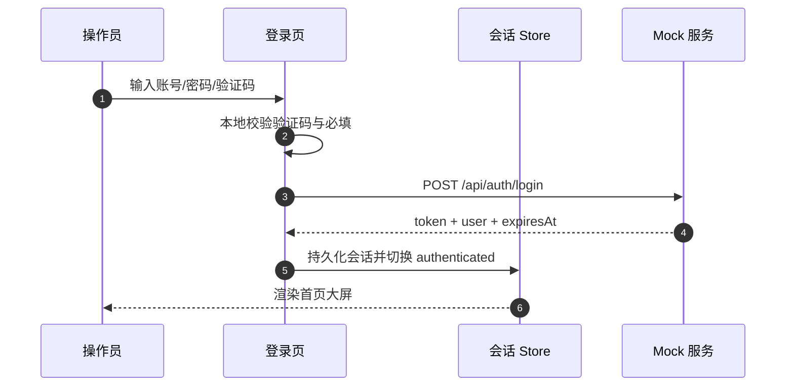
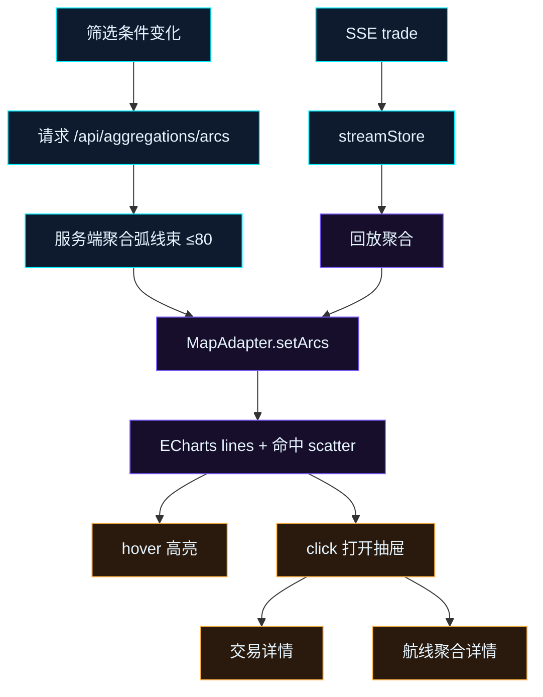

# 原型设计说明书

| 项目 | 内容 |
| --- | --- |
| 文档版本 | v1.0 |
| 日期 | 2026-11-12 |
| 设计基准 | 1920×1080，等比缩放至 1366×768 / 2560×1440 / 3840×2160 |
| 设计输入 | `docs/design/dashboard.html`、`map.html`、`trades.html`、`admin.html`、`login.html`（Codex 设计稿修订版） |
| 评审记录 | `docs/design/review.md` |
| 实现证据 | `docs/screenshots/01-login.png` ~ `08-viewer-403.png` |

## 1. 原型目标

把 PRD 的页面结构与交互点固化为可直接编码的界面原型：明确每页的栅格、模块高度、控件位置、状态变化与视觉 token，使设计稿到实现的偏差只发生在数据与文案层，不发生在结构与交互层。

## 2. 原型基准

### 2.1 画布与缩放

页面以 1920×1080 为唯一设计坐标系。外层 `ScaleStage` 使用 `transform: scale(min(vw/1920, vh/1080))` 缩放并居中，不改变内部任何元素尺寸。1366×768 缩放约 0.711，2560×1440 缩放约 1.333，3840×2160 缩放 2.0。单屏无滚动条，不提供移动端布局。

### 2.2 视觉 token

| 类别 | 取值 |
| --- | --- |
| 背景 | `#05070D` / 面板 `#0A0F1C` / 浮层 `#101A2E` |
| 主霓虹 | `#00F0FF`（青紫主题）、`#FFB547`（琥珀主题）、`#8FE9FF`（冰蓝主题） |
| 次霓虹 | `#FF2BD6` / `#7B5CFF` |
| 状态 | filled `#39FF9E`、pending `#FFB547`、failed `#FF4D6D`、flagged `#FF2BD6` |
| 文字 | 主 `#E6F5FF` / 次 `#8AA3C0` / 弱 `#4B6480` |
| 卡片 | 八边切角 `clip-path`、1px 霓虹描边、四角准星、HUD 编号 |
| 数字 | 等宽字体栈，24/30/40px 三级，主数字带外发光 |

## 3. 信息架构与页面跳转

## 4. 登录页原型

### 4.1 结构

| 区域 | 尺寸 | 内容 |
| --- | --- | --- |
| 顶栏 | 64px | NEXUS 标识、DEMO / 模拟数据、GUEST / 访客、时钟 |
| 品牌区 | 左侧自适应 | 大标题 NEXUS、说明文案、四枚状态胶囊、世界轮廓与节点装饰 |
| 认证面板 | 560px×约 640px，右侧垂直居中 | 编号、标题、账号、密码、验证码、记住我、错误条、提交按钮、演示账号、声明 |
| 底栏 | 48px | 构建号、模拟交易声明、离线声明 |

### 4.2 交互与状态

| 控件 | 行为 | 反馈 |
| --- | --- | --- |
| 账号 / 密码 | 输入、密码显隐 | 聚焦辉光、错误内联提示 |
| 图形验证码 | 本地生成 4 位，点击刷新 | 校验失败刷新并提示「验证码不正确」 |
| 记住我 | 勾选 | 会话 7 天，否则 8 小时 |
| 演示账号 | 一键填入 admin / viewer | 同步填入账号密码并刷新验证码 |
| 提交按钮 | 回车或点击 | loading 旋转；成功跳转来源页；失败按 401/403 提示 |
| 已登录访问 | 路由级拦截 | 直接跳转 `/` |

## 5. 首页大屏原型

### 5.1 栅格

| 区域 | 尺寸 | 模块 |
| --- | --- | --- |
| 顶栏 | 64px | LOGO、DEMO、导航、数据流状态、时钟、全屏、身份 |
| 主区 | 960px | 三栏 410 / 932 / 522（gap 12，左右 padding 16） |
| 底栏 | 56px | 无限滚动行情带 |

三栏内部：

- 左栏：KPI 6 卡（2×3，286px）→ 资产占比（262px）→ 地区排行（自适应）。
- 中栏：分时成交额（384px）→ 简化世界地图（自适应）→ 买卖盘深度（210px）。
- 右栏：实时流水（372px）→ 告警流（306px）→ 系统雷达（自适应）。

### 5.2 模块原型与交互

| 编号 | 原型要素 | 交互 | 状态 |
| --- | --- | --- | --- |
| D-01 | 6 张 KPI 卡：标签/编号/大数字/环比 | 点击联动筛选，激活态左霓虹条 | 加载骨架、错误重试 |
| D-02 | 折线 + 总金额面积、五类资产细线、时间范围分段 | 1H/6H/24H、图例显隐、十字准星 tooltip | 24 桶（24h）/ 24 桶（6h）/ 60 桶（1h） |
| D-03 | 世界轮廓 SVG + 14 节点 + ≤8 飞线 | 节点 hover 浮层、点击进入地图 | 底部节点/航线/异常统计 |
| D-04 | 流水行：时间、资产、路线、金额、状态 | 点击打开交易抽屉、暂停/恢复滚动 | 暂停冻结当前列表 |
| D-05 | 告警行：级别色条、消息、类型、节点、时间 | 点击下钻交易/节点；admin 可处置 | critical 闪烁、已处置降透明度 |
| D-06 | 环形图 + 五类图例百分比 | 图例点击显隐，联动主图 | 中心显示总额 |
| D-07 | 横向条形 TOP 8 + 金额 | 点击按国家筛选 | 空数据提示 |
| D-08 | 买卖 12 档深度 | 资产切换、档位 tooltip | 买卖双向累计量 |
| D-09 | 雷达 + 五项健康度列表 | 静态展示 | 低于 92 显示 DEGRADED |
| D-10 | 行情带 | hover 暂停、点击联动主图 | 涨红跌绿 |

## 6. 全球交易地图原型

### 6.1 结构

| 区域 | 尺寸 | 内容 |
| --- | --- | --- |
| 页头 | 34px | 标题、节点/航线/异常/未处置统计、数据流状态 |
| 工具栏 | 42px | 搜索、实时/全部、时间回放、全屏 |
| 地图区 | 自适应 | 本地 GeoJSON、发光节点、弧形飞线、左下筛选面板、右侧缩放控件、右下统计 |
| 抽屉 | 460px | 航线聚合详情或单笔交易详情（复用全局抽屉） |

### 6.2 交互

| 编号 | 行为 | 反馈 |
| --- | --- | --- |
| M-01 | 弧线 hover | 命中层显示 tooltip，其他线透明度降至 0.08 |
| M-02 | 弧线点击 | 优先打开最新单笔交易抽屉，否则打开航线聚合抽屉 |
| M-03 | 节点 hover / 点击 | tooltip 节点卡；点击写入 `nodeId` 筛选 |
| M-04 | 资产/状态/金额/窗口筛选 | 重新请求聚合弧线，计数更新 |
| M-05 | 城市搜索 | 结果下拉，选择后 650ms 飞入并放大 |
| M-06/M-07 | 回放与倍速 | 6 小时时间轴，1×/2×/4×，每 900ms 推进 |
| M-08 | 图层开关 | 国界、网格、节点、连线、标签即时生效 |
| M-09 | 热力模式 | OFF / 航线密度 / 金额密度 |
| M-10 | 缩放、拖拽、复位、全屏 | 保留当前视角，筛选刷新不清空视口 |
| M-11 | 图例显隐 | 按资产类别隐藏弧线 |
| M-12 | 与首页联动 | 同一 SSE store，三处同源 |

## 7. 交易明细页原型

| 区块 | 原型规格 |
| --- | --- |
| 页头 | 标题、总笔数、已加载成交额、异常率、延迟中位数、导出 CSV（仅 admin） |
| 筛选栏 | 搜索（250ms 防抖）、资产类别、方向、状态 chips、金额区间、重置 |
| 表头 | 时间、交易 ID、卖方、买方、资产、方向、金额、价格、状态、延迟、风险分；可排序 |
| 表体 | 固定 48px 行高，虚拟滚动 overscan 6；选中行左霓虹条；未加载行骨架 |
| 行交互 | 点击打开抽屉；复制 ID；SSE 新交易插入顶部（时间倒序时） |
| 深链 | `?tradeId=` 自动打开抽屉；`?nodeId=` 预填关联筛选 |
| 分页 | 服务端 pageSize=200，最多首屏 6 页/1200 条，触底继续加载 |

## 8. 管理员控制台原型

| 区块 | 宽度 | 内容 |
| --- | --- | --- |
| 用户管理 | 640px | 6 个账号，启停、角色、最近登录、切换身份、最后管理员保护 |
| Mock 数据控制台 | 584px | 暂停/恢复、0.5~4×、Seed 重置、清空、三类异常注入、事件控制台 |
| 系统设置 | 640px | 三套主题、2 档动效、3 档刷新、水印、只读存储说明 |
| 状态条 | 全宽 | 身份、权限、运行状态、客户端数、未处置告警、Seed |

## 9. 403 越权页原型

深空背景 + 红色六边形盾牌图标 + 错误码 `ERR / 403` + 当前角色说明 + 必需角色/当前角色/演示声明三列 + 返回大屏/打开地图按钮。viewer 访问 `/admin` 时路由守卫直接渲染该页，不重定向。

## 10. 全局组件与状态

| 组件 | 原型 | 状态 |
| --- | --- | --- |
| 交易抽屉 | 右侧 460px、遮罩、头部编号、六格信息、风险条、执行信息、底部操作 | 打开/关闭、Esc 关闭、加载/错误 |
| 空态 | 居中标题 + 描述 + 操作按钮 | 列表为空、筛选无结果 |
| 错误态 | 红色状态标题 + 消息 + 重试 | 接口失败保留旧数据 |
| 骨架屏 | 面板形状等比闪烁 | 首次加载 |
| Toast | 右上角栈式，3.2s 自动消失 | info/success/warn/danger |
| 确认弹窗 | 420px 切角卡、危险操作红色确认 | 停用用户、清空数据、重置种子 |

## 11. 设计到实现的偏差登记

| 偏差 | 设计稿 | 实现 | 理由 |
| --- | --- | --- | --- |
| 世界地图底图 | 自绘简化轮廓 | 本地真实 GeoJSON | 地理可信度，离线可用 |
| 地图航线数量 | 12 条视觉样例 | 默认 80 条聚合弧线 | 演示高密度与筛选能力 |
| 登录页 | 修订版 mockup | 实现层独立布局 | 品牌区与验证码可用性整合 |
| 控制台注入 | 4 个场景卡 | 3 类注入 | 与 05 接口契约一致 |
| 明细金额币种 | 部分 CNY | 全部 USD | 全局口径一致 |

## 12. 验收映射

| PRD 验收项 | 原型落点 | 证据 |
| --- | --- | --- |
| 单屏无滚动 | 固定 1920×1080 + ScaleStage | `docs/screenshots/02-dashboard.png` |
| 权限差异 | 403 原型 + 导航隐藏 + 按钮显隐 | `08-viewer-403.png`、`viewerNoExport=true` |
| 三处同源 | SSE store + 服务端聚合 | `03-map.png`、`04-trades.png` |
| 地图交互 | 弧线命中层 + 筛选 + 回放 + 图层 | `09-map-heat.png`、`10-map-replay.png`、`11-map-drawer.png` |
| 明细虚拟滚动 | 48px 行高 + overscan | `04-trades.png` |
| 动效降级 | `data-motion=reduced` + prefers-reduced-motion 默认 | 设置面板与 CSS token |
