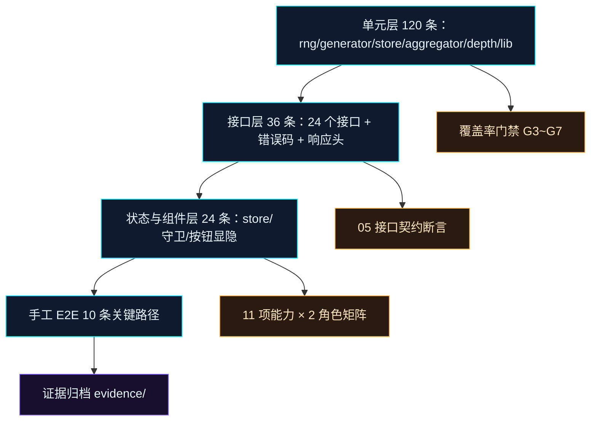

# 测试计划与用例

| 项目 | 内容 |
| --- | --- |
| 项目代号 | NEXUS（赛博交易中枢） |
| 文档版本 | v1.0（冻结） |
| 日期 | 2026-11-12 |
| 输入依据 | `docs/PRD.md` v0.1、`docs/02-概要设计说明书.md` v1.0、`docs/05-接口设计文档.md` v1.0 |
| 适用范围 | 服务端 `server/`、前端 `src/`、`scripts/dev.mjs`、生产静态托管形态 |
| 测试环境 | Node 26.13.0 + npm 11.6.0 + Chrome 131.0.6778.205 + Vitest 2.1.9 + jsdom 25.0.1 |
| 文档结论 | 本计划是 M5 验收与每次发布的测试执行依据，门禁未过不得发布 |

## 1. 测试目标与质量门禁

### 1.1 验收条目基线

本计划的"对应验收条目"列引用下表编号。AC-01~AC-10 来自 PRD 第 11 节验收标准，AC-11~AC-12 来自 02 与 05 的契约约束。

| 编号 | 验收条目 | 量化口径 | 来源 |
| --- | --- | --- | --- |
| AC-01 | 离线可启动且运行时零外部请求 | 断网后刷新可用；Network 面板外部域名请求数 = 0 | PRD 11.1 |
| AC-02 | 1920×1080 单屏完整展示 | 无滚动条、无溢出；1366×768、2560×1440、3840×2160 等比可用 | PRD 11.2 |
| AC-03 | 两账号登录、403 拦截、按钮显隐、身份切换 | viewer 访问 `/admin` 进 403；管理控件 DOM 计数 = 0；切换后即时生效 | PRD 11.3 |
| AC-04 | 三处数据同源 | 一笔新交易在 1 个 tick（≤1500ms）内同时出现在大屏、地图、明细 | PRD 11.4 |
| AC-05 | 弧线生成与帧率 | 按 from/to 生成弧线；≥30 条并发弧线 ≥30fps | PRD 11.5 |
| AC-06 | P0 交互点 100% 可用 | I-01~I-42 中 P0 项逐条通过 | PRD 11.6 |
| AC-07 | 4× 倍速连续 10 分钟稳定 | 前端堆增长 ≤20MB；服务端 RSS ≤300MB；无未捕获报错 | PRD 11.7 |
| AC-08 | DEMO 标识与涨跌色 | 每页存在 DEMO 标识；涨 `#FF4D6D`、跌 `#39FF9E` | PRD 11.8 |
| AC-09 | 降低动效生效 | 手动开关与 `prefers-reduced-motion` 双通道生效 | PRD 11.9 |
| AC-10 | 类型与构建 | `tsc --noEmit` 0 error；`npm run build` 退出码 0 | PRD 11.10 |
| AC-11 | 聚合口径与接口契约 | 24 个接口字段、枚举、信封、错误码与 05 逐字段一致 | 05 第 1~6 节、02 5.2~5.3 |
| AC-12 | 权限与错误码闭环 | 11 项能力 × 2 角色矩阵一致；9 个错误码按 05 第 6 节触发 | 02 第 7 节、05 第 6 节 |

### 1.2 测试目标

1. **契约一致性**：05 文档登记的 24 个接口（认证 4、公共数据 13、管理 7）全部有接口测试覆盖，响应信封、枚举取值、错误码逐字段断言，偏差数 = 0。
2. **数值正确性**：KPI、时序、资产占比、地区排行、盘口深度、健康度、弧线束 7 类聚合全部有固定夹具断言；`server/core/aggregator.js` 语句覆盖率 ≥90%，`src/lib/**` 分支覆盖率 100%。
3. **权限闭环**：`admin` 与 `viewer` 两个角色 × 11 项能力的前端显隐与服务端 403 双向验证，越权成功次数 = 0。
4. **性能达标**：30 条并发弧线 ≥30fps；5000 行表格滚动 ≥45fps；4× 倍速 10 分钟前端堆增长 ≤20MB、服务端 RSS ≤300MB；首屏 gzip ≤1.2MB。
5. **可复现性**：同一 `DEMO_SEED` 两次重建的前 50 笔交易规范化 JSON 的 SHA-256 完全一致；代码中 `Math.random()` 出现次数 = 0。
6. **离线完整性**：断网状态刷新页面仍可登录并浏览；运行时外部域名请求数 = 0。

### 1.3 质量门禁

| 编号 | 门禁 | 阈值 | 判定方式 | 未通过处置 |
| --- | --- | --- | --- | --- |
| G1 | 单元测试强制 | 每个含条件分支的模块必须有同名 `*.test.js`（服务端）与 `*.test.ts`（前端）；新增纯函数须在同一提交内附测试 | `npm run test` 全绿 | 阻断合并 |
| G2 | 无证据=未完成 | 每项交付附"命令 + 退出码 + 输出摘要"；手工项附截图路径 | 人工核对 `evidence/` | 任务退回重做 |
| G3 | 聚合层覆盖率 | `server/core/aggregator.js` 语句/分支/函数/行 ≥90% | 覆盖率报告 | 阻断合并 |
| G4 | 核心纯函数分支 | `src/lib/**/*.ts` 分支覆盖率 = 100%（未覆盖分支数 0） | 覆盖率报告 | 阻断合并 |
| G5 | 鉴权与路由覆盖率 | `server/middleware/auth.js` 分支 100%；`server/routes/**` 行 ≥85% | 覆盖率报告 | 阻断合并 |
| G6 | 状态层覆盖率 | `src/store/**/*.ts` 行覆盖率 ≥90% | 覆盖率报告 | 阻断合并 |
| G7 | 全局覆盖率 | 行 ≥85%、分支 ≥80%、函数 ≥85%、语句 ≥85% | 覆盖率报告 | 阻断合并 |
| G8 | 静态与构建 | `tsc --noEmit` 0 error；ESLint 0 error；`npm run build` 退出码 0；首屏 gzip ≤1.2MB | `npm run verify` | 阻断发布 |
| G9 | 手工 E2E | 第 3.6 节 10 条关键路径全部通过，截图齐全 | E2E 记录表 | 阻断发布 |
| G10 | 文档图示 | mermaid 块 PARSE-ERROR = 0（文档变更时执行） | `validate_mermaid.cjs` | 阻断文档交付 |

### 1.4 覆盖率落地配置

阈值写入 `vitest.config.ts`，与 G3~G7 一一对应，CI 直接以退出码判定。

```ts
// vitest.config.ts 节选
test: {
  environment: 'jsdom',
  coverage: {
    provider: 'v8',
    reporter: ['text', 'json-summary', 'html'],
    thresholds: {
      global: { lines: 85, branches: 80, functions: 85, statements: 85 },
      'server/core/aggregator.js': { lines: 90, branches: 90, functions: 90, statements: 90 },
      'server/middleware/auth.js': { branches: 100 },
      'server/routes/**/*.js': { lines: 85 },
      'src/lib/**/*.ts': { branches: 100 },
      'src/store/**/*.ts': { lines: 90 },
    },
  },
}
```

### 1.5 覆盖率豁免清单

| 文件 | 豁免理由 | 替代验证 |
| --- | --- | --- |
| `src/types/**` | 纯类型声明，无运行时代码 | `tsc --noEmit` |
| `src/main.tsx` | 应用装配入口，仅挂载 | 生产构建后真实入口冒烟 TC-66 |
| `server/index.js` | 端口监听与信号处理 | 生产启动冒烟 TC-66、08 手册健康检查 |
| `server/core/seed.js` | 静态常量表 | 接口测试断言数量：30 节点、12 资产、3 账号 |
| `public/geo/world.geo.json` | 静态数据文件 | 地图页加载冒烟 TC-61 |
| `scripts/gen-world-outline.mjs` | 构建期一次性脚本 | 产物文件存在性校验 |

以下文件禁止豁免：`core/aggregator.js`、`core/depth.js`、`core/rng.js`、`core/generator.js`、`middleware/auth.js`、`routes/*`、`src/lib/**`、`src/store/**`、`src/hooks/usePermission.ts`。

### 1.6 门禁执行时点

| 时点 | 执行内容 | 时长上限 | 失败处置 |
| --- | --- | --- | --- |
| 本地提交前 | `typecheck` + `lint` + 受影响模块单测 | 3 分钟 | 本地修复，不提交 |
| 合并前 | 全量单测 + 覆盖率 + 接口测试 | 8 分钟 | 阻断合并，责任人 4 小时内修复 |
| 发布前 | 全量 67 条用例 + 10 条 E2E + 性能 + 离线 + 构建 | 4 小时 | 阻断发布，回退上一构建 |

## 2. 测试范围与环境

### 2.1 测试范围

| 层 | 纳入范围 | 关键断言 |
| --- | --- | --- |
| 服务端核心 | `rng`、`seed`、`generator`、`store`、`aggregator`、`depth` | 确定性、上限裁剪、7 类聚合数值、缓存失效 |
| 服务端接口 | 认证 4 个、公共数据 13 个、管理 7 个 | 状态码、信封、枚举、错误码、响应头 |
| 前端纯函数 | `src/lib` 的格式化、过滤、弧线几何、聚合 | 输入输出精确值、边界、非法输入 |
| 前端状态 | 5 个 store、`usePermission`、路由守卫 | 持久化、上限、401/403 分支、矩阵 |
| 手工 E2E | 登录、大屏、地图、明细、控制台、断线、离线 | 真实浏览器行为与截图 |
| 非功能 | 帧率、内存、首屏体积、离线、分辨率 | 第 3.7 节阈值 |

**不纳入**：真实行情源、真实下单/清算、移动端、Safari/Firefox/IE、多语言、数据库与持久化、压测 1000 并发（本产品单机演示，容量按 64 个 SSE 连接设计）。

### 2.2 环境矩阵

| 项 | 版本/配置 | 用途 |
| --- | --- | --- |
| Node.js | 26.13.0（最低 20.11） | 服务端与测试运行 |
| npm | 11.6.0 | 依赖安装 |
| 浏览器 | Chrome 131.0.6778.205 | 手工 E2E、性能采样 |
| 操作系统 | macOS 14.6（开发）、Ubuntu 22.04（部署） | 双平台验证 |
| 分辨率 | 1920×1080 主口径；1366×768、2560×1440、3840×2160 抽检 | 适配验收 |
| 硬件 | 4 vCPU / 8GB RAM / SSD 20GB | 性能基线 |
| 网络 | 内网 127.0.0.1:8787；断网场景物理断网 | 离线验收 |
| 测试运行器 | Vitest 2.1.9 + jsdom 25.0.1 | 单元与组件测试 |
| 接口测试 | supertest 7.0.0 + 真实 Express app（`listen(0)` 随机端口） | 24 个接口 |
| 覆盖率 | @vitest/coverage-v8 2.1.9 | G3~G7 判定 |

### 2.3 工具链与选型理由

1. **测试运行器选定 Vitest 2.1.9**：前后端同一套运行器与断言库，`server/` 的 ESM 模块可直接导入，无需 Babel 转译；放弃 Jest 的理由是 ESM 配置成本高、启动慢 3 倍以上。
2. **DOM 环境选定 jsdom 25.0.1**：store、权限守卫、组件显隐只依赖 DOM API，jsdom 无需真实浏览器；布局与帧率类断言一律走真实 Chrome，不用 jsdom 冒充。
3. **接口测试选定 supertest 7.0.0**：直接挂载 `server/app.js` 导出的 Express 实例，随机端口避免与 8787 冲突；断言 HTTP 状态、响应头、SSE 首帧。
4. **组件断言选定 @testing-library/react 16.1.0 + @testing-library/user-event 14.5.2**：以真实渲染后的 DOM 判定按钮显隐，禁止以读取 store 布尔值替代可见性断言。
5. **性能采样选定 Chrome DevTools Performance + FPS Meter**：帧率与内存属于浏览器运行时指标，jsdom 无渲染管线，不参与此类判定。

### 2.4 真实入口验证要求

纯函数单测通过不等于功能可用。以下 5 个入口必须真实启动后验证，禁止用静态断言替代。

| 入口 | 启动命令 | 验证动作 | 证据 |
| --- | --- | --- | --- |
| API 进程 | `npm run dev:server` | `curl` 登录拿 token，再请求 `/api/kpis`、`/api/trades` | 命令 + 状态码 + 响应片段 |
| SPA 开发入口 | `npm run dev` | Chrome 打开 `http://127.0.0.1:5173/login`，走 TC-01、TC-10 | 截图 + 浏览器控制台无报错 |
| 生产产物 | `npm run build && npm start` | Chrome 打开 `http://127.0.0.1:8787/login`，同源验证 | 截图 + `/api/health` 响应 |
| SSE 通道 | `curl -N "http://127.0.0.1:8787/api/stream?token=$TOKEN"` | 60 秒内收到 `hello`、`trade`、`heartbeat` | 终端输出片段 |
| 静态地学数据 | `curl -I http://127.0.0.1:8787/geo/world.geo.json` | 200 且 Content-Length 为 1010239 | 响应头 |

### 2.5 环境准备步骤

```bash
node -v                  # 期望 v26.13.0
npm -v                   # 期望 11.6.0
npm ci                   # 锁定安装，禁用 npm install 改写 lock
npm run typecheck        # 基线必须 0 error
npm run test -- --run    # 基线全绿后再开始新用例
```

## 3. 测试策略

### 3.1 分层策略

用例重心放在单元层与接口层，UI 层只覆盖权限与状态映射，最上层用 10 条手工 E2E 守住关键路径。



### 3.2 服务端单元测试

| 模块 | 必测点 | 断言方式 | 目标条数 |
| --- | --- | --- | --- |
| `core/rng.js` | 同 seed 前 100 个数字逐一相等；不同 seed 前 10 个不等；取值落在 `[0,1)`；`int(min,max)` 命中上下界 | 精确相等 + `toBeGreaterThanOrEqual` | 10 |
| `core/generator.js` | 历史 1200 笔；时间落在 `[now-24h, now]`；交易 ID 唯一；注入三类异常字段范围；单 tick 耗时 ≤8ms | 集合断言 + `performance.now()` | 18 |
| `core/store.js` | 交易上限 6000、告警上限 400，超出丢最旧；每次写入 `version` 自增 1；订阅者抛错不影响其他订阅者 | 数组长度 + 版本号 + 异常隔离 | 12 |
| `core/aggregator.js` | 7 类聚合固定夹具精确值；空窗口返回 0 而非 `NaN`；缓存 key 含窗口、过滤、版本；版本变化后重算 | 精确数值 + 深度相等 | 24 |
| `core/depth.js` | 买卖各 12 档；买价降序、卖价升序；`size` 非负；同资产同 `generatedAt` 结果相等 | 单调性 + 深度相等 | 8 |
| `middleware/auth.js` | 无 token 401、过期 401、停用 403、viewer 访问管理接口 403 | 状态码 + 错误码 | 8 |

### 3.3 服务端接口测试

1. **装配方式**：`server/app.js` 导出 Express 实例，测试内 `app.listen(0)` 取随机端口，`afterAll` 关闭；不启动真实 8787，避免端口占用导致 CI 失败。
2. **断言顺序**：先断言 HTTP 状态码，再断言信封结构（`data` 与 `serverTime`），再断言业务字段，最后断言响应头 `Cache-Control: no-store` 与 `X-Content-Type-Options: nosniff`。
3. **错误码矩阵**：9 个错误码（`VALIDATION_ERROR`、`INVALID_CREDENTIALS`、`UNAUTHORIZED`、`TOKEN_EXPIRED`、`FORBIDDEN`、`USER_DISABLED`、`NOT_FOUND`、`METHOD_NOT_ALLOWED`、`INTERNAL_ERROR`）每个至少 1 条触发用例。
4. **SSE 测试**：用 `node:http` 发起请求，读取前 3 个事件后销毁连接；`hello` 必须在 500ms 内到达；不等待 15s 心跳（心跳由手工用例 TC-39 覆盖）。
5. **数据隔离**：每个用例文件在 `beforeEach` 调 `store.reset(20261112)`，断言不依赖执行顺序；禁止跨文件共享可变单例。

### 3.4 前端 lib 纯函数测试

`src/lib` 全部为无 DOM 依赖的纯函数，使用精确输入输出断言，禁止快照断言。

| 函数 | 输入 | 期望输出 |
| --- | --- | --- |
| `formatAmount` | `48620000000` | `"$48.62B"` |
| `formatAmount` | `12800000` | `"$12.80M"` |
| `formatAmount` | `0` | `"$0.00"` |
| `formatPct` | `99.93` | `"99.93%"` |
| `formatLatency` | `38` | `"38 ms"` |
| `formatClock` | `1763000000000` | `"2026-11-12 12:00:00"`（UTC+8 固定口径） |
| `filterTrades` | F1 的 6 笔 + `{assetClass:'fx'}` | 返回 3 笔，顺序与输入一致 |
| `filterTrades` | F1 的 6 笔 + `{minAmount:600, maxAmount:100}` | 返回 `[]`，不抛错 |
| `arcPath` | `{x:0,y:0}` 与 `{x:100,y:0}` | `"M 0 0 Q 50 -18 100 0"`，控制点纵坐标 = `-0.18 × 距离` |
| `arcPath` | 反向 `{x:100,y:0}` 与 `{x:0,y:0}` | 控制点同样向上偏移，弧线不翻面 |
| `aggregateByClass` | F2 五类 100/100/100/100/50 | 5 项，占比 `22.2/22.2/22.2/22.2/11.2`，合计 `100.0` |
| `arcSeverity` | `filled`、`pending`、`failed`、`flagged` | 依次返回 `0/1/2/3`，合并取最大值 |
| `clamp` | `-1`、`0`、`1`、`2` 于 `[0,1]` | `0/0/1/1` |

几何口径：`arcPath` 取两点中点，沿垂直方向向上偏移 `0.18 × 两点距离` 作为二次贝塞尔控制点；两点距离为 0 时返回空字符串并由调用方过滤。该口径同时被服务端弧线与前端渲染复用，单测锁定后两侧不得各自实现。

### 3.5 store 与权限守卫测试

| 对象 | 必测点 | 断言方式 |
| --- | --- | --- |
| `authStore` | 登录写入 `nexus.auth`；登出清除；`expiresAt - now ≤5000ms` 提前判定过期；身份切换替换当前 token | localStorage 快照 + 状态断言 |
| `filterStore` | 跨页保留筛选；重置后回到默认值（`range=24h`，其余空） | 状态断言 |
| `configStore` | 主题三套、动效两档、水印开关持久化到 `nexus.prefs`；非法值回落到 `cyan/full/true` | localStorage 快照 |
| `streamStore` | 交易上限 1500、告警上限 200；同 `id` 去重；16ms 合批入队 | 数组长度 + 去重断言 |
| `uiStore` | 抽屉打开/关闭、`selectedTradeId` 与 `drawerKind` 联动 | 状态断言 |
| `usePermission` | 11 项能力 × 2 角色 = 22 个布尔组合全量断言 | 表驱动 |

权限矩阵（前端渲染依据，必须与服务端中间件一致）：

| 能力标识 | admin | viewer |
| --- | --- | --- |
| `screen.view` | true | true |
| `screen.filter` | true | true |
| `stream.control` | true | false |
| `alert.handle` | true | false |
| `admin.users` | true | false |
| `data.inject` | true | false |
| `data.reset` | true | false |
| `data.clear` | true | false |
| `config.theme` | true | false |
| `config.motion` | true | false |
| `view.export` | true | false |

### 3.6 手工 E2E 关键路径

| 编号 | 路径 | 通过判据 |
| --- | --- | --- |
| E2E-01 | admin 登录 → 大屏 → 简化地图 → 地图页 → 明细 → 退出 | 每个页面渲染完整，退出后回登录页 |
| E2E-02 | viewer 登录 → 大屏 → 尝试进入控制台 → 403 → 返回 | 全程无管理控件可见，403 只出现 1 次 |
| E2E-03 | admin 注入大额/延迟/风控三类异常 | 三类告警分别出现，弧线与状态色符合预期 |
| E2E-04 | admin 重置种子两次 | 两次前 50 笔交易 ID 与金额完全一致 |
| E2E-05 | 地图页 hover/点击连线、节点筛选、图层开关、时间回放 | 6 类交互均有可见反馈 |
| E2E-06 | 快捷键 1/2/3/空格/F/Esc | 页面切换与抽屉行为正确，输入框内不触发 |
| E2E-07 | 主题三套切换 + 降低动效 + 水印开关 | 切换即时生效，刷新后保持 |
| E2E-08 | 断网 20 秒后恢复 | 顶部状态灯由红转绿，快照补齐，无重复交易 |
| E2E-09 | 30 条弧线 + 4× 倍速 10 分钟观测 | 帧率与内存读数记录在案 |
| E2E-10 | 断开物理网络后刷新页面 | 页面可用，Network 面板外部请求数 = 0 |

### 3.7 非功能测试口径

| 指标 | 采样方法 | 通过阈值 |
| --- | --- | --- |
| 弧线帧率 | 30 条并发，Chrome FPS Meter 连续 60s | 平均 ≥30fps，P95 帧时长 ≤33.3ms |
| 表格帧率 | 5000 行，连续滚动 60s | 平均 ≥45fps |
| 前端内存 | 4× 倍速 10 分钟，每 60s 采 `performance.memory.usedJSHeapSize` | 首末差 ≤20MB，且无持续单调上升 |
| 服务端内存 | 同场景每 60s 采 `process.memoryUsage().rss` | ≤300MB，10 分钟增长 ≤30MB |
| 首屏体积 | `npm run build` 后对 `dist/assets/*.js` 求 gzip 总和 | ≤1.2MB |
| 离线 | 断网 + DevTools Offline 双验证 | 页面可用，外部请求数 = 0 |
| 交互响应 | 窗口切换 1h/6h/24h | 首次渲染 ≤300ms，节流窗口 200ms |

## 4. 测试用例

### 4.1 用例编号与字段规范

1. 编号 `TC-01`~`TC-67` 连续，不复用、不跳号；新增用例追加到所属分组末尾并顺延编号。
2. 每条用例必须写全"前置条件、执行步骤、预期结果、验收条目"四要素；步骤用 `1)`、`2)` 编号，单步只做一个动作。
3. 预期结果必须是可判定的观测值（状态码、字段值、DOM 数量、帧率、毫秒数），禁止"正常显示""符合预期"这类无法判定表述。
4. "验收条目"引用第 1.1 节编号；一条用例最多对应 2 个条目。
5. 自动化可覆盖的用例在"执行步骤"内标注 `[自动]`，必须手工执行的标注 `[手工]`；`[自动]` 项在发布前必须由 `npm run test` 实测，不得只写不跑。

### 4.2 认证与会话（TC-01~TC-09）

| 编号 | 用例 | 前置条件 | 执行步骤 | 预期结果 | 验收条目 |
| --- | --- | --- | --- | --- | --- |
| TC-01 | admin 登录成功（记住我开启） | 服务端 8787 已启动，`DEMO_SEED=20261112`，账号 `admin/admin123` 处于启用态 | 1) `[自动]` POST `/api/auth/login`，body `{"username":"admin","password":"admin123","remember":true}`；2) `[手工]` 在登录页填同参数并提交 | 200；`data.token` 以 `nx_` 开头且长度 ≥24；`data.user.role=admin`；`expiresAt - serverTime = 604800000`（误差 ≤5000ms）；localStorage `nexus.auth` 存在；落地 `/`；顶栏身份徽章显示「系统管理员」 | AC-03、AC-12 |
| TC-02 | viewer 登录成功 | 账号 `viewer/viewer123` 启用 | 1) `[自动]` 同结构登录；2) `[手工]` 登录后查看顶栏与导航 | 200；`role=viewer`；落地 `/`；导航只有「态势总览 / 全球地图 / 交易明细」3 项；无「控制台」入口；大屏 10 个模块全部渲染 | AC-03、AC-06 |
| TC-03 | 密码错误 | 账号存在，密码错误 | 1) `[自动]` POST 登录，密码改为 `admin124`；2) `[手工]` 观察登录页提示 | 401；`error.code=INVALID_CREDENTIALS`；`error.message=账号密码错误`；响应体不含用户信息；登录页停留且密码输入框清空 | AC-03、AC-12 |
| TC-04 | 用户名不存在 | 使用未登记账号 `ghost/ghost123` | 1) `[自动]` POST 登录；2) 对比 TC-03 的响应体 | 401；`code` 与 `message` 与 TC-03 完全一致；`details` 为空；不得泄露"用户不存在"信息；耗时与 TC-03 差值 ≤100ms | AC-12 |
| TC-05 | 停用账号登录 | admin 已登录；先 `PATCH /api/admin/users/u_viewer` 置 `enabled=false` | 1) `[自动]` 用 viewer 凭据登录；2) `[手工]` 观察提示与 localStorage | 403；`code=USER_DISABLED`；不下发 token；localStorage 无 `nexus.auth`；页面显示「账号已停用，请联系管理员」 | AC-03、AC-12 |
| TC-06 | 记住我关闭与刷新保持 | viewer 账号启用；浏览器已有一次有效会话 | 1) `[自动]` 以 `remember=false` 登录，断言 `expiresAt - serverTime = 28800000`（误差 ≤5000ms）；2) `[手工]` 勾选「记住我」后刷新页面；3) 关闭标签页重新打开 | 会话有效 8 小时；`nexus.auth.remember=true` 持久化；刷新与重开标签页均免登录；登录页用户名回填、密码不回填 | AC-03 |
| TC-07 | 退出登录与重复登出 | admin 已登录 | 1) `[自动]` POST `/api/auth/logout` 携带 token；2) 同 token 再次登出；3) `[手工]` 点击顶栏退出 | 首次 200，`data.ok=true`；`nexus.auth` 被删除；再次登出 401 `UNAUTHORIZED`；页面回 `/login`；顶栏不再显示身份 | AC-03、AC-12 |
| TC-08 | 管理员切换演示身份 | admin 已登录且持有 token A | 1) `[自动]` POST `/api/auth/impersonate` body `{"userId":"u_viewer"}`；2) 用新 token B 请求 `/api/auth/session`；3) 用 token A 再次请求 session；4) `[手工]` 点击头像「切换为普通用户」 | 200；token B 的 `user.role=viewer`；token A 仍返回 200 且 `role=admin`；`/api/meta.clients` 加 1；界面管理控件立即隐藏；可一键切回 | AC-03、AC-06 |
| TC-09 | 过期与篡改 token | 已持有效 token | 1) `[自动]` 将 `expiresAt` 改为 `now-1000` 后请求 `/api/kpis`；2) 将 token 末 4 位替换为 `0000` 后请求；3) `[手工]` 在 DevTools 修改后刷新页面 | 第 1 步 401 `TOKEN_EXPIRED`；第 2 步 401 `UNAUTHORIZED`；`nexus.auth` 清除；跳转 `/login?from=<当前路径>`；不进入无限重定向 | AC-03、AC-12 |

### 4.3 路由守卫与服务端权限（TC-10~TC-16）

| 编号 | 用例 | 前置条件 | 执行步骤 | 预期结果 | 验收条目 |
| --- | --- | --- | --- | --- | --- |
| TC-10 | 未登录路由守卫 | 浏览器无 `nexus.auth` | 1) `[手工]` 依次访问 `/`、`/map`、`/trades`、`/admin`；2) 登录 admin 后观察回跳 | 4 个路径全部跳 `/login`，query 含 `from=%2Fmap` 等原始路径；跳转前无业务接口请求；登录成功后回到 `from` 路径 | AC-03、AC-06 |
| TC-11 | viewer 访问控制台被拦截 | viewer 已登录 | 1) `[手工]` 地址栏输入 `/admin`；2) 观察页面与 Network 面板 | 渲染 403 视图，含「权限不足」标题与「返回大屏」按钮；不重定向到 `/login`；`/api/admin/users` 请求次数 = 0；侧边导航无控制台项 | AC-03、AC-06 |
| TC-12 | admin 访问控制台正常 | admin 已登录 | 1) `[手工]` 访问 `/admin`；2) 检查三个分区 | 200 视图；分区「用户管理」「数据控制台」「系统设置」全部出现；用户列表 3 行；注入/重置/清空按钮可见且可点击 | AC-03、AC-06 |
| TC-13 | viewer 管理控件不可见 | viewer 已登录，进入大屏与地图页 | 1) `[自动]` 用 Testing Library 渲染顶部栏与大屏；2) 查询 `[data-capability]` 为管理项的节点；3) `[手工]` 全页搜寻 | `stream.control`、`alert.handle`、`admin.users`、`data.inject`、`data.reset`、`data.clear`、`config.theme`、`config.motion`、`view.export` 共 9 类的 DOM 节点数 = 0；无禁用态残留按钮；无「敬请期待」占位 | AC-03 |
| TC-14 | viewer 越权调用管理接口 | viewer 已登录持 token | 1) `[自动]` 依次请求 `PATCH /api/admin/stream`、`POST /api/admin/inject`、`POST /api/admin/reset`、`POST /api/admin/clear`、`GET /api/admin/users`、`PATCH /api/admin/users/u_viewer`、`PATCH /api/admin/alerts/x` | 7 个请求全部 403 `FORBIDDEN`；服务端状态不变：`/api/meta.stream.paused` 不变、`/api/trades.total` 不变、用户 `enabled` 不变；响应体不含用户列表 | AC-03、AC-12 |
| TC-15 | viewer 告警处置按钮不可见 | 存在至少 1 条未处置告警，viewer 已登录 | 1) `[手工]` 打开大屏告警流；2) 悬停并点击告警条目 | 条目可下钻查看详情；无「标记已处置」按钮；点击不产生写请求；管理员登录后同一位置按钮出现 | AC-03、AC-06 |
| TC-16 | 401 全局拦截与 403 返回 | admin 已登录 | 1) `[手工]` 重启服务端使内存 token 失效；2) 在 `/map` 触发一次数据请求；3) 观察跳转；4) 在 403 页点击「返回大屏」 | 401 后 `nexus.auth` 清除，跳 `/login?from=%2Fmap`，只跳 1 次；重新登录后回到 `/map`；403 页按钮回 `/` 且导航正常 | AC-03、AC-12 |

### 4.4 聚合与数值正确性（TC-17~TC-27）

聚合口径在实现与测试中统一如下，任何一侧偏离即判失败。

1. 窗口 `W ∈ {1h, 6h, 24h}`，取 `[now-W, now]`。
2. `volume = Σ amount`；`trades = count`；`successRate = filled / total × 100`，保留 2 位小数。
3. `activeNodes` = 窗口内出现过的卖方/买方节点去重数；`avgLatency = round(Σ latencyMs / count)`。
4. `riskIndex = Σ riskScore / count`，保留 1 位小数；空窗口一律返回 `0`，禁止 `NaN`。
5. `deltaPct = (当前窗口值 - 上一等长窗口值) / 上一等长窗口值 × 100`，保留 1 位；上一窗口为空时取 `0.0`。
6. `trend`：`deltaPct > 0.05` 为 `up`，`deltaPct < -0.05` 为 `down`，其余为 `flat`。
7. 时序桶：1h→60 点/60000ms，6h→24 点/900000ms，24h→24 点/3600000ms；桶区间左闭右开，最后一个桶右闭。仅统计 `status='filled'` 的成交金额。
8. 资产占比固定顺序 `fx/equity/crypto/bond/commodity`，`pct` 保留 1 位，第五项吸收舍入误差，五项合计恒为 `100.0`。
9. 地区排行 `pct = 该国 amount / 窗口总 amount × 100`，保留 1 位，`limit` 取值 1~20。
10. 盘口买卖各 12 档，买价降序、卖价升序，`size` 为累计量，`spread = (asks[0] - bids[0]) / price` 保留 4 位。
11. 健康度 `score ≥90` 为 `normal`，`70 ≤ score < 90` 为 `busy`，`score < 70` 为 `alert`。
12. 弧线按 `fromNodeId + toNodeId + assetClass` 分组：`amount` 求和、`count` 计数、`maxLatency` 取最大、`riskScore` 取最大、`status` 取最严重（`flagged > failed > pending > filled`）、`latestTs` 取最大；`id = a_<from>_<to>_<assetClass>`。
13. 弧线按 `amount` 降序，`limit` 缺省 120、取值 1~180，组数超过 `limit` 时 `truncated=true`。

| 编号 | 用例 | 前置条件 | 执行步骤 | 预期结果 | 验收条目 |
| --- | --- | --- | --- | --- | --- |
| TC-17 | KPI 六卡数值 | 单元夹具 F1：6 笔交易，金额 100/200/300/400/500/600，延迟 20/30/40/50/60/70，风险 10/20/30/40/50/60，状态 5 笔 filled + 1 笔 failed，端点为 `n_sh`、`n_ny`、`n_ldn` | 1) `[自动]` 将 F1 写入独立 store；2) 调 `computeKpis('24h')`；3) 逐项断言 | 6 项 key 为 `volume/trades/successRate/activeNodes/avgLatency/riskIndex`；`volume=2100`；`trades=6`；`successRate=83.33`；`activeNodes=3`；`avgLatency=45`；`riskIndex=35.0`；单位依次 `USD/count/pct/count/ms/index` | AC-11 |
| TC-18 | KPI 增量与趋势 | 当前窗口 volume 2100；上一等长窗口 volume 2000 | 1) `[自动]` 构造两窗口夹具；2) 断言 `deltaPct` 与 `trend`；3) 另造上一窗口为空、两窗口相等的两组 | 第一组 `deltaPct=5.0`、`trend=up`；上一窗口为空时 `deltaPct=0.0`、`trend=flat`；两窗口相等时 `deltaPct=0.0`、`trend=flat`；`deltaPct` 保留 1 位 | AC-11 |
| TC-19 | 时序点数与桶宽 | 服务端已启动且有 24h 历史 | 1) `[自动]` 分别请求 `/api/timeseries?range=1h`、`6h`、`24h`；2) 断言 `points.length`、`bucketMs`、相邻 `ts` 差值 | 1h→60 点、60000ms；6h→24 点、900000ms；24h→24 点、3600000ms；相邻点 `ts` 差恒等于 `bucketMs`；末点 `ts ≤ serverTime` 且覆盖最近一个桶 | AC-11 |
| TC-20 | 时序总量守恒 | 24h 窗口已知交易总额 | 1) `[自动]` 对每个点断言 `total = fx+equity+crypto+bond+commodity`（相对误差 ≤1e-6）；2) 对全窗口 Σ`total` 与 Σ`amount` 比较 | 每点五类之和与 `total` 相对误差 ≤1e-6；全窗口 Σ`total` 与窗口成交总额相对误差 ≤1e-6；无负值点；空桶输出 `0` | AC-11 |
| TC-21 | 资产占比与舍入 | 夹具 F2：五类金额 100/100/100/100/50，合计 450 | 1) `[自动]` 调 `computeAssetShares('24h')`；2) 断言每项 `pct` 与合计；3) 请求 `/api/aggregations/assets` 复核字段 | 顺序 `fx/equity/crypto/bond/commodity`；`pct` 依次 `22.2/22.2/22.2/22.2/11.2`；合计精确 `100.0`；`amount` 合计 450；`tradeCount` 合计 5 | AC-11 |
| TC-22 | 地区成交排行 | 夹具：中国 2 笔合计 600（`n_sh` 400、`n_hk` 200），美国 2 笔合计 400（`n_ny` 300、`n_chi` 100），英国 1 笔 200 | 1) `[自动]` 调 `computeRegionRanking('24h', 8)`；2) 断言排序、`pct`、`topNodeId`；3) 以 `limit=2` 再调一次 | 降序 `中国 600 / 美国 400 / 英国 200`；`pct=50.0/33.3/16.7`；`topNodeId` 依次 `n_sh/n_ny/n_ldn`；`limit=2` 只返回 2 项；`limit=0`、`limit=21` 返回 400 | AC-11 |
| TC-23 | 买卖盘深度 | 服务端已启动，资产表含 `BTC/USD` | 1) `[自动]` 请求 `/api/aggregations/depth?asset=BTC/USD`；2) 断言档位、单调性、价差；3) 请求未知资产 `DOGE/USD` | `bids.length=12`、`asks.length=12`；买价严格降序、卖价严格升序；`bids[0][0] < asks[0][0]`；`size` 非负且逐档递增；`spread` 与 `(asks[0][0]-bids[0][0])/price` 差值 ≤1e-4；未知资产 400 `VALIDATION_ERROR` | AC-11 |
| TC-24 | 系统健康度 | 单元夹具分数 90/89/70/69/55，对应 5 个 key | 1) `[自动]` 调 `computeHealth()`；2) 断言 `status` 映射；3) 请求 `/api/aggregations/health` 复核 | 5 项 key 为 `gateway/matching/clearing/risk/datalink`；`status` 依次 `normal/busy/busy/alert/alert`；`score` 范围 0~100；接口 `label` 为中文且非空 | AC-11 |
| TC-25 | 弧线束聚合语义 | 夹具 F3：同一 `n_sh→n_ny` 且 `fx` 的 4 笔，金额 100/200/300/400，延迟 20/50/30/40，风险 10/20/30/40，状态 `filled/pending/failed/flagged` | 1) `[自动]` 调 `computeArcs({window:'24h'})`；2) 断言唯一组与字段 | 返回 1 组；`id=a_n_sh_n_ny_fx`；`amount=1000`；`count=4`；`maxLatency=50`；`riskScore=40`；`status=flagged`；`latestTs` 为 4 笔最大 `ts`；`fromNodeName=上海`、`toNodeName=纽约` | AC-04、AC-11 |
| TC-26 | 弧线排序、截断与过滤 | 夹具 F4：5 组同窗口弧线，金额 1000/800/600/400/200，端点含 `n_sh` 的 2 组 | 1) `[自动]` `limit=3` 取一次；2) 断言顺序与 `truncated`；3) `nodeId=n_sh` 再取；4) `limit=0`、`limit=181` 各取一次 | `limit=3` 返回金额 1000/800/600 三条，`truncated=true`；`limit=120` 返回 5 条且 `truncated=false`；`nodeId=n_sh` 只返回 2 组；`limit=0`、`limit=181` 返回 400；`from/to` 参数覆盖 `window` | AC-11 |
| TC-27 | 市场快照 | 服务端已启动，资产表 12 项 | 1) `[自动]` 请求 `/api/markets`；2) 断言数量、`sparkline` 长度、价格与涨跌符号 | 12 项，`assetClass` 覆盖五类；每个 `sparkline.length=24`；`price = sparkline[23]`（误差 ≤0.01）；`changePct` 符号与 `sparkline[23]-sparkline[0]` 一致，保留 2 位 | AC-11 |

### 4.5 交易明细、分页与筛选（TC-28~TC-35）

| 编号 | 用例 | 前置条件 | 执行步骤 | 预期结果 | 验收条目 |
| --- | --- | --- | --- | --- | --- |
| TC-28 | 分页基础 | 默认 1200 笔历史，`pageSize=50` | 1) `[自动]` 请求第 1 页；2) 第 2 页；3) 第 24 页；4) 第 25 页 | 第 1 页 50 条，`total=1200`，`hasMore=true`；第 2 页首条与第 1 页末条不重复，`page=2`；第 24 页 `hasMore=false`（24×50=1200）；第 25 页 `items=[]`、`hasMore=false` | AC-11 |
| TC-29 | 分页与参数边界 | 同上 | 1) `[自动]` `pageSize=1`、`200` 各请求；2) `pageSize=0`、`201`、`500`、`-1`；3) `page=0`、`page=abc` | `1` 与 `200` 返回 200；`0`、`201`、`500`、`-1`、`page=0`、`page=abc` 全部 400 `VALIDATION_ERROR`，`details.field` 指向对应参数 | AC-11、AC-12 |
| TC-30 | 排序 | 同数据集 | 1) `[自动]` 默认请求；2) `sortBy=amount&sortDir=desc`；3) `sortBy=amount&sortDir=asc`；4) `sortBy=latencyMs`、`sortBy=riskScore`；5) `sortBy=foo` | 默认按 `ts` 降序；amount 降序/升序全表严格单调；`latencyMs`、`riskScore` 排序结果与逐行值一致；`sortBy=foo` 返回 400；同值记录不丢失、不重复 | AC-11 |
| TC-31 | 搜索 | 同数据集，含资产 `BTC/USD`、节点名「上海」 | 1) `[自动]` `search=BTC`；2) `search=bTc`；3) `search=上海`；4) `search=<script>alert(1)</script>`；5) `search` 长 81 字符 | 命中 `asset` 包含 BTC 的行；大小写不敏感；命中 `fromNodeName` 含上海的行；恶意字符串返回空集且响应体与页面均不出现 `<script>`；81 字符返回 400 | AC-11、AC-12 |
| TC-32 | 多条件组合过滤 | 同数据集 | 1) `[自动]` 逐条单条件请求并记录总数；2) 组合请求 `assetClass=fx&status=filled&side=buy&minAmount=1000000&maxAmount=20000000&nodeId=n_sh&country=中国&from=<now-6h>&to=<now>`；3) 逐行断言 | 组合结果每行同时满足 8 个条件；总数等于各单条件结果集合的交集计数；`total` 与 `items.length` 一致；翻页后筛选条件保持 | AC-06、AC-11 |
| TC-33 | 非法金额区间 | 同数据集 | 1) `[自动]` `minAmount=-1`；2) `maxAmount=100&minAmount=200`；3) `minAmount=abc` | 三种输入均 400 `VALIDATION_ERROR`；`details.field` 分别为 `minAmount`、`maxAmount`、`minAmount`；不返回任何交易 | AC-12 |
| TC-34 | 5000 行虚拟滚动 | 以 `node server/tests/perf/fixture-5000.mjs` 在 8790 端口启动带 5000 笔交易的实例 | 1) `[手工]` 打开 `/trades`；2) 连续滚动 10 次、每次 1000px；3) 滚到列表底部；4) 全选可见行核对 ID | 首屏渲染 DOM 行数 ≤60；每次滚动无空白行、无重复行；底部最后一行 ID 等于第 5000 笔；行高恒定 48px；顶部与底部对齐无抖动 | AC-06 |
| TC-35 | 行详情、复制与地图跳转 | 明细页有数据 | 1) `[手工]` 点击任意行；2) 点击「复制交易 ID」；3) 按 Esc；4) 重新打开抽屉点击「在地图定位」 | 抽屉展示 12 个字段；剪贴板内容与行 `id` 完全一致；Esc 关闭抽屉且焦点回到原行；跳转 `/map?tradeId=<id>`，地图选中对应弧线 | AC-06 |

### 4.6 SSE 实时推送（TC-36~TC-42）

| 编号 | 用例 | 前置条件 | 执行步骤 | 预期结果 | 验收条目 |
| --- | --- | --- | --- | --- | --- |
| TC-36 | SSE 握手 | admin 已登录取得 token；服务端未暂停 | 1) `[手工]` `curl -N "http://127.0.0.1:8787/api/stream?token=$TOKEN"`；2) 观察响应头与前 3 行；3) 持续 60s | 响应头含 `Content-Type: text/event-stream; charset=utf-8`、`Cache-Control: no-cache, no-transform`、`Connection: keep-alive`、`X-Accel-Buffering: no`；500ms 内收到 `retry: 5000` 与 `event: hello`；`hello.data.meta.seed=20261112`；连接 60s 不断开 | AC-04、AC-11 |
| TC-37 | 交易事件推送 | 数据流 1× 运行中，浏览器已连 SSE | 1) `[自动]` 记录连续 3 个 `trade` 事件的到达时间；2) 断言事件字段；3) `[手工]` 观察大屏流水与地图 | 相邻事件间隔 1500ms ±300ms；`data` 含 12 个字段且 `id` 唯一、`ts` 递增；前端 store 在 16ms 合批内新增 1 条；大屏流水首行、地图弧线、明细首行在 1500ms 内出现同一 `id` | AC-04 |
| TC-38 | KPI 与行情周期推送 | 浏览器已连 SSE | 1) `[自动]` 记录 3 个 `kpi` 事件间隔；2) 记录 2 个 `market` 事件间隔；3) 断言载荷 | `kpi` 间隔 2000ms ±500ms，`items.length=6`；`market` 间隔 5000ms ±500ms，`items.length=12`；两类事件 `data` 可被前端直接替换切片，无字段缺失 | AC-04、AC-11 |
| TC-39 | 心跳与断连判定 | SSE 已连接 | 1) `[自动]` 持续 45s 记录 `heartbeat`；2) 人为阻断事件流 30s，观察前端状态灯 | 45s 内收到 3 次心跳，间隔 15000ms ±1000ms；心跳缺失超过 30s 时前端标记 `connection=disconnected`，顶部指示灯变红，但页面数据保留 | AC-04 |
| TC-40 | 断线重连与快照补齐 | admin 已登录，大屏有数据 | 1) `[手工]` DevTools 切 Offline 20s；2) 观察重连节奏与状态灯；3) 恢复 Online；4) 核对交易列表 | 断线期间重连间隔依次 1s、2s、4s、8s、16s、30s，30s 封顶；连续失败 3 次状态灯红；恢复后 5s 内收到 `hello` 并调用 REST 快照；列表按 `id` 去重后无重复、无缺口，上限仍为 1500 条 | AC-04 |
| TC-41 | 无效 token 连接 | 使用 `token=bad_token` | 1) `[自动]` 请求 `/api/stream?token=bad_token`；2) 观察前端重试次数 | HTTP 401 后连接立即结束，不发送任何事件；前端最多重试 3 次即停止，提示「登录已失效，请重新登录」，不进入无限重连；不产生 401 请求风暴（3 次后请求数不再增长） | AC-12 |
| TC-42 | 多客户端计数与状态广播 | 2 个浏览器标签已连 SSE | 1) `[自动]` 再建第 3 个连接；2) 请求 `/api/meta`；3) 关闭 1 个连接；4) admin 暂停数据流 | 3 连接时 `clients=3`；关闭 1 个后 2s 内 `clients=2`；暂停后 2s 内所有连接收到 `status` 事件且 `paused=true`；恢复后 `paused=false`、`intervalMs=1500` | AC-04、AC-11 |

### 4.7 管理操作（TC-43~TC-52）

注入异常告警级别口径固定为：`large_trade=warn`、`latency_spike=warn`、`risk_hit=critical`。

| 编号 | 用例 | 前置条件 | 执行步骤 | 预期结果 | 验收条目 |
| --- | --- | --- | --- | --- | --- |
| TC-43 | 注入大额交易 | admin 已登录，数据流运行中 | 1) `[自动]` POST `/api/admin/inject` body `{"type":"large_trade"}`；2) 断言交易与告警；3) `[手工]` 观察大屏、地图、明细 | 200；`created.trade.amount` 落在 8,000,000~20,000,000；`status=filled`；`created.alert.type=large_trade`、`level=warn`、`tradeId=trade.id`；三端在 1 个 tick 内出现同一 `id`；大屏告警流新增 1 条并闪烁角标 | AC-04、AC-06 |
| TC-44 | 注入延迟尖刺 | 同上 | 1) `[自动]` POST inject `{"type":"latency_spike"}`；2) 断言字段；3) 观察健康雷达 | `created.trade.latencyMs` 落在 900~1600；`status=pending`；`created.alert.type=latency_spike`、`level=warn`；交易明细该行延迟列高亮；健康度 `datalink` 分数下降 ≥1 且 `status` 进入 `busy` | AC-06、AC-11 |
| TC-45 | 注入风控告警 | 同上 | 1) `[自动]` POST inject `{"type":"risk_hit"}`；2) 断言字段；3) 观察地图弧线与明细状态色 | `created.trade.riskScore` 落在 85~99；`status=flagged`；`created.alert.type=risk_hit`、`level=critical`；对应弧线为红色闪烁；明细该行状态色标为品红 `#FF2BD6` | AC-05、AC-06 |
| TC-46 | 重置种子可复现 | admin 已登录；记录旧 seed | 1) `[自动]` POST `/api/admin/reset` body `{"seed":20261112}`；2) 取前 50 笔按 `id,ts,amount,price,fromNodeId,toNodeId` 规范化 JSON 求 SHA-256；3) 再次以同 seed 重置并复算；4) 校验会话与流状态 | 两次 SHA-256 完全一致；`meta.seed=20261112`；交易总数 1200；admin token 仍有效（用户与会话保留）；`stream={paused:false,speed:1,intervalMs:1500}`；告警按种子重建 | AC-11 |
| TC-47 | 重置种子非法输入 | admin 已登录 | 1) `[自动]` `seed=0`、`seed=2147483647`、`seed="abc"`、`seed=1.5` 各请求；2) 空 body 请求 | 前 4 种返回 400 `VALIDATION_ERROR`，`details.field=seed`；空 body 返回 200 并使用缺省 `20261112`；失败请求不改变现有数据与 seed | AC-12 |
| TC-48 | 清空数据 | admin 已登录；先 `PATCH /api/admin/stream` 置 `paused=true`；记录当前 `total` | 1) `[自动]` POST `/api/admin/clear`；2) 断言返回值；3) 等待 5s 再查；4) `[手工]` 查看大屏、地图、明细 | 200；`cleared.trades` 等于清空前 `total`；`cleared.alerts` 等于清空前告警数；随后 `trades.total=0`、`alerts.items=[]`；5s 后仍为 0（暂停态不生成）；三个页面进入空态且不报错；`POST /api/admin/reset` 后恢复 1200 笔 | AC-06 |
| TC-49 | 用户停用与恢复 | admin 已登录；viewer 已登录并持有 token | 1) `[自动]` `PATCH /api/admin/users/u_viewer` body `{"enabled":false}`；2) viewer 用原 token 请求 `/api/kpis`；3) viewer 重新登录；4) admin 重新置 `enabled=true`；5) viewer 登录 | 停用后 viewer 原会话立即失效，请求返回 403 `USER_DISABLED`；重新登录同码；admin 列表该行 `enabled=false`；恢复启用后 viewer 可正常登录，旧 token 仍失效 | AC-03、AC-12 |
| TC-50 | 最后管理员保护 | 仅 `u_admin` 一个启用管理员 | 1) `[自动]` `PATCH /api/admin/users/u_admin` body `{"enabled":false}`；2) body `{"role":"viewer"}`；3) 请求 `/api/admin/users` 复核 | 两次均返回 400 `VALIDATION_ERROR`，`details.reason=LAST_ADMIN`；`u_admin` 仍 `enabled=true` 且 `role=admin`；系统可正常继续登录管理 | AC-12 |
| TC-51 | 自身角色保护 | admin 已登录 | 1) `[自动]` `PATCH /api/admin/users/u_admin` body `{"role":"viewer"}`；2) 断言错误码与 `details.reason`；3) 复核当前用户 | 返回 400 `VALIDATION_ERROR`，`details.reason=SELF_ROLE`（自身角色校验先于最后管理员校验）；当前 token 角色仍为 `admin`；不产生角色变更审计记录 | AC-12 |
| TC-52 | 告警处置 | 存在未处置告警；admin 与 viewer 均可登录 | 1) `[自动]` admin `PATCH /api/admin/alerts/<id>` body `{"handled":true}`；2) viewer 调同一接口；3) 请求不存在的告警 ID；4) `[手工]` 观察告警条目 | admin 200，`alert.handled=true`，`handledAt` 与 `serverTime` 差值 ≤1000ms；viewer 403 `FORBIDDEN`；不存在 ID 404 `NOT_FOUND`；处置后条目置灰、未处置计数减 1，刷新后状态保持（内存态） | AC-06、AC-12 |

### 4.8 交互、主题与视觉（TC-53~TC-61）

| 编号 | 用例 | 前置条件 | 执行步骤 | 预期结果 | 验收条目 |
| --- | --- | --- | --- | --- | --- |
| TC-53 | 全局快捷键 | admin 已登录，焦点在页面空白处 | 1) `[手工]` 依次按 `1`、`2`、`3`；2) 按空格；3) 按 `F`；4) 打开抽屉后按 `Esc`；5) 焦点移到搜索框后重复 `1` 与空格；6) 切换 viewer 后按空格 | `1/2/3` 切到 `/`、`/map`、`/trades`；admin 空格切换 `stream.paused` 且收到 `status` 广播；`F` 进入全屏；`Esc` 关闭抽屉并将焦点还给原行；输入框聚焦时 4 个键均不触发页面动作；viewer 按空格弹「无权限」提示且 `paused` 不变 | AC-06 |
| TC-54 | 三套主题切换与持久化 | admin 已登录 | 1) `[手工]` 在控制台依次选青紫 `cyan`、琥珀 `amber`、冰蓝 `ice`；2) 每次记录 `--neon-primary` 与页面主色；3) 刷新页面；4) 切回登录页再进入 | 三套主题的 `--neon-primary` 分别为 `#00F0FF`、`#FFB547`、`#7B5CFF`；切换在 1 帧内生效，无需刷新；`nexus.prefs.theme` 写入对应值；刷新后保持最后选择；viewer 无切换入口且主题跟随管理员设定 | AC-06、AC-09 |
| TC-55 | 降低动效与系统偏好 | admin 已登录 | 1) `[手工]` 关闭「完整动效」；2) 观察粒子、扫描线、故障字效；3) 在系统开启「减少动态效果」后重新登录；4) 手动切回完整动效并刷新 | 降低动效时粒子、扫描线、glitch 全部停止，页面根节点出现 `motion-lite`；基础过渡保留 200ms；系统 `prefers-reduced-motion: reduce` 时首次进入自动为 `motion-lite`；手动选择完整动效后刷新仍为 `motion=full`，不被系统覆盖 | AC-09 |
| TC-56 | 水印与 DEMO 标识 | 任一角色登录 | 1) `[手工]` 关闭水印；2) 逐页检查角标；3) 检查登录页声明；4) 请求 `/api/meta` | 关闭后全页水印层隐藏，但顶栏 `DEMO` 标识仍存在；大屏、地图、明细、控制台四页均有 `DEMO / 模拟数据` 文案；登录页有「非真实交易系统」声明；`meta.demo=true` | AC-08 |
| TC-57 | 空态、加载态、错误态 | admin 已登录 | 1) `[手工]` 暂停流后清空数据，查看三页；2) 强刷首屏观察骨架；3) 停掉服务端后刷新页面；4) 触发一次 500 响应 | 空态显示「暂无交易数据」并提供「重置种子」入口，不出现 `NaN`/`undefined`；首屏骨架 ≤800ms 后被真实数据替换；服务端不可用时保留上一次成功数据，显示可读错误条与「重试」按钮；500 时展示 `INTERNAL_ERROR` 文案；全程无白屏、无未捕获控制台错误 | AC-06 |
| TC-58 | 涨跌色与数字排版 | 有行情的页面 | 1) `[手工]` 找到 `changePct` 为正与为负的资产；2) 取色值；3) 放大截图检查数字字形 | 正 `changePct` 数字为红 `#FF4D6D` 并带 `+`；负值为绿 `#39FF9E` 并带 `-`；涨跌色只作用于价格与涨跌幅数字，不用于状态标签；所有数字使用等宽数字栈，列对齐无抖动 | AC-08 |
| TC-59 | 分辨率适配 | Chrome 可调窗口 | 1) `[手工]` 1920×1080 检查四页 `scrollHeight/scrollWidth`；2) 1366×768；3) 2560×1440；4) 3840×2160 | 1920×1080 下四页 `scrollHeight=1080`、`scrollWidth=1920`，无滚动条、无元素溢出；1366×768 与 2560×1440 等比缩放且文字可读；3840×2160 无遮挡、无错位、无空白拉伸 | AC-02 |
| TC-60 | 首页简化地图 | admin 已登录，大屏有数据 | 1) `[手工]` 统计简化地图节点与弧线；2) hover 节点；3) 点击整块区域 | 节点 12~20 个、弧线 ≤8 条；hover 显示节点名与 `volume24h`；点击跳转 `/map?nodeId=<id>` 并高亮对应节点；简化地图为 SVG 渲染，页面只有 1 个 WebGL 上下文（地图页独立） | AC-06 |
| TC-61 | 地图页交互全路径 | admin 已登录，地图页有 ≥10 条弧线 | 1) `[手工]` hover 连线；2) 点击连线；3) 点击节点；4) 依次切换 6 个图层；5) 按资产/金额/状态/时间窗筛选；6) 拖动时间轴并播放；7) 切换倍速 0.5×/1×/2×/4×；8) 点击图例；9) 复位视角 | hover 时该线高亮、其余透明度降至 40%，浮层显示交易对/金额/时间/延迟/状态；点击打开右侧抽屉且可跳明细；节点卡显示进出笔数与健康度，点击后只保留与该节点相关的线；6 个图层开关各生效；四类筛选后连线与节点计数同步更新；回放按 1 分钟步长重演；倍速改变新连线节奏；图例点击按类别隐藏；复位回到全局视角 | AC-05、AC-06 |

### 4.9 性能、内存与离线（TC-62~TC-67）

| 编号 | 用例 | 前置条件 | 执行步骤 | 预期结果 | 验收条目 |
| --- | --- | --- | --- | --- | --- |
| TC-62 | 30 条并发弧线帧率 | 地图页筛选出 ≥30 条弧线；关闭其他标签页；Chrome FPS Meter 打开 | 1) `[手工]` 连续观察 60s；2) 记录平均帧率与最长帧；3) 导出 Performance 采样文件 | 平均帧率 ≥30fps；P95 帧时长 ≤33.3ms；不出现连续 5s 以上低于 20fps；页面无「强制同步布局」告警超过 10 条 | AC-05 |
| TC-63 | 5000 行表格滚动帧率 | 8790 端口 5000 笔实例 | 1) `[手工]` 连续上下滚动 60s；2) FPS Meter 记录；3) 观察是否出现空白行 | 平均帧率 ≥45fps；P95 帧时长 ≤22.2ms；滚动期间 DOM 行数稳定 ≤60；无空白行、无重复行、无卡顿超过 500ms | AC-06 |
| TC-64 | 4× 倍速 10 分钟内存 | admin 已登录；数据流速率为 4× | 1) `[手工]` 打开大屏 + 地图 + 明细三页；2) 每 60s 记录 `performance.memory.usedJSHeapSize`；3) 同时用 `ps -o rss= -p <pid>` 记录服务端 RSS；4) 第 10 分钟做一次强制 GC 后复测 | 前端堆首末差 ≤20MB 且无连续 5 个采样点单调上升；服务端 RSS ≤300MB，10 分钟增长 ≤30MB；期间无未捕获报错；SSE `clients` 稳定不增长 | AC-07 |
| TC-65 | 离线零外部请求 | 已构建产物在 8787 运行 | 1) `[手工]` 物理断开网络；2) 刷新页面并登录、进地图；3) 打开 Network 面板按域名过滤；4) 统计外部请求 | 断网后页面可打开、可登录、地图可渲染；全部请求域名只有 `127.0.0.1:8787`（开发态含 `127.0.0.1:5173`）；外部域名请求数 = 0；字体、图标、GeoJSON 均来自本地 | AC-01 |
| TC-66 | 生产构建与首屏体积 | 干净工作区 | 1) `[自动]` `npm run build`；2) 统计 `dist/assets/*.js` 与 `*.css` 的 gzip 总和；3) `npm start` 后访问 8787；4) 检查 `/api/health` | 构建退出码 0，`tsc` 无错误；JS+CSS gzip 总和 ≤1.2MB；`npm start` 后同源登录成功；`/api/health` 返回 200 且 `data.ok=true`；页面无 404 静态资源 | AC-10 |
| TC-67 | 三处数据同源 | admin 已登录，三页均已打开，数据流运行中 | 1) `[手工]` 注入一笔大额交易；2) 记录 `trade.id`；3) 在 1 个 tick 内核对大屏流水、地图弧线、明细首行；4) 重启服务端后复核 | 三处出现同一 `trade.id`，时间差 ≤1500ms；地图自动生成对应弧线并高亮；明细首行即该笔；服务端重启后注入数据消失，历史按 `DEMO_SEED` 重建 | AC-04 |

### 4.10 用例统计

| 分组 | 编号区间 | 数量 | 自动化 | 手工 |
| --- | --- | --- | --- | --- |
| 认证与会话 | TC-01~TC-09 | 9 | 9 | 8 |
| 路由守卫与权限 | TC-10~TC-16 | 7 | 2 | 6 |
| 聚合与数值 | TC-17~TC-27 | 11 | 11 | 0 |
| 明细与筛选 | TC-28~TC-35 | 8 | 6 | 2 |
| SSE 实时推送 | TC-36~TC-42 | 7 | 5 | 3 |
| 管理操作 | TC-43~TC-52 | 10 | 10 | 3 |
| 交互与视觉 | TC-53~TC-61 | 9 | 0 | 9 |
| 性能与离线 | TC-62~TC-67 | 6 | 0 | 6 |
| **合计** | TC-01~TC-67 | **67** | **43** | **32** |

说明：同一用例允许同时含自动步骤与手工步骤，因此"自动化"与"手工"列是步骤计数，两者之和大于 67。自动化断言总数目标 ≥170 条（单元 120、接口 36、组件与 store 24），本表 67 条为主干用例粒度。

## 5. 缺陷分级与回归流程

### 5.1 缺陷分级

| 级别 | 判定标准 | 典型场景 | 响应时限 | 修复时限 | 发布影响 |
| --- | --- | --- | --- | --- | --- |
| P0 阻断 | 主流程不可用、权限被绕过、数据被越权改写、构建失败 | 登录 500；viewer 成功调用 reset；任一页面白屏；`npm run build` 失败；token 可伪造 | 15 分钟 | 4 小时 | 阻断发布，已发布版本立即回滚 |
| P1 严重 | 核心数值错误、实时链路中断、关键权限失效 | 聚合偏差 >1%；SSE 断线后不恢复；403 未生效；注入接口不产生数据；10 分钟内存增长 >40MB | 1 小时 | 24 小时 | 阻断发布 |
| P2 一般 | 局部功能异常，有替代路径 | 排序边界错误；空态文案缺失；1366×768 局部错位；输入框内快捷键误触发；加载骨架闪烁 | 1 工作日 | 3 工作日 | 可发布，须登记并排期 |
| P3 轻微 | 视觉细节与低频体验问题 | 配色偏差 ≤2 个色阶；hover 辉光缺失；文案措辞；非关键动画时长偏差 ≤100ms | 3 工作日 | 下个迭代 | 可发布，登记即可 |

### 5.2 缺陷生命周期


规则：P0/P1 缺陷修复必须同时提交一条能复现原问题的自动化用例，用例在修复前失败、修复后通过，禁止只改代码不补测。

### 5.3 回归策略

| 场景 | 回归范围 | 执行方式 | 通过标准 |
| --- | --- | --- | --- |
| 每次提交 | 冒烟 12 条：TC-01、TC-02、TC-05、TC-13、TC-17、TC-28、TC-36、TC-46、TC-49、TC-51、TC-57、TC-65 | `npm run test` 中对应的自动化断言 | 12 条全绿 |
| 合并到主干 | 受影响模块单测 + 接口测试 + 冒烟 12 条 | `npm run test:coverage` | 覆盖率门禁全过 |
| 发布前 | 全量 67 条 + 10 条 E2E | 自动化 + 手工 | 无 P0/P1，P2 ≤3 且已登记 |
| P0 热修后 | 冒烟 12 条 + 该缺陷所属模块全部用例 | 4 小时内完成 | 全绿并留证据 |
| 种子/聚合逻辑变更 | TC-17~TC-27 全量 + TC-46 | 自动化 | 数值夹具全绿 |

时间敏感用例（TC-37、TC-38、TC-39、TC-64）连续失败时允许重跑 3 次；3 次均失败判定为真实失败，禁止以 `skip` 掩盖，禁止放宽阈值。

### 5.4 缺陷记录字段

缺陷单必须包含：缺陷 ID（`BUG-<序号>`）、标题、级别、模块（`server/core`、`server/routes`、`src/lib`、`src/store`、`src/pages`）、发现阶段（单测/接口/E2E/验收）、复现率、环境（Node 版本、Chrome 版本、seed）、关联 TC 与 AC 编号、复现步骤、期望与实际、根因、修复提交号、回归证据路径、状态（新建/修复中/待验证/已关闭/挂起）。

## 6. 测试数据与种子

### 6.1 种子与可复现规则

1. 唯一随机源为 `server/core/rng.js` 的 mulberry32；`grep -rn "Math.random" server/ src/` 输出行数必须为 0，作为 G1 的附加检查项。
2. 默认种子 `DEMO_SEED=20261112`；种子在进程启动时读取一次，运行期不改变；`POST /api/admin/reset` 可指定 1~2147483646 的整数。
3. 历史数据规模固定：24h 内 1200 笔交易、30 个节点、12 个资产、6 个账号（2 内置 + 4 演示）、告警上限 400。
4. 可复现判据：同一 seed 连续两次重建后，前 50 笔按 `id,ts,amount,price,fromNodeId,toNodeId` 六字段规范化 JSON 的 SHA-256 完全一致；同时首笔 `id`、第 50 笔 `ts` 完全一致。
5. 改种子属于契约变更：必须同步更新 02 文档基线、演示脚本与截图，旧种子记录在案（见 08 手册 6.4 变更记录）。

### 6.2 固定夹具

| 夹具 | 内容 | 用途 |
| --- | --- | --- |
| F1 | 6 笔交易：金额 100/200/300/400/500/600；延迟 20/30/40/50/60/70；风险 10/20/30/40/50/60；状态 5 filled + 1 failed；端点 `n_sh`、`n_ny`、`n_ldn`；类别 fx 3 笔、equity 1 笔、crypto 1 笔、bond 1 笔 | TC-17、TC-18、TC-21 |
| F2 | 五类金额 100/100/100/100/50，合计 450 | TC-21、`aggregateByClass` 单测 |
| F3 | 同一 `n_sh→n_ny` 且 `fx` 的 4 笔：金额 100/200/300/400；延迟 20/50/30/40；风险 10/20/30/40；状态 filled/pending/failed/flagged | TC-25 |
| F4 | 5 组弧线：金额 1000/800/600/400/200，其中 2 组端点含 `n_sh` | TC-26 |
| F5 | 5000 笔交易性能数据集，交易 ID 连续，时间覆盖最近 2h | TC-34、TC-63 |
| F6 | 用户 3 个：`u_admin/admin/admin123/enabled`、`u_viewer/viewer/viewer123/enabled`、`u_demo/demo/demo123/disabled` | TC-05、TC-49、TC-50、TC-51 |

### 6.3 数据隔离与清理

1. 每个测试文件在 `beforeAll` 创建独立的 store 与 generator 实例，禁止共享模块级单例；`afterAll` 清理订阅与定时器。
2. SSE 与生成器的时间推进统一使用 `vi.useFakeTimers()`，测试内以 `advanceTimersByTime(1500)` 驱动，禁止真实 `setTimeout` 等待导致用例时长失控。
3. 前端测试每个用例前执行 `localStorage.clear()`，并重置 Zustand store 到初始值，禁止用例之间通过持久化状态互相污染。
4. 测试进程禁止监听 8787 与 5173，接口测试统一 `listen(0)`；性能夹具实例使用 8790，且仅在本机执行。

### 6.4 敏感数据

测试只使用 3 个内置演示账号，不在测试代码中写入任何真实姓名、手机号、邮箱、密钥。截图中的 token 只保留前 8 位，其余用 `****` 覆盖；日志证据禁止粘贴完整 `Authorization` 头。

## 7. 准入与准出标准

### 7.1 准入条件

1. 05 接口文档处于冻结状态，24 个接口路径与字段无未决项。
2. `npm ci` 成功，`npm run dev` 可拉起 5173 与 8787 两个进程。
3. `npm run typecheck` 与 `npm run lint` 均为 0 error。
4. 现有测试基线全绿，覆盖率报告可生成。
5. 6 个账号（admin/viewer + 4 演示）、30 个节点、12 个资产、1200 笔历史数据可正常提供。
6. 测试环境与本计划 2.2 节矩阵一致，Chrome 可启动且 DevTools Performance 面板可用。

### 7.2 准出条件

| 条件 | 阈值 | 证据形式 |
| --- | --- | --- |
| 主干用例 | TC-01~TC-67 全部执行，P0/P1 缺陷 0 个 | 用例执行表 + 缺陷列表 |
| P2/P3 缺陷 | P2 ≤3 个且全部登记排期，P3 数量不限但须登记 | 缺陷单 |
| 覆盖率 | G3~G7 全部达标 | `coverage/coverage-summary.json` |
| 接口契约 | 24 个接口全部通过，错误码 9 类全覆盖 | 接口测试输出 |
| 手工 E2E | 10 条全部通过 | `evidence/` 截图 |
| 性能 | 弧线 ≥30fps、表格 ≥45fps、堆增长 ≤20MB、RSS ≤300MB | FPS 截图 + 内存采样表 |
| 离线 | 外部请求数 0 | Network 面板截图 |
| 构建 | 退出码 0，首屏 gzip ≤1.2MB | 构建日志 + 体积统计 |
| 文档 | 本计划与 08 手册 mermaid PARSE-ERROR 0 | 校验输出 |

### 7.3 不通过处置

1. 存在 P0 缺陷：停止发布，回滚到上一构建，4 小时内修复并重新执行全量回归。
2. 存在 P1 缺陷：延期发布，修复后执行"冒烟 12 条 + 受影响模块"回归。
3. 覆盖率未达标：补齐测试后重新生成报告，禁止用 `/* v8 ignore */` 规避；确属不可达分支须在评审中说明并登记豁免。
4. 性能未达标：按 P1 处理，先定位热点（Performance 火焰图），再决定优化代码与调整数据规模；阈值不得放宽。

## 8. 命令清单

### 8.1 安装与启动

```bash
npm ci                          # 按 package-lock.json 安装
npm run dev                     # 双进程：API 8787 + Vite 5173
npm run dev:server              # 仅 API 8787
npm start                       # 生产模式，同源托管 dist 与 API
```

### 8.2 测试与覆盖率

```bash
npm run test                    # 全量单测与接口测试，退出码 0 为通过
npm run test:watch              # 开发期监听
npm run test:coverage           # 生成文本 + json-summary + html 覆盖率
npm run test:server             # 仅 server/ 下测试
npm run test:web                # 仅 src/ 下测试
```

### 8.3 静态检查、构建与门禁

```bash
npm run typecheck               # tsc --noEmit
npm run lint                    # ESLint 0 error
npm run build                   # tsc + vite build
npm run verify                  # lint + typecheck + coverage + build 串行门禁
```

### 8.4 手工验证辅助命令

```bash
# 登录并保存 token
TOKEN=$(curl -s -X POST http://127.0.0.1:8787/api/auth/login \
  -H 'Content-Type: application/json' \
  -d '{"username":"admin","password":"admin123","remember":true}' \
  | node -e 'let s="";process.stdin.on("data",d=>s+=d).on("end",()=>console.log(JSON.parse(s).data.token))')

# 健康检查
curl -fsS http://127.0.0.1:8787/api/health

# 拉取 KPI 与交易
curl -s -H "Authorization: Bearer $TOKEN" "http://127.0.0.1:8787/api/kpis?window=24h"
curl -s -H "Authorization: Bearer $TOKEN" "http://127.0.0.1:8787/api/trades?page=1&pageSize=5"

# 观察 SSE 前 5 个事件
curl -N "http://127.0.0.1:8787/api/stream?token=$TOKEN" | head -n 30

# 端口占用排查
lsof -nP -iTCP:8787 -sTCP:LISTEN
```

### 8.5 一键门禁

发布前执行 `npm run verify`，随后按 3.6 节手工执行 E2E-01~E2E-10，最后运行第 9 节的证据归档脚本（`scripts/collect-evidence.mjs` 复制覆盖率摘要、构建日志与截图目录）。

## 9. 证据留存规范

### 9.1 目录结构

```text
evidence/
└── 2026-11-12/
    └── M5/
        ├── unit/            # 单测与覆盖率文本
        ├── api/             # 接口测试输出
        ├── e2e/             # 手工 E2E 截图
        ├── perf/            # 帧率与内存采样
        └── INDEX.md         # 用例编号 → 证据文件映射
```

### 9.2 文本证据格式

每条文本证据固定四段：命令、退出码、输出摘要、结论。示例格式如下（数值以实际运行输出为准，禁止手工编造）：

```text
$ npm run test:coverage
exit 0
Tests: 170 passed, 0 failed
Coverage: statements 88.4% | branches 84.2% | functions 90.1% | lines 89.7%
结论：G3~G7 通过，G4 分支 100% 见 coverage-summary.json
```

### 9.3 截图规范

1. 文件名 `TC-<编号>_<场景>.png`，例如 `TC-13_viewer-no-admin-buttons.png`。
2. 截图必须包含浏览器整窗与地址栏路径；性能类截图必须同时包含 FPS Meter 与 Performance 面板。
3. 涉及多步操作的用例（TC-53、TC-61）拆成 `_step1`、`_step2` 多张，单张 ≤2MB。
4. 截图中 token、`Authorization` 头按 6.4 节脱敏。

### 9.4 性能证据

1. 帧率：FPS Meter 读数截图 + Performance 采样 `.json` 导出文件，采样时长 60s。
2. 内存：CSV 三列 `elapsedSec,jsHeapMB,rssMB`，每 60s 一行，共 11 行；附 `ps` 命令与 PID。
3. 首屏体积：`du -sh dist/assets` 与逐文件 gzip 统计输出，附构建哈希。

### 9.5 归档与保留

证据随发布单一并归档，保留 180 天；发布评审只看 `INDEX.md` 索引与失败项原始证据。证据目录纳入版本库，单文件超过 2MB 的采样文件压缩为 `.zip` 后提交。

## 10. 测试风险与应对

| 风险 | 影响 | 应对措施 | 残余风险 |
| --- | --- | --- | --- |
| SSE 时间断言抖动 | TC-37~TC-39 偶发失败 | 统一 fake timers；手工项用 ±300ms 容差；连续 3 次失败才判定 | 真实网络下仍有 ±1 个 tick 偏差 |
| jsdom 无布局与渲染 | 分辨率、帧率类断言失效 | 此类用例一律走真实 Chrome，jsdom 只测逻辑与 DOM 结构 | 手工执行耗时较长 |
| ECharts 依赖 canvas | jsdom 下图表初始化报错 | 图表封装在测试中 mock 为纯容器；地图与图表交互走手工 E2E | 图表配置错误只能在浏览器发现 |
| 种子与聚合口径漂移 | 数值用例集体失败 | 口径写入 02 与本计划 4.4；夹具 F1~F4 固定；变更须评审 | 文档与实现不同步时回归成本高 |
| 手工性能采样波动 | 帧率读数不稳定 | 同一机器、关闭其他标签、连续 3 次取中位数 | 低端集显达不到阈值时按 P1 处理 |
| 覆盖率虚高 | 覆盖了行但未断言行为 | 禁止只调用不断言；关键分支必须有失败路径用例 | 评审需抽查断言质量 |

