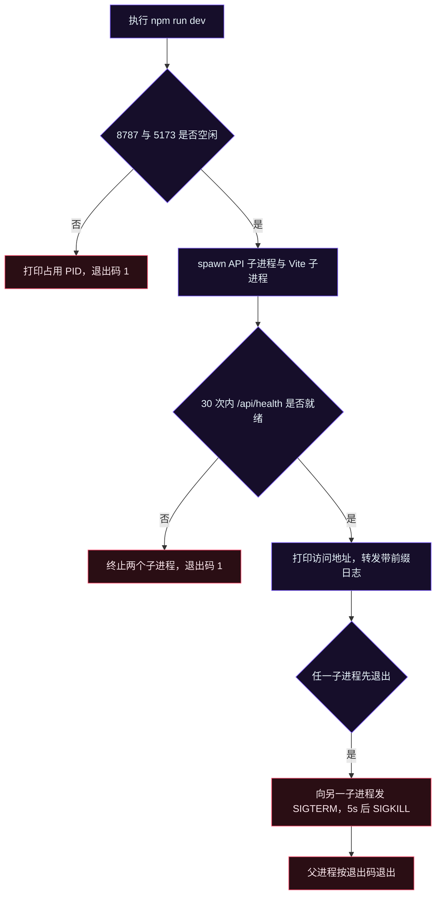
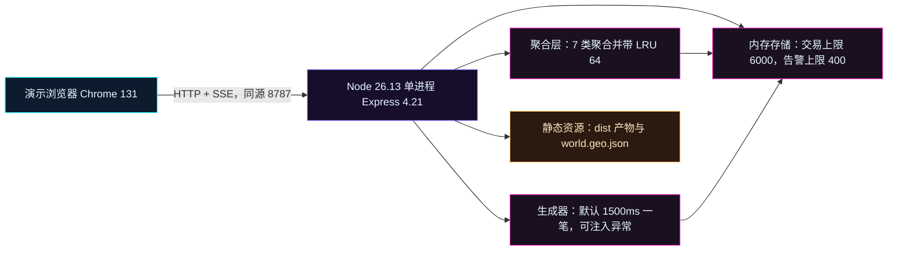
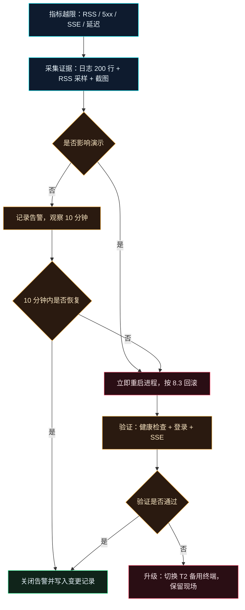
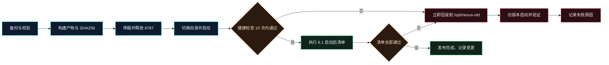

# 部署与运维手册

| 项目 | 内容 |
| --- | --- |
| 项目代号 | NEXUS（赛博交易中枢） |
| 文档版本 | v1.0（冻结） |
| 日期 | 2026-11-12 |
| 输入依据 | `docs/02-概要设计说明书.md` v1.0、`docs/05-接口设计文档.md` v1.0、`docs/07-测试计划与用例.md` v1.0 |
| 部署形态 | 单机单进程，Node 同源托管 SPA 与 API；公网场景叠加 Nginx 反向代理 |
| 运行基线 | Node 26.13.0、npm 11.6.0、Chrome 131.0.6778.205、端口 8787（生产）/5173（开发） |
| 文档结论 | 本手册是 M5 交付、现场部署与日常运维的唯一操作依据 |

## 1. 环境要求

### 1.1 硬件与操作系统

| 项 | 交付基线 | 说明 |
| --- | --- | --- |
| CPU | 4 vCPU | 单进程 Node + 浏览器同机演示；低于 2 vCPU 时弧线帧率不达标 |
| 内存 | 8GB | Node 进程 RSS 预算 300MB，浏览器大屏约占 1.2GB |
| 磁盘 | 20GB SSD | 产物 + 依赖约 420MB，备份保留 5 版约 1.5GB |
| 显示 | 1920×1080 及以上 | 4K 拼接屏使用 8 vCPU / 16GB 配置 |
| 操作系统 | Ubuntu 22.04 LTS（生产）、macOS 14.6（展厅本机） | 两套系统使用同一份产物 |

### 1.2 软件与版本

| 软件 | 版本 | 用途 | 缺失后果 |
| --- | --- | --- | --- |
| Node.js | 26.13.0（最低 20.11） | 运行服务端与构建 | 启动失败，`node:fs` API 不可用 |
| npm | 11.6.0 | 开发机构建与依赖校验 | 无法构建，生产机不需要 |
| Chrome | 131.0.6778.205 | 大屏与地图渲染、E2E 验证 | 地图 WebGL 不可用 |
| curl | 8.7.1 | 健康检查与接口验证 | 无法执行第 3.4 节检查 |
| lsof | 4.9.0 | 端口占用排查 | 无法定位 `EADDRINUSE` |
| systemd | 249 | 生产进程守护 | 进程退出后不自恢复 |
| Nginx | 1.24.0 | T2 反向代理与 TLS 终止 | 仅影响 T2 拓扑 |
| 数据库 | 无 | 业务数据全部内存态 | 不引入 MySQL/Redis/PostgreSQL |
| 其他运行时 | 无 | 不依赖 Java、Python、Go | 交付机无需额外语言环境 |

### 1.3 网络与端口

| 端口 | 监听地址 | 用途 | 开放范围 |
| --- | --- | --- | --- |
| 8787 | 127.0.0.1 | API、SSE、生产静态托管 | 仅本机；T2 由 Nginx 转发 |
| 5173 | 127.0.0.1 | Vite 开发服务器与 HMR | 仅开发机，生产不启动 |
| 443 | 0.0.0.0 | T2 对外 HTTPS | 仅内网网段，见 3.3 节 allowlist |

出站规则：服务端出站连接数必须为 0。运行时不访问 CDN、地图瓦片、字体服务、npm registry。防火墙只需放行 443（T2），8787 与 5173 不对外网开放。

### 1.4 离线安装与依赖说明

1. **交付包形态**：`nexus-1.0.0-offline.tar.gz` 内含 `dist/`、`server/`、`public/`、`package.json`、`package-lock.json`、`node_modules/`、`scripts/`、`SHA256SUMS`。
2. **生产机不执行 `npm install`、`npm ci`**：依赖已随包提供。选定该方案的理由是演示现场常有断网，任何在线安装都会把可用性绑定到 registry；代价是包体约 420MB。
3. **开发机安装**：`npm ci` 严格按 `package-lock.json` 还原，依赖来自内网 registry 缓存；缓存缺失时使用同版本交付包中的 `node_modules`，禁止 `npm install` 改写 lock。
4. **依赖版本锁定**：运行时 `express@4.21.2`、`react@18.3.1`、`react-dom@18.3.1`、`react-router-dom@6.26.2`、`zustand@4.5.5`、`echarts@5.5.1`、`lucide-react@0.451.0`；开发 `vite@5.4.10`、`typescript@5.6.3`、`vitest@2.1.9`、`jsdom@25.0.1`、`supertest@7.0.0`、`eslint@9.13.0`、`prettier@3.3.3`、`@vitejs/plugin-react@4.3.2`、`@testing-library/react@16.1.0`。
5. **本地资源**：`public/geo/world.geo.json` 固定 1,010,239 字节，随包分发；字体使用系统字体栈，不下载 webfont；图标由 `lucide-react` 打包进产物。
6. **完整性校验**：解压后执行 `sha256sum -c SHA256SUMS`，任一文件校验失败即停止部署并重新拷贝交付包。

## 2. 安装与启动

### 2.1 安装步骤

```bash
# 1) 解压到固定目录
sudo mkdir -p /opt/nexus
sudo tar -xzf nexus-1.0.0-offline.tar.gz -C /opt/nexus --strip-components=1

# 2) 校验产物完整性
cd /opt/nexus
sha256sum -c SHA256SUMS

# 3) 校验运行时版本
node -v                                  # 期望 v26.13.0
node -e "console.log(require('./node_modules/express/package.json').version)"   # 期望 4.21.2

# 4) 校验静态产物存在
test -f dist/index.html && echo "dist OK"
test -f public/geo/world.geo.json && echo "geo OK"
```

安装完成的判定：上述 4 步退出码全部为 0，且 `dist/index.html` 与 `public/geo/world.geo.json` 均存在。

### 2.2 开发模式与 `scripts/dev.mjs`

```bash
npm ci
npm run dev
```

`scripts/dev.mjs` 的行为固定如下，不允许改动顺序：

| 步骤 | 行为 | 失败处置 |
| --- | --- | --- |
| 1 | 端口预检：8787 与 5173 必须空闲 | 打印占用进程 PID，退出码 1 |
| 2 | spawn 两个子进程：`server/index.js` 与 `node_modules/.bin/vite` | spawn 失败打印错误，退出码 1 |
| 3 | 轮询 `http://127.0.0.1:8787/api/health`，间隔 500ms，最多 30 次 | 30 次未就绪，终止两个子进程，退出码 1 |
| 4 | 就绪后打印 `API http://127.0.0.1:8787` 与 `WEB http://127.0.0.1:5173` | — |
| 5 | 子进程日志加前缀 `[api]`、`[web]` 转发到父进程 stdout | — |
| 6 | 任一子进程退出，向另一个发送 SIGTERM，5s 后 SIGKILL，父进程以退出码退出 | — |
| 7 | 收到 SIGINT/SIGTERM，向两个子进程发送 SIGTERM，5s 后 SIGKILL，清理后退出 | — |



开发地址：SPA 走 5173，`/api` 由 Vite 代理到 8787；SSE 连接同样经代理转发。禁止在开发态把前端直连 8787，避免跨域配置与 Cookie 行为差异。

### 2.3 构建

```bash
npm run build
```

构建脚本固定为 `tsc --noEmit && vite build`，两段必须都成功：

1. `tsc --noEmit` 0 error；任一类型错误终止构建，退出码 1。
2. Vite 产出 `dist/`，`base` 固定 `/`，`build.sourcemap` 固定 `false`。
3. 构建后自检：`dist/index.html` 存在，`dist/assets/*.js` 与 `*.css` 的 gzip 总和 ≤1.2MB。
4. 构建产物不包含 `server/`、`node_modules/`、测试文件、`docs/`。

### 2.4 生产启动

```bash
cd /opt/nexus
PORT=8787 DATA_PROVIDER=mock DEMO_SEED=20261112 node server/index.js
```

生产环境使用 systemd 守护，unit 文件写入 `/etc/systemd/system/nexus.service`：

```ini
[Unit]
Description=NEXUS demo server
After=network-online.target
Wants=network-online.target

[Service]
Type=simple
WorkingDirectory=/opt/nexus
Environment=PORT=8787
Environment=DATA_PROVIDER=mock
Environment=DEMO_SEED=20261112
Environment=NODE_ENV=production
ExecStart=/usr/bin/node server/index.js
Restart=on-failure
RestartSec=5
KillSignal=SIGTERM
TimeoutStopSec=15
LimitNOFILE=4096

[Install]
WantedBy=multi-user.target
```

`NODE_ENV` 只影响 Express 默认行为，不参与业务分支；业务配置只读取 `PORT`、`DATA_PROVIDER`、`DEMO_SEED` 三个变量。

```bash
sudo systemctl daemon-reload
sudo systemctl enable nexus
sudo systemctl start nexus
sudo systemctl status nexus --no-pager
```

停止与重启：

```bash
sudo systemctl stop nexus      # 发送 SIGTERM，最多等待 15s
sudo systemctl restart nexus
journalctl -u nexus -n 200 --no-pager
```

优雅退出流程：收到 SIGTERM 后停止接受新连接，向全部 SSE 连接发送结束事件并关闭，等待活动请求完成，10s 内退出；超过 15s 由 systemd 发送 SIGKILL。SSE 客户端会按 1s、2s、4s 重连，服务恢复后重新 `hello`。

### 2.5 静态托管与 API 同源

同一 Node 进程同时托管 `dist/` 与 `/api/*`，浏览器只访问一个源（生产 `http://127.0.0.1:8787`），不配置 CORS。

| 请求 | 响应 | 缓存策略 |
| --- | --- | --- |
| `GET /api/*` 已登记路由 | JSON，`Cache-Control: no-store` | 不缓存 |
| `GET /api/*` 未登记路径 | 404 JSON，`code=NOT_FOUND` | 不缓存 |
| `GET /`、`/map`、`/trades`、`/admin`、`/login` | 返回 `dist/index.html`，由前端路由接管 | `no-store` |
| `GET /assets/<hash>.<ext>` | 静态文件 | `public, max-age=31536000, immutable` |
| `GET /geo/world.geo.json` | 静态文件，1,010,239 字节 | `public, max-age=86400` |
| 非 GET 的页面路径 | 405 JSON，`code=METHOD_NOT_ALLOWED` | 不缓存 |

T1 不在 Node 层做 gzip：回环带宽足够，压缩会增加 CPU 与依赖；T2 由 Nginx 开启 gzip。SPA 回退只对 `Accept: text/html` 的 GET 生效，`/api` 与静态资源路径永不回退到 `index.html`。

### 2.6 环境变量

| 变量 | 缺省值 | 合法取值 | 生效方式 | 非法处置 |
| --- | --- | --- | --- | --- |
| `PORT` | `8787` | 1~65535 的整数 | 启动时读取一次，修改需重启 | 非整数/越界：打印错误，退出码 1 |
| `DATA_PROVIDER` | `mock` | `mock`、`real` | 启动时读取一次，修改需重启 | `real` 当前为占位实现，启动即退出码 1 并提示「RealProvider 未实现」 |
| `DEMO_SEED` | `20261112` | 1~2147483646 的整数 | 启动时读取一次；运行期以 `POST /api/admin/reset` 临时更换 | 非法：退出码 1，不进入监听 |
| `NODE_ENV` | `production`（systemd 设置） | `production`、`development` | 进程环境 | 缺失按 `production` 处理 |

配置来源只有进程环境，不读取 `.env` 文件，不落盘；systemd unit 是唯一配置载体。修改环境变量后必须 `systemctl restart nexus`，热更新不支持。

## 3. 部署拓扑

### 3.1 拓扑结论

| 方案 | 适用场景 | 组成 | 选定理由 |
| --- | --- | --- | --- |
| T1 单机单进程 | 展厅本机、内网评审、离线演示 | Chrome + Node 8787 + 内存数据 | 零外部依赖、一条命令启动、故障面最小 |
| T2 反向代理 | 多人内网访问、需要 HTTPS、需要固定 443 | Nginx 443 + Node 127.0.0.1:8787 | TLS 与访问控制由 Nginx 承担，Node 保持只监听回环 |

判定规则：演示只在一台机器上进行时选 T1；需要 2 台以上终端同时访问、需要 HTTPS、需要按网段限制访问时选 T2。两种拓扑使用同一份 `dist/` 与同一份 `server/`，切换不改代码。

### 3.2 单机单进程拓扑（T1）



T1 部署清单：Node 进程 1 个、端口 1 个（8787）、静态目录 1 个、GeoJSON 1 份、systemd unit 1 份。无数据库、无消息队列、无缓存服务。

### 3.3 反向代理拓扑（T2）


Nginx 关键配置（`/etc/nginx/conf.d/nexus.conf`）：

```nginx
server {
  listen 443 ssl http2;
  server_name nexus.demo.local;

  ssl_certificate     /etc/nexus/tls/server.crt;
  ssl_certificate_key /etc/nexus/tls/server.key;
  ssl_protocols       TLSv1.2 TLSv1.3;

  allow 10.0.0.0/8;
  deny  all;

  gzip on;
  gzip_types text/css application/javascript application/json image/svg+xml;

  location /api/stream {
    proxy_pass http://127.0.0.1:8787;
    proxy_http_version 1.1;
    proxy_set_header Connection "";
    proxy_buffering off;
    proxy_cache off;
    proxy_read_timeout 3600s;
  }

  location / {
    proxy_pass http://127.0.0.1:8787;
    proxy_http_version 1.1;
    proxy_set_header Host $host;
    proxy_set_header X-Forwarded-For $remote_addr;
  }
}
```

SSE 路径必须单独配置 `proxy_buffering off`，否则 `trade` 事件会被 Nginx 缓冲到 4KB 才下发，表现为「地图与流水不动」。`proxy_read_timeout 3600s` 覆盖 15s 心跳间隔。

### 3.4 端口与健康检查

```bash
curl -fsS --max-time 2 http://127.0.0.1:8787/api/health
```

期望 HTTP 200，响应体 `data.ok=true`、`data.uptimeMs` 为正整数、`data.version=1.0.0`。健康检查不鉴权，供 systemd、Nginx、监控脚本调用。

| 检查项 | 命令 | 通过标准 | 频率 |
| --- | --- | --- | --- |
| 存活探针 | `curl -fsS --max-time 2 /api/health` | 200 且 `ok=true` | 30s 一次，连续 3 次失败触发重启 |
| 静态首页 | `curl -fsS -o /dev/null -w "%{http_code}" /` | 200 | 启动后 1 次 |
| 地学数据 | `curl -fsS -o /dev/null -w "%{http_code}" /geo/world.geo.json` | 200，长度 1,010,239 | 启动后 1 次 |
| SSE 冒烟 | `curl -N --max-time 20 "/api/stream?token=$TOKEN"` | 20s 内收到 `hello` 与至少 1 个 `trade` | 每次发布后 1 次 |
| 端口占用 | `lsof -nP -iTCP:8787 -sTCP:LISTEN` | 只有 1 个 node 进程 | 故障时 |

### 3.5 启动与停止顺序

启动：`systemctl start nexus` → 轮询健康检查最多 10 次（间隔 1s）→ 打开 Chrome 访问 8787 → 登录 → 确认顶栏数据流状态为绿 → 确认地图弧线在动。

停止：通知现场停止操作 → `systemctl stop nexus` → 等待 15s → 确认 `lsof` 无 8787 监听 → 确认浏览器 SSE 断开并显示重连状态。重启按「停止 → 启动」顺序执行，不中断 Nginx（T2）。

## 4. 运维操作

### 4.1 操作总表

所有写操作都要求携带 admin token，且只能在演示开始前 30 分钟、演示结束后 30 分钟两个窗口执行；演示进行中只允许「启停数据流」一项操作。

| 操作 | 接口 | 影响范围 | 回滚方式 | 恢复耗时 |
| --- | --- | --- | --- | --- |
| 重置种子 | `POST /api/admin/reset` | 全部交易、告警重建；会话与用户保留 | 用记录的旧 seed 再次 reset | 5s |
| 清空数据 | `POST /api/admin/clear` | 交易与告警归零；用户与会话保留 | reset 回当前 seed | 5s |
| 启停数据流 | `PATCH /api/admin/stream` | 只影响后续新交易；历史与连接保留 | 反向设置 `paused` | 即时 |
| 注入异常 | `POST /api/admin/inject` | 新增 1 笔交易 + 1 条告警 + 1 条弧线 | reset 回当前 seed | 5s |
| 用户停用 | `PATCH /api/admin/users/:id` | 该用户全部会话立即失效；在线连接数变化 | 重新启用并让用户登录 | 1 分钟 |
| 进程重启 | `systemctl restart nexus` | 全部会话失效；内存数据按 seed 重建 | 无需回滚，重新登录 | 20s |

### 4.2 重置种子

```bash
TOKEN=$(curl -s -X POST http://127.0.0.1:8787/api/auth/login \
  -H 'Content-Type: application/json' \
  -d '{"username":"admin","password":"admin123"}' \
  | node -e 'let s="";process.stdin.on("data",d=>s+=d).on("end",()=>console.log(JSON.parse(s).data.token))')

OLD_SEED=$(curl -s -H "Authorization: Bearer $TOKEN" http://127.0.0.1:8787/api/meta \
  | node -e 'let s="";process.stdin.on("data",d=>s+=d).on("end",()=>console.log(JSON.parse(s).data.seed))')
echo "旧种子：$OLD_SEED"

curl -s -X POST http://127.0.0.1:8787/api/admin/reset \
  -H "Authorization: Bearer $TOKEN" \
  -H 'Content-Type: application/json' \
  -d '{"seed":20261112}'
```

影响范围：清空现有交易与告警，按新种子重建 24h 历史（1200 笔）与告警；用户与会话保留；数据流复位为 `paused=false`、`speed=1`、`intervalMs=1500`；已连接 SSE 的客户端在下一个 2s 的 `kpi` 周期看到新数据。重置前必须先记录 `OLD_SEED`，否则无法回到上一基线。

回滚：执行 `POST /api/admin/reset` 并传入 `{"seed":<OLD_SEED>}`。注意回滚只恢复「确定性历史」，不恢复重置前注入的异常交易与已处置告警状态，这两类数据无持久化、无单条恢复接口。

### 4.3 清空数据

```bash
curl -s -X PATCH http://127.0.0.1:8787/api/admin/stream \
  -H "Authorization: Bearer $TOKEN" -H 'Content-Type: application/json' \
  -d '{"paused":true}'

curl -s -X POST http://127.0.0.1:8787/api/admin/clear \
  -H "Authorization: Bearer $TOKEN"
```

影响范围：`trades` 与 `alerts` 全部清空且不重建；大屏 KPI 归零、流水与告警为空态、地图无弧线、明细列表为空；用户、会话、配置不受影响。必须先暂停数据流，否则 1.5s 后就会产生新交易，清空结果不可复现。

回滚：`POST /api/admin/reset`，传入当前 seed，恢复 1200 笔历史；清空前的注入数据无法恢复。

### 4.4 启停数据流

```bash
# 暂停
curl -s -X PATCH http://127.0.0.1:8787/api/admin/stream \
  -H "Authorization: Bearer $TOKEN" -H 'Content-Type: application/json' \
  -d '{"paused":true}'

# 恢复并设为 2 倍速
curl -s -X PATCH http://127.0.0.1:8787/api/admin/stream \
  -H "Authorization: Bearer $TOKEN" -H 'Content-Type: application/json' \
  -d '{"paused":false,"speed":2}'
```

影响范围：只停止/恢复新交易生成；已有数据、SSE 连接、心跳、定时推送保持不变；`speed` 取 0.5、1、2、4 四档，对应 `intervalMs` 为 3000、1500、750、375。暂停状态下修改 speed 会被接受，恢复后按新速率生成。

回滚：再次设置 `paused=false`、`speed=1`，`intervalMs` 回到 1500；此操作幂等，重复调用结果一致。

### 4.5 注入异常

```bash
curl -s -X POST http://127.0.0.1:8787/api/admin/inject \
  -H "Authorization: Bearer $TOKEN" -H 'Content-Type: application/json' \
  -d '{"type":"large_trade"}'
```

三类注入的固定口径：

| 类型 | 交易金额 | 延迟 | 风险分 | 状态 | 告警级别 |
| --- | --- | --- | --- | --- | --- |
| `large_trade` | 8,000,000~20,000,000 USD | 正常区间 | 正常区间 | `filled` | `warn` |
| `latency_spike` | 正常区间 | 900~1600ms | 正常区间 | `pending` | `warn` |
| `risk_hit` | 正常区间 | 正常区间 | 85~99 | `flagged` | `critical` |

影响范围：新增 1 笔交易、1 条告警，地图生成/更新 1 条弧线；KPI 与健康度在下一个 2s 周期刷新；大屏告警流新增 1 条并闪烁。注入会占用交易上限（6000），连续注入 100 笔不会导致溢出，最旧历史会被裁剪。

回滚：无单条删除接口，回滚方式为 `POST /api/admin/reset` 回到当前 seed；需要保留注入现场时先截图留证。

### 4.6 用户停用

```bash
# 停用
curl -s -X PATCH http://127.0.0.1:8787/api/admin/users/u_viewer \
  -H "Authorization: Bearer $TOKEN" -H 'Content-Type: application/json' \
  -d '{"enabled":false}'

# 恢复
curl -s -X PATCH http://127.0.0.1:8787/api/admin/users/u_viewer \
  -H "Authorization: Bearer $TOKEN" -H 'Content-Type: application/json' \
  -d '{"enabled":true}'
```

影响范围：被停用用户的全部会话立即失效，后续请求返回 403 `USER_DISABLED`；该用户无法重新登录；`/api/meta.clients` 在 2s 内减 1；其他用户与数据不受影响。

保护规则：不能停用与降级最后一个启用的管理员（400，`details.reason=LAST_ADMIN`）；管理员不能修改自己的角色（400，`details.reason=SELF_ROLE`，该校验先于 LAST_ADMIN）。

回滚：重新置 `enabled=true`，用户重新登录即可；停用期间无需补数据。

### 4.7 进程重启与会话失效

```bash
sudo systemctl restart nexus
```

影响范围：服务端内存中的全部 token 立即失效，所有已登录用户下次请求收到 401，前端清除 `nexus.auth` 并跳转登录页；交易、告警按 `DEMO_SEED` 重建，最近 24h 历史与重启前不同（重启时刻变化）；浏览器端 `nexus.prefs` 保留。

回滚：无需回滚；重启后重新登录即可。若重启由 OOM 触发，先按 5.3 节采集 RSS 证据再重启。

### 4.8 操作权限与变更窗口

1. 仅持有 `admin` 账号的人员可执行 4.2~4.7 的写操作；`viewer` 只能查看。
2. 变更窗口：演示前 30 分钟至演示开始，以及演示结束后 30 分钟；演示进行中只允许启停数据流。
3. 每次操作记录到 6.4 节变更记录，字段为时间、操作人、操作、旧值、新值、影响、验证结果。
4. 生产环境操作使用 `curl` 直连 127.0.0.1，不通过公网入口，避免 Nginx 日志记录 admin token。

## 5. 监控与日志

### 5.1 请求日志字段

服务端以 JSON Lines 输出到 stdout，由 journald 收集。每条请求日志固定字段：

| 字段 | 示例 | 说明 |
| --- | --- | --- |
| `ts` | `2026-11-12T16:40:00.000+08:00` | 服务端本地时间，ISO 8601 |
| `requestId` | `req_8f2a1c` | 每请求唯一，错误响应同值 |
| `method` | `GET` | HTTP 方法 |
| `path` | `/api/trades` | 不含 query，避免记录 token |
| `status` | `200` | HTTP 状态码 |
| `durMs` | `12` | 处理耗时，SSE 连接在关闭时记录总时长 |
| `userId` | `u_admin` | 未登录为 `anonymous` |
| `role` | `admin` | 未登录为 `none` |
| `bytes` | `18234` | 响应体字节数，SSE 为 0 |
| `sse` | `false` | 是否为 SSE 连接 |

禁止记录：`password`、`Authorization` 头、`token` query、完整请求体、用户 IP 之外的隐私字段。

### 5.2 SSE 连接数

| 观测项 | 取值方式 | 正常范围 | 告警阈值 |
| --- | --- | --- | --- |
| 当前连接数 | `GET /api/meta` 的 `data.clients` | 1~3（单展厅） | >20 记录告警，>64 人工介入 |
| 连接增长速率 | 每 60s 采样一次并记录 `sse_clients=N` | 每分钟增长 ≤1 | 每分钟增长 ≥5 判定泄漏 |
| 心跳有效性 | 日志中 `heartbeat` 计数 | 每连接每 15s 一次 | 某连接 30s 无心跳判定异常 |
| 断连重连 | 日志 `sse_reconnect` 计数 | ≤3 次/小时 | ≥10 次/小时排查代理与网络 |

容量上限按 64 个并发 SSE 连接设计（单进程、内存数据、无外部依赖）；超过 64 不主动拒绝，只触发告警并由运维降低接入终端数量。

### 5.3 内存与阈值

| 指标 | 采集命令 | 警告阈值 | 严重阈值 | 处置 |
| --- | --- | --- | --- | --- |
| 进程 RSS | `ps -o rss= -p <pid>`（KB） | >300MB 持续 5 分钟 | >450MB 持续 5 分钟 | 警告：记录并观察 10 分钟；严重：重启并保留现场 |
| Node 堆 | `node --inspect` + `process.memoryUsage().heapUsed` | >200MB | >300MB | 同上 |
| 事件循环延迟 | `perf_hooks.monitorEventLoopDelay` p99 | >50ms | >200ms | 检查注入频率与聚合缓存 |
| 5xx 比例 | 日志按 `status>=500` 统计 | 5 分钟内 >1% | 5 分钟内 >5% | 立即回滚上一构建 |
| 请求耗时 | 日志 `durMs` p95 | >200ms | >500ms | 定位慢接口 |
| 磁盘可用 | `df -h /opt` | <10% | <5% | 清理旧备份，保留最近 5 版 |
| SSE 连接数 | `/api/meta.clients` | >20 | >64 | 减少终端接入 |

基线数据：4× 倍速、3 页面打开、10 分钟连续运行，RSS 应稳定在 180~260MB，前端堆增长 ≤20MB。超过 300MB 说明存在订阅泄漏、缓存未淘汰、ECharts 实例未销毁三类问题之一。

### 5.4 告警处置流程



### 5.5 日志落盘与轮转

1. 只写 stdout，不写业务日志文件；journald 负责落盘与轮转。
2. 保留策略：`SystemMaxUse=200M`、`MaxRetentionSec=7day`，写入 `/etc/systemd/journald.conf` 后 `systemctl restart systemd-journald`。
3. 常用命令：`journalctl -u nexus -n 200 --no-pager`、`journalctl -u nexus --since "10 min ago"`、`journalctl -u nexus | grep req_8f2a1c`。
4. 事故现场：重启前执行 `journalctl -u nexus -n 500 --no-pager > /tmp/nexus-incident-$(date +%s).log`，与 RSS 采样一并归档。

### 5.6 常见故障排查

| 故障 | 现象 | 定位命令/位置 | 根因 | 处置 | 验证 |
| --- | --- | --- | --- | --- | --- |
| SSE 不推送 | 顶部状态灯红；流水与地图静止；心跳仍在 | `curl -N "/api/stream?token=$TOKEN"`；`journalctl -u nexus \| grep sse` | token 失效、Nginx 缓冲、数据流被暂停 | 重新登录；Nginx 加 `proxy_buffering off`；`PATCH stream {"paused":false}` | 15s 内收到 heartbeat，30s 内收到 trade |
| 401 循环 | 登录成功后立即跳回登录页，Network 连续 401 | DevTools Network 过滤 `401`；查看 `nexus.auth.expiresAt` | 服务端重启导致 token 失效；系统时钟偏差 >5s；账号被停用 | 清 `nexus.auth` 重新登录；校时 `timedatectl`；检查用户 `enabled` | 连续 60s 无 401，页面停留正常 |
| 地图空白 | 地图页只有网格，无节点与弧线 | `curl -I /geo/world.geo.json`；Chrome Console 搜 `echarts` | GeoJSON 未返回、注册失败、容器高度为 0、WebGL 被禁用 | 恢复静态文件；检查容器 1920×1080；启用硬件加速；重新 `npm run build` | 节点 ≥20，弧线 ≥1，Console 无报错 |
| 端口占用 | 启动报 `EADDRINUSE`，退出码 1 | `lsof -nP -iTCP:8787 -sTCP:LISTEN` | 上一个进程未退出；另一个服务占用 8787 | `kill <pid>` 后重启；临时改 `PORT=8788` 验证 | `/api/health` 200，端口只有 1 个监听 |
| 构建白屏 | 打开 8787、5173 只有背景，无内容 | DevTools Console 与 Network；`dist/index.html` 引用 | `base` 配置错误、静态路径 404、旧缓存、`dist` 未重新构建 | 用 `npm run build && npm start` 同源访问；清缓存；检查 assets 200 | 登录页完整渲染，无 404 |
| 内存持续增长 | RSS 每分钟上升 >5MB，10 分钟 >300MB | 按 5.3 节采样；`/api/meta.clients` | SSE 订阅未清理、ECharts 未 `dispose`、弧线数组无上限 | 重启止血；修复订阅与 dispose；回归 TC-64 | 10 分钟增长 ≤30MB，clients 稳定 |
| 登录 403 USER_DISABLED | 正确密码仍提示停用 | `GET /api/admin/users` 查看 `enabled` | 账号被管理员停用 | 重新启用；用户重新登录 | 登录 200，角色正确 |
| 演示机字体异常 | 数字不对齐、中文回退 | `fc-list`；对比截图 | 系统缺少等宽字体 | 安装 `JetBrains Mono` 到本地字体目录；刷新页面 | 数字列宽一致，无回退告警 |

## 6. 备份与恢复

### 6.1 数据资产盘点

本系统没有持久化业务数据，备份对象是「可重建的代码与配置」：

| 资产 | 路径 | 变更频率 | 备份必要性 |
| --- | --- | --- | --- |
| 服务端代码 | `/opt/nexus/server/` | 每次发布 | 必须 |
| 构建产物 | `/opt/nexus/dist/` | 每次发布 | 必须 |
| 静态地学数据 | `/opt/nexus/public/geo/world.geo.json` | 极少 | 必须 |
| 依赖目录 | `/opt/nexus/node_modules/` | 每次发布 | 随包备份 |
| 种子文件 | `server/core/seed.js` | 变更受控 | 必须 |
| 配置文件 | `server/config.js`、systemd unit、Nginx conf | 变更受控 | 必须 |
| 锁文件 | `package-lock.json` | 每次依赖变更 | 必须 |
| 业务数据 | 内存 | 不落盘 | 无 |
| 会话 | 服务端内存 + 浏览器 localStorage | 不落盘 | 无 |
| 用户偏好 | 浏览器 `nexus.prefs` | 不落盘 | 无 |

### 6.2 备份策略

1. 每次发布前 10 分钟执行备份，命名 `nexus-backup-<version>-<YYYYMMDDHHmm>.tar.gz`。
2. 备份命令：`tar -czf /var/backups/nexus/nexus-backup-1.0.0-$(date +%Y%m%d%H%M).tar.gz -C /opt/nexus server dist public package.json package-lock.json`。
3. 生成校验文件：`sha256sum /var/backups/nexus/*.tar.gz > /var/backups/nexus/SHA256SUMS`。
4. 保留最近 5 版，超出按时间删除；每次发布结束后把最新一版复制到内网 NAS 1 份、加密 U 盘 1 份。
5. 备份文件权限 600，属主 root，禁止放在 Web 可访问目录。

### 6.3 恢复步骤

```bash
# 1) 停止服务
sudo systemctl stop nexus

# 2) 解压备份到临时目录并校验
mkdir -p /opt/nexus-restore
tar -xzf /var/backups/nexus/nexus-backup-1.0.0-202611121630.tar.gz -C /opt/nexus-restore

# 3) 替换代码与产物（保留旧目录用于二次回滚）
mv /opt/nexus /opt/nexus-old
mv /opt/nexus-restore /opt/nexus
cd /opt/nexus && sha256sum -c SHA256SUMS

# 4) 启动并验证
sudo systemctl start nexus
curl -fsS http://127.0.0.1:8787/api/health
```

恢复后的数据验证：登录 admin → `GET /api/meta` 的 `seed` 与变更记录一致 → `GET /api/trades?pageSize=1` 的 `total=1200` → 大屏、地图、明细三页有数据 → SSE 30s 内有 `trade`。

指标：RTO 10 分钟（含停服、解压、启动、验证）；RPO 0（无持久化业务数据）；浏览器 `nexus.prefs` 与 `nexus.auth` 在恢复后丢失属正常现象，重新登录并重设主题即可。

### 6.4 配置与种子变更记录

当前基线：

| 项 | 当前值 | 生效位置 |
| --- | --- | --- |
| `PORT` | 8787 | systemd unit |
| `DATA_PROVIDER` | mock | systemd unit |
| `DEMO_SEED` | 20261112 | systemd unit，运行期以 reset 覆盖 |
| 交易上限 | 6000 | `server/config.js` |
| 告警上限 | 400 | `server/config.js` |
| 数据流速率 | 1500ms/笔 | `server/config.js` |
| SSE 心跳 | 15000ms | `server/config.js` |
| 主题缺省 | cyan | `nexus.prefs` |

变更记录模板（每次变更追加一行，禁止覆盖历史行）：

| 日期 | 变更人 | 项目 | 旧值 | 新值 | 影响 | 回滚方式 | 验证 |
| --- | --- | --- | --- | --- | --- | --- | --- |
| 2026-11-12 | 交付负责人 | 初版基线 | 无 | seed 20261112、PORT 8787、mock | 初始化 | 不适用 | 手册第 8 节清单 |
|  |  |  |  |  |  |  |  |

种子变更属于契约变更：变更后所有演示截图、测试夹具 F1~F4、验收基线需同步复核；旧种子至少保留 1 个发布周期，便于现场回滚。

## 7. 安全与合规

### 7.1 演示鉴权边界声明

| 项 | 事实 | 结论 |
| --- | --- | --- |
| 会话 token | 服务端内存随机串，重启即失效，无签名校验 | 不是真实身份认证，不可用于生产访问控制 |
| 密码存储 | `server/core/seed.js` 明文常量 | 不具备密码学保护，禁止复用任何真实密码 |
| 前端持久化 | `localStorage` 可被用户任意修改 | 前端角色判断只用于界面显隐，服务端仍必须校验 |
| 越权防护 | 前端守卫 + 服务端 `requireRole('admin')` 双重校验 | 服务端是唯一有效边界，前端校验不构成安全控制 |
| 传输 | T1 仅回环 HTTP；T2 由 Nginx 终止 TLS | 公网访问必须走 T2，禁止直接暴露 8787 |

本系统的鉴权能力服务于「演示权限差异」，安全强度等价于无鉴权。任何对外访问都必须叠加网络层隔离：T1 限定本机，T2 使用 IP allowlist 与 TLS。

### 7.2 凭据管理

1. 凭据只存在于内置种子 `server/core/seed.js`，共 3 个账号：`admin/admin123`、`viewer/viewer123`、`demo/demo123`（默认停用）。
2. 不通过环境变量、配置文件、命令行参数注入凭据；不在日志、截图、工单中记录完整密码。
3. 修改密码唯一路径：编辑 `seed.js` → `npm run test` 回归登录用例 → `npm run build` → 重新部署 → 记录 6.4 变更。运行期不支持改密接口。
4. 禁止把真实系统密码、企业邮箱密码、SSO 凭据填入种子；演示账号密码在展厅公开可见，属于公开信息。
5. 交付前检查：`grep -rn "password" server/core/seed.js` 只应命中 3 个演示账号；仓库中不得出现 `.env`、私钥、证书私钥。

### 7.3 禁止事项

1. 禁止接入真实行情、真实下单、真实撮合、真实清算、真实资金账户。
2. 禁止录入真实客户姓名、手机号、身份证号、银行卡号、交易记录。
3. 禁止把系统部署在公网裸奔；公网展示必须使用 T2 + TLS + IP allowlist，并在外层再加一层 VPN。
4. 禁止把界面输出用于投资决策、风控决策、对账、审计取证。
5. 禁止移除与隐藏 `DEMO`、`模拟数据`、登录页免责声明。
6. 禁止为演示便利关闭服务端角色校验，禁止把 admin token 写入前端代码、静态文件。

### 7.4 传输与响应头

| 头 | 值 | 作用 |
| --- | --- | --- |
| `Cache-Control` | API 与 `index.html` 为 `no-store`；哈希资源为 `public, max-age=31536000, immutable` | 防止聚合数据与登录态被缓存 |
| `X-Content-Type-Options` | `nosniff` | 禁止 MIME 嗅探 |
| `Referrer-Policy` | `no-referrer` | 不泄露内部路径 |
| `X-Frame-Options` | `DENY` | 禁止被嵌入第三方页面 |
| `Content-Security-Policy` | `default-src 'self'; img-src 'self' data:; style-src 'self' 'unsafe-inline'; script-src 'self'; connect-src 'self'; frame-ancestors 'none'` | 限制外部加载；`unsafe-inline` 仅放行样式以兼容图表内联样式 |
| `X-Accel-Buffering` | SSE 路径为 `no` | 禁止代理缓冲事件流 |

T2 的 TLS 版本限定 TLSv1.2 与 TLSv1.3，禁用 SSLv3、TLSv1.0、TLSv1.1；证书有效期不足 30 天时提前更换，更换后执行第 8.1 节 TLS 检查项。

### 7.5 日志与截图脱敏

1. 请求日志只记录 `path`，不记录 query，因此 `?token=` 不会落盘。
2. 错误日志只记录 `requestId`、错误码、堆栈摘要，不记录请求体与认证头。
3. 排障截图中的 `Authorization` 头、token、密码输入框必须打码；token 只保留前 8 位。
4. 事故归档文件权限 600，保留 180 天后删除；对外分享前执行一次脱敏复核。

### 7.6 合规声明

本系统是演示型数据可视化产品，全部交易、行情、节点、告警、用户数据均为程序生成的模拟数据，与任何真实市场、交易所、清算机构无关。系统不提供交易、支付、清算、投资咨询、资产管理能力，输出结果不构成任何形式的投资咨询、决策依据。演示场景中应在显著位置保留 `DEMO / 模拟数据` 标识；任何将本系统用于真实交易、资金处理、客户数据展示的行为均超出设计边界，由使用方自行承担全部责任。

## 8. 上线检查清单与回滚

### 8.1 上线检查清单

部署前：

- [ ] 交付包 `nexus-1.0.0-offline.tar.gz` 的 `sha256sum -c SHA256SUMS` 通过。
- [ ] `node -v` 为 v26.13.0（不低于 v20.11）。
- [ ] `node -e "require('./node_modules/express/package.json').version"` 输出 4.21.2。
- [ ] `dist/index.html` 与 `public/geo/world.geo.json`（1,010,239 字节）存在。
- [ ] 端口 8787 无其他监听进程，`lsof -nP -iTCP:8787 -sTCP:LISTEN` 为空。
- [ ] systemd unit 中 `PORT`、`DATA_PROVIDER`、`DEMO_SEED` 与变更记录一致。
- [ ] `DEMO_SEED` 已记录到 6.4 节变更记录，且旧种子可查。
- [ ] 磁盘可用空间 ≥10%，`/var/backups/nexus` 保留最近 5 版。
- [ ] 已执行发布前备份并生成 SHA256SUMS。
- [ ] `npm run test` 退出码 0，覆盖率达到 07 文档 G3~G7。
- [ ] `npm run build` 退出码 0，首屏 gzip ≤1.2MB。
- [ ] `npm run typecheck` 与 `npm run lint` 均为 0 error。

启动后：

- [ ] `curl -fsS http://127.0.0.1:8787/api/health` 返回 200 且 `data.ok=true`。
- [ ] 浏览器打开 8787，登录页完整渲染，无 404 静态资源。
- [ ] `admin/admin123` 登录成功，顶栏身份徽章为「系统管理员」。
- [ ] 大屏 10 个模块全部出现，KPI 数字非 `NaN`。
- [ ] 地图页节点 ≥20、弧线 ≥1，GeoJSON 加载成功。
- [ ] 明细页 `total=1200`，翻页与筛选可用。
- [ ] 顶栏数据流状态为绿色，30s 内观察到新交易。
- [ ] `viewer/viewer123` 登录后管理入口不可见，访问 `/admin` 进入 403。
- [ ] `GET /api/meta` 的 `demo=true`、`seed` 与配置一致、`clients` 合理。
- [ ] 断网刷新页面仍可用，Network 面板外部请求数为 0（T1 必须，T2 验证仅本域）。
- [ ] T2 场景额外检查：`openssl s_client -connect nexus.demo.local:443 -tls1_2` 握手成功；非白名单 IP 访问返回 403。
- [ ] 演示账号密码仅在种子文件中，截图与日志无完整 token。

### 8.2 发布步骤

1. 冻结变更：确认没有正在进行的注入、重置、种子调整操作。
2. 备份：按 6.2 节生成备份包与校验文件，复制一份到异地存储。
3. 构建：在开发机执行 `npm run verify`，产物复制到交付包并更新 `SHA256SUMS`。
4. 传输：将交付包传到目标机 `/opt/nexus` 同级目录，校验 SHA256。
5. 停服：`sudo systemctl stop nexus`，确认端口释放。
6. 切换：旧目录改名为 `/opt/nexus-old-<timestamp>`，新包解压为 `/opt/nexus`。
7. 启动：`sudo systemctl start nexus`，按 3.4 节健康检查最多轮询 10 次。
8. 验证：按 8.1 节启动后清单逐项打勾，记录证据路径；通过后通知演示负责人。



### 8.3 回滚步骤

回滚触发后 5 分钟内完成，不做部分回滚。

```bash
# 1) 停止新版本
sudo systemctl stop nexus

# 2) 新版本目录留证
mv /opt/nexus /opt/nexus-failed-$(date +%s)

# 3) 恢复上一版本
mv /opt/nexus-old-202611121630 /opt/nexus

# 4) 启动并验证
sudo systemctl start nexus
curl -fsS --max-time 2 http://127.0.0.1:8787/api/health
```

验证步骤：健康检查 200 → 打开 8787 登录页 → admin 登录 → 大屏有数据 → SSE 30s 内有新交易 → 记录回滚时间、版本、原因与验证人。

注意：回滚不恢复浏览器端 `nexus.auth` 与 `nexus.prefs`，用户需重新登录；服务端内存数据按旧版本代码与 `DEMO_SEED` 重建，回滚前后历史数据必然不同，属于预期行为。

### 8.4 回滚判定条件

| 条件 | 判定窗口 | 动作 |
| --- | --- | --- |
| 健康检查连续 3 次失败 | 90s | 立即回滚 |
| 登录失败率 >10% | 5 分钟 | 立即回滚 |
| SSE 连续 5 分钟无新交易，心跳正常 | 5 分钟 | 先排查 paused 与代理；10 分钟未恢复则回滚 |
| 5xx 比例 >1% | 5 分钟 | 立即回滚 |
| 进程 RSS >450MB 且持续上升 | 5 分钟 | 重启止血；30 分钟未恢复则回滚 |
| 任一页面白屏且无法通过刷新恢复 | 1 次 | 立即回滚 |

### 8.5 回滚演练

1. 频率：每个发布周期 1 次，演示前 1 天执行；间隔不超过 90 天。
2. 步骤：按 8.3 节完整执行一次「停服 → 切换 → 启动 → 验证」；演练使用备份包，不影响正式目录。
3. 通过标准：从停服到健康检查通过 ≤10 分钟；8.3 节 6 项验证全过；演练记录写入 6.4 变更记录。
4. 演练失败（超过 10 分钟）按 P1 缺陷处理，补齐备份完整性、unit 配置、目录权限三项检查后重演。
